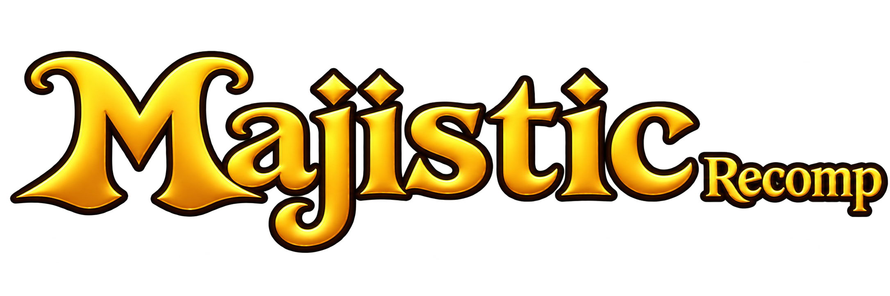

<div align="center">



# Majistic Recomp

**Native PC port and static recompilation of Majin and the Forsaken Kingdom (Xbox 360) for modern Windows x64 PC.**

[](LICENSE)
[]()
[]()
[]()

Early Prototype (WIP) · Native C++23 · Direct3D 12 · 60 FPS Target · Custom Launcher

</div>

---

> [!WARNING]
> **EARLY DEVELOPMENT & EXPERIMENTAL PROTOTYPE:**
> This project is currently in an **early stage of development (work-in-progress)**. While foundational game systems, rendering, and gameplay sequences are functional, **expect bugs, edge-case graphical artifacts, audio glitches, and potential crashes**. It is actively being researched and improved, and is not yet a polished or final release.

---

## ⚠️ Legal, Copyright & Fair Use Notice

> [!IMPORTANT]
> **STRICT ZERO-ASSET DISTRIBUTION POLICY:**
> This repository distributes **NO game assets, ISO disk images, executables, textures, audio, dialogue, video, or precompiled game binaries**.  
> Users and testers **MUST** provide their own legally acquired physical disc copy of the original Xbox 360 game (**Majin and the Forsaken Kingdom**). All executable unpacking, symbol mapping, code generation, and static recompilation steps are executed **strictly locally on the user's computer** using the automated scripts provided in this repository.

> [!NOTE]
> **NO AFFILIATION DISCLAIMER:**
> **Majistic Recomp** is an independent, non-commercial, experimental open-source preservation and static recompilation project. The authors and contributors have **ABSOLUTELY NO affiliation, relationship, association, sponsorship, or endorsement with Bandai Namco Entertainment Inc., Game Republic, Microsoft Corporation, or any of their parent companies, subsidiaries, or affiliates**.
> All trademarks, service marks, trade names, product names, logos, and registered trademarks appearing in this repository are the property of their respective owners.

---

## Overview

**Majistic Recomp** is an open-source static recompilation of the classic 2010 action-adventure game **Majin and the Forsaken Kingdom** (originally developed by Game Republic and published by Bandai Namco for the Xbox 360). It translates original PowerPC machine code into native, optimized C++23, running on modern Windows x64 hardware via the **ReXGlue SDK (0.10.0)** and a specialized **Direct3D 12** graphics runtime derived from Xenia.

By translating game logic into native CPU instructions and mapping Xbox 360 GPU calls through a Direct3D 12 runtime, the project currently implements:
- **60 FPS gameplay target** with experimental delta-time normalization hooks.
- **Multi-threaded startup PSO compilation**, significantly reducing runtime shader stuttering.
- **Native Host Render Target (RTV) rendering**, providing direct Direct3D 12 execution without requiring slow ROV interlocks.
- **Synchronized fast-forward** for in-game dialogues and cutscenes with dynamic audio frequency scaling.
- **Multi-language support** with selectable in-game text and localized voiceover (English, Spanish, French, German, Italian, Korean, and Japanese).
- **Configurable resolutions** (720p, 1080p, 1440p, 4K) paired with built-in **AMD FidelityFX FSR 1.0**, **CAS**, and **FXAA** upscalers.
- **Desktop Launcher** powered by Tauri v2 and Tailwind CSS, featuring configuration controls, automatic build pipelines, and portable game-data management.

---

## Supported Game Editions

| Region / Edition | Executable Version | Title ID | Media ID | Support Status |
| :--- | :---: | :---: | :---: | :---: |
| **American / NTSC-U** | `0.0.0.2` | `4E4D0816` | `76FDB642` | **Playable Prototype (WIP)** (`prototype-usa/`) |
| **European / PAL** | `0.0.0.3` | `4E4D0816` | `67BD87EF` | **Playable Prototype (WIP)** (`prototype/`) |

### Deterministic Shift Law (USA 0.0.0.2)
Analysis of the executable revealed that between the `.text` entry (`0x82150000`) and `0x821C0000`, 100% of function addresses match 1:1 between European and American releases. Above `0x821C0000`, every function is shifted by exactly **`-0x70` bytes (`-112` bytes / 28 PowerPC instructions)** due to an alignment padding variation in the PAL compiler toolchain.

All **34,247 PowerPC functions** have been mapped and recompiled with **zero unresolved branch targets**.

---

## Key Technical Highlights

### 1. Direct3D 12 Renderer & Frame Pacing (60 FPS Target)
- **Frametime Pacing:** Benchmarked on modern GPUs (e.g., RTX 3060 Ti) targeting steady 16.6ms frame intervals.
- **Default Host Render Target (RTV) Mode:** Restored CPU-side vertex height estimation in `draw_extent_estimator.cpp`, preventing 2D clears from claiming all 2048 EDRAM tiles and resolving the black 3D screen regression in non-ROV mode.
- **UI Presenter Loop Fix:** Resolved an architectural regression where toast dialogs kept the presenter trapped in uncapped UI repaints, restoring true cadence presentation (`PaintMode::kGuestOutputThreadImmediately`).
- **GPU Bandwidth Tuning:** Emulates gamma render targets with 32bpp (`R8G8B8A8_UNORM`) saving 50% VRAM bandwidth over 64bpp, restored native anisotropic filtering, and disabled synchronous GPU-to-CPU memexport readbacks.

### 2. Multi-Threaded Startup Pipeline Pre-Compilation
- Compiles Direct3D 12 graphics pipeline state objects (PSOs) across background worker threads during engine initialization.
- Substantially reduces in-game shader compilation stuttering during gameplay.

### 3. Synchronized Cutscene & Dialogue Fast-Forward
- Holding `Select`/`Back` (controller) or `Tab` (keyboard) during in-game cutscenes and dialogues triggers clean fast-forward (`2x`, `4x`, `6x`, `8x`).
- Integrated dynamic audio stream frequency scaling via SDL3 (`SDL_SetAudioStreamFrequencyRatio`), preserving voice clarity and releasing audio channels naturally without muting or corruption.

### 4. Scalable Display & Modern Controls
- **Display Output:** Selectable output between 720p, 1080p, 1440p, and 4K UHD.
- **Draw Scaling:** Native 1x (720p), 2x (1440p), and 3x (4K).
- **Upscaling & Anti-Aliasing:** Integrated AMD FSR 1.0 (EASU edge-adaptive scaling + RCAS contrast-adaptive sharpening), Contrast-Adaptive Sharpening (CAS), Bilinear stretching, and FXAA.
- **Input Profiles:** Controller (via SDL3 / XInput) and fully remappable Keyboard + Mouse with configurable mouse look sensitivity.

### 5. Vulkan Backend (Experimental / In Development)
- Includes waitable-timer frame presentation pacing (`vulkan_hooks.cpp`).
- Dedicated reverse-engineering and diagnosis ongoing to decouple 2D vector HUD passes from 3D resolution upscaling.

### 6. High Frame Rate Physics & Animation Fixes
- **Collision Edge Step Scaling (`step_fix`):** At high frame rates (60+ FPS), character movement steps into small lips, ledges, or stair edges could resolve backwards rather than upwards, creating invisible walls. Incorporates root-motion scaling hooks (researched by ArthurMS15) to smoothly scale step distance when blocked, allowing characters to climb edges naturally just like on console.
- **Sub-Motion & Object Animation Speed Normalization (`anim_speed`):** Fixes partial animations (Majin's facial expressions, Tepeu's gesture commands, healing animations) and certain world objects running 2x to 4x too fast above 30 FPS by dynamically scaling them by frame delta-time.
- **Frame-Time Smoothing (`frame_timer`):** Evens out frame time steps to keep game delta-time in lockstep with real time, avoiding collision jitter.
- **Camera FOV & Post-Processing Controls:** Configurable field-of-view multiplier (`--majin_fov_scale`) and switches for pause blur (`--majin_pause_blur`), depth of field (`--majin_dof`), and glare/bloom (`--majin_bloom`).

---

## Directory Architecture: Self-Contained `game-data/`

All decompiled game files, extracted assets, binaries, and runtime caches are cleanly isolated inside a single self-contained directory:

```
Majin Recomp/
├── Majistic Launcher.exe       # Portable desktop launcher executable
├── branding/                   # Official logo & high-resolution icons
├── launcher/                   # Launcher source code (Tauri v2 + Tailwind CSS)
├── prototype/                  # PAL (0.0.0.3) codegen manifests & translation units
├── prototype-usa/              # USA (0.0.0.2) codegen manifests & translation units
├── src/                        # Unified C++ source code & QoL hooks (shared)
├── scripts/                    # Automation scripts (extraction, build, run)
└── game-data/                  # Self-contained game directory
    ├── bin/                    # Compiled native game binary (majin.exe)
    ├── unpacked/               # Unpacked executable image (loaded-image.bin)
    ├── runtime/                # Save files (user/), shader cache, and logs
    └── [Game Assets]           # Audio, video, textures, level packages from disc
```

> [!TIP]
> If you ever want to recompile, clean cache, or switch game versions, **simply delete or replace the `game-data/` directory**. The root launcher and project files remain completely untouched and clean.

---

## Controls Reference

| Action | Xbox Gamepad | PlayStation Reference | Keyboard & Mouse |
| :--- | :--- | :--- | :--- |
| **Move** | Left Stick | Left Stick (L3) | **W / A / S / D** |
| **Camera** | Right Stick | Right Stick (R3) | **Mouse / I / J / K / L** |
| **Jump / Confirm** | A | Cross | **Space** |
| **Run / Dash** | Hold B + Move | Hold Circle + Move | **Hold Shift + WASD** |
| **Interact / Back** | B | Circle | **E** |
| **Attack** | X | Square | **Left Mouse Button** |
| **Roll / Evade** | Y | Triangle | **R** |
| **Crouch** | LT | L2 | **Hold Q** |
| **Command Partner** | RT | R2 | **Right Mouse Button** |
| **Throw Mode** | LB | L1 | **F** |
| **Special Ability** | RB | R1 | **C** |
| **D-Pad Navigation** | D-Pad | D-Pad | **Arrow Keys** |
| **Pause Menu** | Start / Menu | Options | **Enter** |
| **Map / Fast-Forward** | Back / View | Share / Touchpad | **Tab** |
| **Quit Game Prompt** | Guide / Esc | PS / Esc | **Esc** |

---

## Building from Source

### Prerequisites
1. **Windows 10 or 11 (x64)**
2. **Visual Studio 2022** (Community, Professional, or Build Tools) with:
   - **Desktop Development with C++** (`MSVC v143 x64`, `Windows 10/11 SDK`)
   - **Clang:** Visual Studio component *C++ Clang Compiler for Windows*, or standalone LLVM 20.1.8+
3. **CMake 3.25+** and **Ninja**
4. **Python 3.10+**, **Git**, and **PowerShell 7+** (or Windows PowerShell 5.1)
5. **Node.js 18+** and **Rust** (optional, only required to build or modify the desktop launcher from source)

You can install the required toolchain quickly via `winget`:
```powershell
winget install Microsoft.VisualStudio.2022.BuildTools --override "--quiet --wait --add Microsoft.VisualStudio.Workload.VCTools --add Microsoft.VisualStudio.Component.VC.Tools.x86.x64 --add Microsoft.VisualStudio.Component.Windows11SDK.26100 --add Microsoft.VisualStudio.Component.VC.CMake.Project --includeRecommended"
winget install LLVM.LLVM --version 20.1.8
winget install Kitware.CMake Ninja-build.Ninja Python.Python.3.12 Git.Git
```

---

### Step-by-Step Compilation

#### 1. Clone this repository
```powershell
git clone https://github.com/kelvynzucco/majistic-recomp.git
cd majistic-recomp
```

#### 2. Prepare and build the local ReXGlue SDK (v0.10.0)
```powershell
.\scripts\prepare-sdk-source.ps1
.\scripts\build-sdk-local.ps1
```

#### 3. Extract your legally owned game data
Extract your Xbox 360 disc dump directly into `game-data/`:
```powershell
.\scripts\extract-iso.ps1 -IsoPath "path\to\your_dump.iso" -OutputDir "game-data"
```

Unpack the encrypted executable:
```powershell
.\scripts\unpack-xex-usa.ps1
```

#### 4. Recompile and build the native executable
Generates the C++23 source translation via `rexglue codegen` and compiles `game-data/bin/majin.exe`:
```powershell
.\scripts\build-usa.ps1 -Configuration Release
```

#### 5. Build and Launch via the Desktop Launcher
To build the lightweight desktop launcher:
```powershell
.\scripts\build-launcher-usa.ps1
```
Then run `Majistic Launcher.exe`, or develop live with:
```powershell
cd launcher
npm run tauri dev
```

Alternatively, you can launch directly via the CLI runner:
```powershell
.\scripts\run-usa.ps1 -RenderingPath Default -Resolution 1080p -FrameRate 60
```

---

## Credits & Acknowledgments

- **GM-0856 / [majin-recompile](https://github.com/GM-0856/majin-recompile):** Original recompilation research and PAL proof-of-concept that served as the initial kickoff inspiration for this project.
- **ArthurMS15 / [MajinRecomp](https://github.com/ArthurMS15/MajinRecomp):** Research and implementation of physics collision step scaling (`step_fix`), sub-motion animation speed correction (`anim_speed`), frame time smoothing (`frame_timer`), camera FOV scaling, and post-processing toggles.
- **[ReXGlue Project](https://github.com/rexglue/rexglue-sdk) & [Xenia Project](https://github.com/xenia-project/xenia):** Static recompilation toolkit, PowerPC intermediate representation, and Xbox 360 Direct3D 12 GPU emulation architecture.
- **Game Republic & Bandai Namco:** The original developers and publishers of this classic game.

---

## License

This project is licensed under the **GNU General Public License v3.0 (GPLv3)**. You are free to use, modify, and distribute this software under the terms of the GNU General Public License as published by the Free Software Foundation, either version 3 of the License, or (at your option) any later version.  
See the [`LICENSE`](LICENSE) file for the full text. Upstream third-party licenses are preserved in [`LICENSES/`](LICENSES/).
