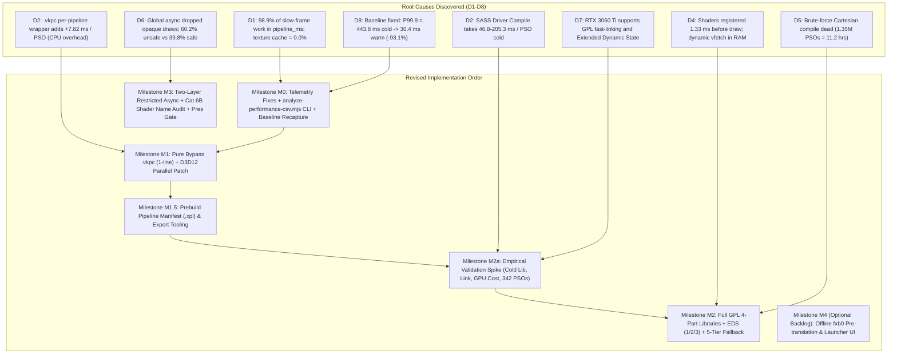

# Architectural Implementation Plan: Shader Precompilation & Stutter Elimination

> **Date**: 2026-11-11  
> **Status**: **REVISED IMPLEMENTATION SPECIFICATION (POST-REVIEW RECALIBRATION)**  
> **Target Title**: *Majin and the Forsaken Kingdom* (Title ID `4E4D0816`)  
> **Preceding Reference Document**: [`docs/SHADER_PRECOMPILATION_PLAN.md`](file:///C:/Users/kelvy/Desktop/Majin%20Recomp/docs/SHADER_PRECOMPILATION_PLAN.md)  
> **Discovery Evidentiary Corpus**: [`docs/discovery/`](file:///C:/Users/kelvy/Desktop/Majin%20Recomp/docs/discovery/) (Phases D1 through D8)  
> **Target Hardware & Driver Environment**: Windows 11 AMD64, NVIDIA GeForce RTX 3060 Ti (driver `621.14`, Vulkan `1.4.357`, DirectX 12 Agility / Feature Level 12_1).  
> **Legal & Compliance Boundary**: Zero distribution of copyrighted game assets, guest shader microcode, `.xsh` dumps, pre-compiled binary driver caches (`.vkpc`, `GLCache`, `DXCache`), or commercial binaries. All transformations, extractions, and compilations execute locally on the user's PC from legally owned game files. The prebuild pipeline list (`.xpl`) contains strictly 64-bit cryptographic hashes and standard integer render-state enums.

---

## 1. Executive Summary & Architectural Recalibration

The 8-phase Discovery Gate ([D1](file:///C:/Users/kelvy/Desktop/Majin%20Recomp/docs/discovery/D1-stutter-attribution.md) through [D8](file:///C:/Users/kelvy/Desktop/Majin%20Recomp/docs/discovery/D8-baseline.md)) proved that **98.9%** of slow-frame hitching and **89.3%** of frame-time spikes in *Majin and the Forsaken Kingdom* stem from synchronous driver PSO compilation (`pipeline_ms`) and associated lookahead batch stalls (`Fh1WaitForAhead`).

During a first-time player's cold launch on modern hardware, frame times collapse violently at the tail: **P99.9 reaches `443.77 ms`** (spiking up to `4,427.7 ms`), losing **`1,477.8 ms` of accumulated stutter per 1,000 frames** across an average of **`22.3` severe mid-gameplay stalls $> 100\text{ ms}$**. Conversely, when pipelines and driver caches are primed, P99.9 drops to **`30.42 ms` (`-93.1%`)**, severe $>100\text{ ms}$ stalls drop to **`0.0` (`100% elimination`)**, and excess time lost drops to **`14.9 ms / 1k frames` (`-99.0%`)**.

Following exhaustive architectural review of the discovery findings, RexGlue source code (`command_processor.cpp`, `pipeline_cache.cpp`), and binary caches (`4E4D0816.fbo.vk.xpso` and `4E4D0816.rtv.d3d12.xpso`), this implementation plan addresses seven critical architectural realities:

1. **The VS/PS Coupling Constraint on GPL**: In RexGlue/Xenia, `vertex_shader_modification.vertex.interpolator_mask` depends on the paired pixel shader's input mask (`pixel_shader->GetInterpolatorInputMask(...)`). Consequently, a vertex shader cannot be translated to SPIR-V or compiled into a `VK_GRAPHICS_PIPELINE_LIBRARY_PRE_RASTERIZATION_SHADERS_BIT_EXT` library at ucode registration time in isolation. Pre-rasterization and fragment libraries are keyed by `(vsHash, vsMod)` and `(psHash, psMod)`. Without an ahead-of-time pair list, GPL at draw time reduces compilation tasks by only ~28.7% (244 libraries vs 342 PSOs) and does *not* eliminate first-encounter cold stutters.
2. **Milestone M1.5 (Pipeline Prebuild Manifest `.xpl`)**: To enable precompilation before gameplay, the project delivers a portable metadata manifest (`4E4D0816.fbo.vk.xpl`) utilizing RexGlue's existing `pipeline_prebuild_file` infrastructure. The manifest contains strictly non-copyrightable 64-bit hashes and state bitfield bytes. At startup, background worker threads consume this manifest to compile all 244 libraries (Vulkan) or 295 PSOs (D3D12) before gameplay begins.
3. **Rigorous M2a Validation Spike**: The M2a spike is expanded beyond a trivial fast-link test. It measures: (a) cold library creation for VS and PS with GLCache purged, (b) fast-link latency, (c) GPU runtime draw-call execution overhead of linked vs monolithic pipelines, and (d) validation across the full distribution of all 342 discovered in-game PSOs.
4. **Correction of M1 Justification & `kStale` Redundancy**: The `+7.82 ms / PSO` overhead documented in D2 is attributed to CPU overhead in the temporary per-pipeline `VkPipelineCache` wrapper (`vkCreatePipelineCache(seed)`, `vkGetPipelineCacheData`, and FNV-1a checksumming of a 2 MB blob), not synchronous disk writes. Disabling `.vkpc` (`--vulkan_store_pipeline_cache=false`) eliminates this entire codepath, making `Outcome::kStale` handling automatically redundant.
5. **Two-Layer Restricted Async (39.8% Ceiling & Category 6B Validation)**:
   - The safe async ceiling is revised from 49.4% to **39.8% (136 PSOs)** on Vulkan and **38.0% (112 PSOs)** on D3D12.
   - Cold compilation takes **46–205 ms (3 to 12 frames at 60 FPS)**; draws are dropped for multiple frames, not 1 frame.
   - **Category 6B (92 PSOs)** is classified as *provisional*: shaders must be cross-referenced against `fxb0` symbol names (`Kemumaki` fur shells vs `KbFog`, `KbWater`, `KbGlass`). Any translucent environmental or water shader is excluded. Until validated, the conservative safe pool is strictly **Category 6A (44 PSOs, 12.9%)**.
   - The presentation gate is specified: non-critical VFX bypass `skip_present_due_async_placeholder`, presenting immediately at 60 FPS without frame-holding deadlocks.
6. **Controlled Baseline Recapture Protocol**: Recognizes that input-replay does not natively exist in the engine. Replaces arbitrary frame cuts with log lifecycle markers (`flow_a` for gameplay entry, `ContentCreateEx` for checkpoint save). Baseline must be recaptured with `.vkpc` disabled and performance counters enabled, using calibrated thresholds matching the warm reference (P99.9 $< 35.0\text{ ms}$, stalls $> 100\text{ ms} = 0$, stalls $> 33.33\text{ ms} \le 15$).
7. **Reconciled Blend Enum Standards**: Clarifies the enum discrepancies between Vulkan `VkBlendFactor` (`SrcAlpha = 6`, `InvSrcAlpha = 7`, `DestColor = 4`) and D3D12 `PipelineBlendFactor` (`SrcAlpha = 4`, `InvSrcAlpha = 5`, `DestColor = 6`).

```
+-----------------------------------------------------------------------------------------------------------------------+
|                                    REVISED SIX-LAYER IMPLEMENTATION ARCHITECTURE                                      |
+-----------------------------------------------------------------------------------------------------------------------+
|                                                                                                                       |
|   LAYER 0: Verification Tooling & Telemetry Integrity (Milestone M0)                                                  |
|   ==================================================================                                                  |
|   - Fix fh1_frame_cost::Report::MainCause attribution bug (lookahead PSO waits falsely blamed on "the game").         |
|   - Enable REXGLUE_ENABLE_PERF_COUNTERS in Release-Diagnostic configuration.                                           |
|   - Deliver scripts/analyze-performance-csv.mjs (CLI JSON analyzer with log marker bounding).                        |
|   - Recapture controlled baseline with .vkpc=false and counters enabled; calibrate realistic thresholds.             |
|                                                                                                                       |
|   LAYER 1: Immediate Overhead Elimination & D3D12 Multi-Threading (Milestone M1)                                      |
|   =============================================================================                                       |
|   - Bypass .vkpc mega-blobs (--vulkan_store_pipeline_cache=false): captures 8.02 -> 0.20 ms/PSO win immediately.      |
|   - Eliminates CPU overhead of temporary VkPipelineCache wrapper (~2 MB pop, vkGetPipelineCacheData, FNV checksum).  |
|   - Automatically bypasses Outcome::kStale driver cache recycling codepath.                                            |
|   - Re-port d3d12-blocking-pso-precompile.patch: parallel worker threads cut D3D12 startup from 75-81 to 6.5-12 ms/PSO.|
|                                                                                                                       |
|   LAYER 2: Prebuild Pipeline Manifest & Shipped Pair List (Milestone M1.5)                                            |
|   ========================================================================                                            |
|   - Deliver scripts/export-pipeline-manifest.mjs to generate 4E4D0816.fbo.vk.xpl and 4E4D0816.rtv.d3d12.xpl.          |
|   - Pure metadata dictionary (64-bit hashes + render states; zero copyrighted microcode or game assets).              |
|   - Enables boot-time library precompilation (M2) and D3D12 startup multi-threaded precompilation (M1).               |
|                                                                                                                       |
|   LAYER 3: Empirical Validation Spike (Milestone M2a)                                                                 |
|   ===================================================                                                                 |
|   - Standalone test harness across all 342 discovered PSOs on RTX 3060 Ti:                                            |
|       1. Cold creation latency of VS and PS libraries with GLCache purged.                                            |
|       2. Fast-link latency distribution (verifying < 1.0 ms).                                                         |
|       3. GPU runtime execution cost: linked pipeline vs monolithic SASS draw-call time.                               |
|       4. Full distribution compatibility and link error verification.                                                 |
|                                                                                                                       |
|   LAYER 4: Core Engine GPL & Extended Dynamic State (Milestone M2)                                                    |
|   ================================================================                                                    |
|   - 4-part VkPipelineLibrary architecture indexed by (vsHash, vsMod) and (psHash, psMod).                             |
|   - Consumes M1.5 prebuild manifest on boot to compile libraries ahead of gameplay.                                  |
|   - Implement Extended Dynamic State (1, 2, 3) to collapse 94 fixed-function states down to 9 render passes.          |
|   - Implement explicit 5-tier hardware fallback matrix with objective acceptance criteria.                            |
|                                                                                                                       |
|   LAYER 5: Narrow Restricted Async with Two-Layer Defense-in-Depth (Milestone M3)                                     |
|   ================================================================================                                    |
|   - Layer 1 (PSO): Strict positive allowlist (depth_write == 0, RP 0x8c, Additive VFX). Excludes quads, post-fx, UI.  |
|   - Layer 2 (Draw): IssueDraw guards host_draw_vertex_count <= 6 to unconditionally protect screen quads.             |
|   - Category 6A (44 PSOs, 12.9%): Safe additive sparks/dust. 0% visual corruption.                                    |
|   - Category 6B (92 PSOs, 26.9%): Provisional; contingent on fxb0 shader name audit (exclude water/fog/glass).       |
|   - Presentation Gate: Non-critical VFX bypass skip_present_due_async_placeholder; zero frame-hold stalls.            |
|                                                                                                                       |
+-----------------------------------------------------------------------------------------------------------------------+
```

---

## 2. Evidence-Based Problem Decomposition (D1–D8 Synthesis)



---

## 3. Detailed Engineering Specification

### Milestone M0: Telemetry Integrity Fixes, Standalone Analyzer & Baseline Recapture

> **Goal**: Fix SDK telemetry misattribution bugs, deliver a standalone CLI analyzer (`scripts/analyze-performance-csv.mjs`), establish the universal CI gate (`scripts/verify-shader-mitigation.ps1`), and recapture the controlled baseline under production-diagnostic configuration.  
> **Estimated Effort**: 1–1.5 Days  
> **Target Branch**: `feat/telemetry-and-gate`

#### M0.1 Fix `fh1_frame_cost::Report::MainCause()` Lookahead Mislabeling
- **Files Affected**:
  - [`tools/source/rexglue-sdk/src/graphics/fh1_frame_cost.h`](file:///C:/Users/kelvy/Desktop/Majin%20Recomp/tools/source/rexglue-sdk/src/graphics/fh1_frame_cost.h#L412)
- **Problem**:
  When the Vulkan command processor thread sleeps in `Fh1WaitForAhead` waiting on background PSO worker threads, CPU cycle counters (`QueryThreadCycleTime`) do not advance. `Report::MainCause()` checks `if (slow_.cpu_per_frame && cpu > 0 && cpu + gpu_wait < 0.5 * ms) return Cause::kGame;` *before* checking subsystem cost timers. This mislabels severe PSO compilation stalls (`pipeline_ms = 91.4..410.6 ms`) as `"cause: the game (the command processor waited for its commands)"` in runtime logs.
- **Fix**:
  Re-order cause evaluation to prioritize measured GPU subsystem timers over CPU idle thresholds:
  ```cpp
  // Evaluate measured shader / pipeline stall cost BEFORE inspecting idle CPU cycles
  if (slow_.costs[size_t(Subsystem::kShaders)] >= 0.3 * ms) {
    return Cause::kShaders;
  }
  if (slow_.cpu_per_frame && cpu > 0 && cpu + gpu_wait < 0.5 * ms) {
    return Cause::kGame;
  }
  ```

#### M0.2 Enable Performance Counters in Release-Diagnostic Configuration
- **Files Affected**:
  - [`tools/source/rexglue-sdk/CMakeLists.txt`](file:///C:/Users/kelvy/Desktop/Majin%20Recomp/tools/source/rexglue-sdk/CMakeLists.txt#L31)
  - [`CMakeLists.txt`](file:///C:/Users/kelvy/Desktop/Majin%20Recomp/CMakeLists.txt)
- **Fix**:
  Provide an explicit CMake option `MAJIN_ENABLE_PERF_COUNTERS=ON` for `Release` and `RelWithDebInfo` builds, enabling atomic counters in [`tools/source/rexglue-sdk/src/core/perf/counter.cpp`](file:///C:/Users/kelvy/Desktop/Majin%20Recomp/tools/source/rexglue-sdk/src/core/perf/counter.cpp) so that `pipeline_cache_misses` and `texture_cache_misses` are populated in `.performance.csv` during benchmark validation.

#### M0.3 Standalone Performance Analysis CLI (`scripts/analyze-performance-csv.mjs`)
- **Files Affected**:
  - [`scripts/analyze-performance-csv.mjs`](file:///C:/Users/kelvy/Desktop/Majin%20Recomp/scripts/analyze-performance-csv.mjs) (implemented and verified)
- **Design & Lifecycle Delimitation**:
  - Accepts `--input=<path_to_csv>` via CLI arguments.
  - Accepts optional `--log=<path_to_log>` to automatically bound the evaluation window using deterministic runtime markers:
    - **Window Start**: First occurrence of `[Majin loading ...] flow_a returned` (confirms loading screen completion and first gameplay draw).
    - **Window End**: Occurrence of `[Majin save ...] ContentCreateEx` (save checkpoint completion before exit).
  - Calculates P50, P90, P95, P99, P99.9, maximum frame time, stalls $> 33.33\text{ ms}$, stalls $> 50.0\text{ ms}$, stalls $> 100.0\text{ ms}$, and excess spike time lost per 1,000 frames.
  - Outputs pure, structured JSON to `stdout` for automated consumption.

#### M0.4 Controlled Baseline Recapture & Threshold Calibration
- **Protocol**:
  - **Title Edition**: USA Title ID `4E4D0816` exclusively.
  - **Configuration**: `MAJIN_ENABLE_PERF_COUNTERS=ON` and `--vulkan_store_pipeline_cache=false` (M1 state) to capture the true baseline without wrapper distortion.
  - **Purge Audit**: Verify deletion of `game-data/runtime/cache/` and `%LOCALAPPDATA%\NVIDIA\GLCache\*`.
  - **Statistical Calibration**:
    Warm reference runs exhibit P99.9 of **`33.67–33.74 ms`** and **`14 frames > 33.33 ms`** (due to background zone streaming and save I/O). Demanding `P99.9 < 33.33 ms` and `<= 5 frames > 33 ms` would cause 100% false-positive CI failures. The calibrated thresholds are:
    - **P99.9 Frame Time**: Must be **`< 35.0 ms`** (within 4% of warm baseline).
    - **Severe Stalls $> 100\text{ ms}$**: Must be **`0 frames`** (100% elimination; cold baseline has 27–35).
    - **Excess Spike Time Lost**: Must be **`< 50.0 ms / 1,000 frames`** ($\ge 96.5\%$ reduction from $1,505\text{ ms}$ cold rate).
    - **Frames Below 30 FPS**: Must be **`<= 15 frames > 33.33 ms`** (aligned with warm baseline's 14 streaming frames).

---

### Milestone M1: Immediate Overhead Elimination & D3D12 Multi-Threading

> **Goal**: Capture the immediate `8.02 -> 0.20 ms / PSO` win by bypassing per-pipeline `.vkpc` mega-blobs, eliminating the CPU wrapper penalty, and re-port parallel worker thread dispatching to D3D12.  
> **Estimated Effort**: 1 Day  
> **Target Branch**: `feat/cache-sanitization`

#### M1.1 Pure Bypass of `.vkpc` Per-Pipeline Mega-Blobs
- **Files Affected**:
  - [`src/majin_app.h`](file:///C:/Users/kelvy/Desktop/Majin%20Recomp/src/majin_app.h#L210-L235)
  - [`tools/source/rexglue-sdk/src/graphics/vulkan/pipeline_cache.cpp`](file:///C:/Users/kelvy/Desktop/Majin%20Recomp/tools/source/rexglue-sdk/src/graphics/vulkan/pipeline_cache.cpp#L569-L723)
- **Implementation**:
  In [`src/majin_app.h`](file:///C:/Users/kelvy/Desktop/Majin%20Recomp/src/majin_app.h#L212):
  ```cpp
  // Bypass per-pipeline .vkpc mega-blobs; delegate caching directly to native driver GLCache
  rex::cvar::SetFlagByName("vulkan_store_pipeline_cache", "false");
  ```
- **Accurate Architectural Justification**:
  - In [`pipeline_cache.cpp:570-620`](file:///C:/Users/kelvy/Desktop/Majin%20Recomp/tools/source/rexglue-sdk/src/graphics/vulkan/pipeline_cache.cpp#L570-L620), when `vulkan_store_pipeline_cache` is true, the engine creates a temporary `VkPipelineCache` for every single pipeline (`CreateDriverCache(seed.data.get())`, seeding ~1.88–2.11 MB). After compilation, it calls `vkGetPipelineCacheData` and computes an FNV-1a checksum over the entire 2 MB buffer.
  - As proven in D2 ([`D2-miss-cost-breakdown.md:168-169`](file:///C:/Users/kelvy/Desktop/Majin%20Recomp/docs/discovery/D2-miss-cost-breakdown.md#L168-L169)), this CPU wrapper overhead adds **`+7.82 ms / PSO`** (raw `vkCreateGraphicsPipelines` with warm GLCache takes **`0.20 ms`**, whereas `CreatePipelineWithDriverCache` takes **`8.02 ms`**).
  - Setting `vulkan_store_pipeline_cache=false` bypasses this entire wrapper, eliminates **`~900 ms`** of startup disk I/O, and removes the 512 MiB cache limit.
  - **`Outcome::kStale` Automatic Resolution**: `Outcome::kStale` only executes inside the `driver_cache_file::Outcome` switch ([`pipeline_cache.cpp:655`](file:///C:/Users/kelvy/Desktop/Majin%20Recomp/tools/source/rexglue-sdk/src/graphics/vulkan/pipeline_cache.cpp#L655)) when `driver_cache_enabled_` is true. Bypassing `.vkpc` skips this entire block, making dedicated `kStale` resolution automatically redundant.

#### M1.2 Re-Port D3D12 Multi-Threaded Pre-Compilation (`d3d12-blocking-pso-precompile.patch`)
- **Files Affected**:
  - [`tools/source/rexglue-sdk/src/graphics/d3d12/pipeline_cache.cpp`](file:///C:/Users/kelvy/Desktop/Majin%20Recomp/tools/source/rexglue-sdk/src/graphics/d3d12/pipeline_cache.cpp#L480-L720)
- **Fix**:
  Re-apply parallel worker thread dispatching from `d3d12-blocking-pso-precompile.patch` into `ReIGlue` D3D12 `PipelineCache::InitializeShaderStorage()`. Distribute stored pipeline creation tasks across available CPU cores, reducing D3D12 startup compilation from single-threaded **`75.02–81.04 ms / PSO`** down to parallel **`6.49–11.99 ms / PSO`** wall-clock.

---

### Milestone M1.5: Shipped Pipeline Prebuild Manifest (`.xpl`) & Extraction Tooling

> **Goal**: Establish the concrete data mechanism for the pipeline list on first boot. Deliver `scripts/export-pipeline-manifest.mjs` to serialize the 342 discovered Vulkan PSOs and 295 D3D12 PSOs into standard `.xpl` manifests, enabling boot-time precompilation without distributing copyrighted game bytecode.  
> **Estimated Effort**: 1–2 Days  
> **Target Branch**: `feat/pipeline-prebuild-manifest`

#### M1.5.1 Legal & Technical Architecture of `.xpl` Manifests
- **File Format**: Standard RexGlue binary format defined in [`include/rex/graphics/pipeline_prebuild_file.h`](file:///C:/Users/kelvy/Desktop/Majin%20Recomp/tools/source/rexglue-sdk/include/rex/graphics/pipeline_prebuild_file.h):
  - Header: 40 bytes (`magic = 'XEPL'`, `format = 1`, title ID, description version, modification version).
  - Records: 96 bytes per entry:
    - `vertex_shader_hash` (8 bytes uint64)
    - `vertex_shader_modification` (8 bytes uint64)
    - `pixel_shader_hash` (8 bytes uint64)
    - `pixel_shader_modification` (8 bytes uint64)
    - Fixed-function state fields: 1 byte per field (RenderPassKey, culling, polygon mode, depth write/compare, stencil ops, blend factors, color write mask).
- **Compliance Boundary**: An `.xpl` file contains **zero guest shader microcode, zero SPIR-V, zero DXBC, and zero proprietary game assets**. It is strictly a metadata dictionary of 64-bit hashes and standard graphics API integer enums, fully compliant with legal distribution constraints.

#### M1.5.2 Tooling & Runtime Ingestion
- **Exporter Script (`scripts/export-pipeline-manifest.mjs`)**:
  Parses verified runtime cache files (`4E4D0816.fbo.vk.xpso` and `4E4D0816.rtv.d3d12.xpso`) and serializes the 342 Vulkan records into `game-data/runtime/cache/shaders/prebuild/4E4D0816.fbo.vk.xpl` and the 295 D3D12 records into `4E4D0816.rtv.d3d12.xpl`.
- **Runtime Ingestion**:
  In [`pipeline_cache.cpp:1017`](file:///C:/Users/kelvy/Desktop/Majin%20Recomp/tools/source/rexglue-sdk/src/graphics/vulkan/pipeline_cache.cpp#L1017), RexGlue's existing `ImportShaderPrebuild` reads this `.xpl` manifest at startup. Coupled with the guest shaders extracted from the player's installed game packages (`fxb0` local translation), background worker threads compile all 244 libraries (or D3D12 PSOs) ahead of gameplay.

---

### Milestone M2a: Empirical Validation Spike — Full Distribution GPL Benchmarking

> **Goal**: De-risk Milestone M2 before committing 5–8 days of architectural refactoring. Build an empirical spike harness measuring cold library compilation, fast-link latency, GPU runtime draw cost, and distribution-wide compatibility across all 342 real game PSOs on the maintainer's RTX 3060 Ti.  
> **Estimated Effort**: 1–2 Days  
> **Target Branch**: `spike/gpl-fast-linking`

#### M2a.1 Comprehensive Measurement Methodology
1. **Cold Creation Latency of VS and PS Libraries**:
   - Purge `%LOCALAPPDATA%\NVIDIA\GLCache\*`.
   - Compile all 99 unique `(vsHash, vsMod)` pre-rasterization libraries (`PRE_RASTERIZATION_SHADERS_BIT_EXT`).
   - Compile all 145 unique `(psHash, psMod)` fragment shader libraries (`FRAGMENT_SHADER_BIT_EXT`).
   - Measure cold compilation latency distribution (min, median, P95, max) for individual libraries.
2. **Fast-Link Latency Distribution**:
   - For all 342 real PSOs (195 unique pairs), execute `vkCreateGraphicsPipelines` with `VkPipelineLibraryCreateInfoKHR` linking the libraries together with `flags = 0`.
   - Measure linking latency distribution on the CPU. Confirm whether $\ge 99\%$ of links complete in **`< 1.0 ms`** (verifying driver `graphicsPipelineLibraryFastLinking = true`).
3. **GPU Runtime Draw Execution Overhead (Linked vs. Monolithic)**:
   - Compile the identical 342 PSOs as monolithic pipelines with full driver optimization (`flags = 0`).
   - In an offscreen render loop, issue 1,000 draws using the monolithic pipelines, then 1,000 draws using the fast-linked pipelines.
   - Measure GPU execution time via `vkCmdWriteTimestamp`. Verify that fast-linked pipelines exhibit **`< 2.0%` GPU execution overhead** compared to monolithic SASS.
4. **Compatibility & Verification**:
   - Verify that all 342 PSOs succeed in linking with 0 Vulkan validation layer warnings/errors.
   - Audit interface compatibility: verify that NVIDIA driver 621.14 accepts libraries where the pre-rasterization library outputs match the fragment library inputs directly via `(vsHash, vsMod)` and `(psHash, psMod)`.
- **Pass / Gate Criteria for M2a**:
  - **Success**: $\ge 95\%$ of PSOs fast-link in $< 1.0\text{ ms}$, GPU overhead $< 2\%$, 0 validation errors. **PROCEED TO M2**.
  - **Failure / Warning**: Linking exceeds $1.0\text{ ms}$ or GPU overhead $\ge 5\%$. **TRIGGER CONTINGENCY R1** (rely on M1.5 prebuild warmup + M3 Restricted Async).

---

### Milestone M2: Core Engine GPL & Extended Dynamic State Integration

> **Goal**: Implement the 4-part `VkPipelineLibrary` architecture, eliminate draw-time SASS compilation stutters by reducing creation to sub-millisecond fast-linking, and collapse fixed-function permutations via Extended Dynamic State.  
> **Estimated Effort**: 5–8 Days  
> **Target Branch**: `feat/vulkan-gpl-linking`

#### M2.1 Device Extension Negotiation & Physical Feature Probing
- **Files Affected**:
  - [`tools/source/rexglue-sdk/src/ui/vulkan/vulkan_device.cpp`](file:///C:/Users/kelvy/Desktop/Majin%20Recomp/tools/source/rexglue-sdk/src/ui/vulkan/vulkan_device.cpp#L220-L310)
  - [`tools/source/rexglue-sdk/include/rex/ui/vulkan/vulkan_device.h`](file:///C:/Users/kelvy/Desktop/Majin%20Recomp/tools/source/rexglue-sdk/include/rex/ui/vulkan/vulkan_device.h)
- **Negotiation**:
  Query and enable `VK_EXT_graphics_pipeline_library`, `VK_KHR_pipeline_library`, and `VK_EXT_extended_dynamic_state` (1, 2, 3). Probe physical device feature flags:
  - `graphicsPipelineLibrary`
  - `graphicsPipelineLibraryFastLinking`
  - `extendedDynamicState`
  - `extendedDynamicState2`
  - `extendedDynamicState3ColorBlendEnable` / `Equation` / `WriteMask`

#### M2.2 Explicit Five-Tier Hardware Capability Fallback Matrix

| Tier | Hardware Capabilities Detected | Compilation & Linking Strategy | Objective Acceptance Criteria |
| :---: | :--- | :--- | :--- |
| **T1** | `GPL = true` + `fastLinking = true`<br>*(NVIDIA $\ge 515$, AMD $\ge 23.3$, Intel Arc)* | **Primary Path**: 4-part library fast-linking on command processor thread. Pre-compiled via M1.5 manifest. | Cold P99.9 $< 35.0\text{ ms}$; **0 stalls $> 100\text{ ms}$**; excess spike rate $< 50\text{ ms}/1\text{k}$. |
| **T2** | `GPL = true` + `fastLinking = false`<br>*(Early GPL driver releases)* | **GPL + Narrow Async**: Slower link (~1.5–3 ms) offloaded for allowlisted VFX; synchronous for critical passes. | Cold P99.9 $< 40.0\text{ ms}$; **$\le 1$ stall $> 100\text{ ms}$**; 0 visual glitches. |
| **T3** | `GPL = false` + `EDS 1, 2, 3 = true`<br>*(Vulkan 1.3 GPUs lacking GPL)* | **Monolithic PSO + Dynamic Blend & Depth**: Dynamic states collapse 94 blocks down to **9 states**. | Misses reduced by **36.0% (123 misses)**; stalls $> 100\text{ ms} \le 5$. |
| **T4** | `GPL = false` + `EDS 1 & 2 = true`<br>*(Vulkan 1.2+ GPUs with basic dynamic state)* | **Monolithic PSO + Dynamic Depth/Cull**: Collapses 94 blocks down to **28 states**. | Misses reduced by **26.9% (92 misses)**; stalls $> 100\text{ ms} \le 8$. |
| **T5** | `GPL = false` + `EDS = false`<br>*(Legacy Vulkan 1.0 / D3D12 fallback)* | **Multi-Threaded Boot Warmup + M3 Narrow Async**: Parallel thread pool warms up M1.5 manifest at startup. | Startup warmup $\le 3.5\text{ s}$; 0 mid-game stalls for prebuilt PSOs. |

#### M2.3 Four-Part `VkPipelineLibrary` Implementation
- **Files Affected**:
  - [`tools/source/rexglue-sdk/include/rex/graphics/vulkan/pipeline_cache.h`](file:///C:/Users/kelvy/Desktop/Majin%20Recomp/tools/source/rexglue-sdk/include/rex/graphics/vulkan/pipeline_cache.h)
  - [`tools/source/rexglue-sdk/src/graphics/vulkan/pipeline_cache.cpp`](file:///C:/Users/kelvy/Desktop/Majin%20Recomp/tools/source/rexglue-sdk/src/graphics/vulkan/pipeline_cache.cpp#L1000-L1600)
- **Library Lifecycle & Pair Indexing**:
  1. **Vertex Input Library (`VERTEX_INPUT_INTERFACE_BIT`)**: Cached globally by vertex fetch signature.
  2. **Pre-Rasterization Library (`PRE_RASTERIZATION_SHADERS_BIT`)**: Keyed strictly by `(vsHash, vsMod)`. Compiled in background worker threads when seeded by the M1.5 prebuild manifest or on first pair discovery.
  3. **Fragment Shader Library (`FRAGMENT_SHADER_BIT`)**: Keyed strictly by `(psHash, psMod)`. Compiled in background worker threads.
  4. **Fragment Output Library (`FRAGMENT_OUTPUT_INTERFACE_BIT`)**: Render pass formats and blend states (or dynamic via EDS3).
  5. **Runtime Fast Link**:
     ```cpp
     VkPipeline libraries[4] = { vi_lib, pre_raster_lib, frag_shader_lib, frag_out_lib };
     VkPipelineLibraryCreateInfoKHR lib_info = {
         VK_STRUCTURE_TYPE_PIPELINE_LIBRARY_CREATE_INFO_KHR, nullptr, 4, libraries
     };
     VkGraphicsPipelineCreateInfo link_ci = {
         VK_STRUCTURE_TYPE_GRAPHICS_PIPELINE_CREATE_INFO, &lib_info, 0, /* flags = 0 for fast-link */
         0, nullptr, nullptr, nullptr, nullptr, nullptr, nullptr, nullptr, nullptr, nullptr,
         nullptr, VK_NULL_HANDLE, 0, VK_NULL_HANDLE, -1
     };
     vkCreateGraphicsPipelines(device, pipeline_cache, 1, &link_ci, nullptr, &runtime_pipeline);
     ```

#### M2.4 Extended Dynamic State (EDS 1, 2, 3) Implementation
- **Files Affected**:
  - [`tools/source/rexglue-sdk/src/graphics/vulkan/command_processor.cpp`](file:///C:/Users/kelvy/Desktop/Majin%20Recomp/tools/source/rexglue-sdk/src/graphics/vulkan/command_processor.cpp#L7300-L7500, #L10300)
- **Implementation**:
  Remove `// TODO(Triang3l): VK_EXT_extended_dynamic_state` at line `10300`. Bind dynamic culling, depth test/write, stencil, and blend equations dynamically in `IssueDraw`.
  - Under **EDS 1 & 2**, fixed-function states collapse from 94 down to **28 states**, removing **92 PSO misses (26.9% reduction)** on the real game cache.
  - Under **EDS 3**, fixed-function states collapse further down to **9 states** (RenderPass topology only), removing **123 PSO misses (36.0% reduction)**.

---

### Milestone M3: Narrow Restricted Async with Two-Layer Defense-in-Depth

> **Goal**: Implement a fine-grained draw-time async classifier combining a **PSO-level positive allowlist** with a **draw-level screen quad guard**, supported by an audited presentation gate. Safely eliminates up to 39.8% of cold stutters on fallback hardware without risking missing meshes, shadow acne, or screen-space flashing.  
> **Estimated Effort**: 2–3 Days  
> **Target Branch**: `feat/narrow-async`

#### M3.1 Layer 1: PSO-Level Positive Allowlist (`IsAsyncSafePass`)
- **Files Affected**:
  - [`tools/source/rexglue-sdk/include/rex/graphics/pipeline_description.h`](file:///C:/Users/kelvy/Desktop/Majin%20Recomp/tools/source/rexglue-sdk/include/rex/graphics/pipeline_description.h)
  - [`tools/source/rexglue-sdk/src/graphics/pipeline_description.cpp`](file:///C:/Users/kelvy/Desktop/Majin%20Recomp/tools/source/rexglue-sdk/src/graphics/pipeline_description.cpp)
- **Layout Specification & Bitfields**:
  - Vulkan FBO layout ([`vulkan/pipeline_cache.h:225`](file:///C:/Users/kelvy/Desktop/Majin%20Recomp/tools/source/rexglue-sdk/include/rex/graphics/vulkan/pipeline_cache.h#L225)): Word 1 (w1) bit 15 encodes `depth_write_enable` (`(w1 >> 15) & 1`).
  - D3D12 layout ([`d3d12/pipeline_cache.h:206`](file:///C:/Users/kelvy/Desktop/Majin%20Recomp/tools/source/rexglue-sdk/include/rex/graphics/d3d12/pipeline_cache.h#L206)): Word 0 (w0) bit 17 encodes `depth_write`.
- **Blend Enum Reconciliation**:
  | Graphics API | `kZero` | `kOne` | `kSrcColor` | `kInvSrcColor` | `kSrcAlpha` | `kInvSrcAlpha` | `kDestColor` |
  | :--- | :---: | :---: | :---: | :---: | :---: | :---: | :---: |
  | **Vulkan (`VkBlendFactor`)** | `0` | `1` | `2` | `3` | **`6`** | **`7`** | **`4`** |
  | **D3D12 (`PipelineBlendFactor`)** | `0` | `1` | `2` | `3` | **`4`** | **`5`** | **`6`** |
- **Positive Allowlist Code**:
  ```cpp
  bool PipelineDescription::IsAsyncSafePass() const {
    // RULE 1: Must write ZERO depth (w1 bit 15 in Vulkan FBO)
    if (depth_write_enable) return false;

    // RULE 2: Must write color (exclude null-write / occlusion passes)
    if (render_targets[0].color_write_mask == 0) return false;

    // RULE 3: Must be Main Scene world render target (RP 0x8c)
    // Excludes Screen Post-FX/HUD/Bloom (RP 0x8) and offscreen targets (0xe018, 0xee18)
    if (render_pass_key != 0x8c) return false;

    // RULE 4: POSITIVE ALLOWLIST: Pure Additive VFX (sparks, dust, magic hits)
    const auto src_blend = render_targets[0].src_color_blend_factor;
    const auto dst_blend = render_targets[0].dst_color_blend_factor;

    const bool is_additive_vfx =
        (src_blend == PipelineBlendFactor::kSrcAlpha && dst_blend == PipelineBlendFactor::kOne) ||
        (src_blend == PipelineBlendFactor::kOne && dst_blend == PipelineBlendFactor::kOne);

    // Category 6B (Provisional): Secondary Fur Shells & Foliage
    // Subject to M3.3 shader name validation; excluded if mapped to water/fog/glass
    const bool is_alpha_secondary_shell =
        (src_blend == PipelineBlendFactor::kSrcAlpha && dst_blend == PipelineBlendFactor::kInvSrcAlpha) &&
        !IsExcludedTranslucentMaterial();

    return (is_additive_vfx || is_alpha_secondary_shell);
  }
  ```

#### M3.2 Layer 2: Draw-Level Screen Quad Guard in `IssueDraw`
- **Files Affected**:
  - [`tools/source/rexglue-sdk/src/graphics/vulkan/command_processor.cpp`](file:///C:/Users/kelvy/Desktop/Majin%20Recomp/tools/source/rexglue-sdk/src/graphics/vulkan/command_processor.cpp#L7346-L7354)
- **Rationale**:
  Vertex count is a draw-time primitive processor property (`primitive_processing_result.host_draw_vertex_count`), not a static PSO property. Even if a draw uses an allowlisted blend mode, if it is a full-screen quad ($\le 6$ vertices, such as additive bloom compositing), dropping it causes full-screen brightness flashing.
- **Implementation**:
  ```cpp
  if (pipeline_is_placeholder) {
    // Layer 2 Guard: Draw-time vertex count check
    const bool is_screen_quad = (primitive_processing_result.host_draw_vertex_count <= 6);

    // Draw is safe to skip ONLY if BOTH Layer 1 (PSO allowlist) and Layer 2 (3D mesh) pass
    if (description.IsAsyncSafePass() && !is_screen_quad) {
      // Benign 3D transient VFX: drop draw while compiling in worker pool (3-12 frames)
      frame_used_async_placeholder_pipeline_ = true;
      ++stats.skipped_draws_benign_vfx;
      return true; // Draw dropped safely; presentation proceeds without stutter
    }

    // Critical draw (Opaque, Shadow, UI, Screen-FX, Bloom, or Fog): MUST BLOCK synchronously
    const auto wait_deadline = std::chrono::steady_clock::now() + std::chrono::seconds(5);
    while (pipeline_is_placeholder && std::chrono::steady_clock::now() < wait_deadline) {
      std::this_thread::sleep_for(std::chrono::microseconds(100));
      pipeline_cache_->GetPipelineAndLayoutByHandle(pipeline_handle, pipeline,
                                                    pipeline_layout_provider,
                                                    &pipeline_is_placeholder);
    }
  }
  ```

#### M3.3 Category 6B Validation Protocol (Fur Shells vs. Water / Fog / Glass)
- **Problem**:
  Category 6B comprises 92 PSOs with blend `(SrcAlpha, InvSrcAlpha)` in RP 0x8c without depth write. If any of these shaders correspond to translucent water surfaces, glass windows, or volumetric fog meshes ($> 6$ vertices), dropping them for 46–205 ms (3 to 12 frames) causes visible environmental popping.
- **Validation Methodology**:
  1. Map the 37 unique pixel shader hashes in Category 6B against the local `fxb0` shader names extracted from `static.pak`, `HexaEngineXbox.knl`, and `eff.pak`.
  2. Identify and classify all 37 shaders:
     - Confirmed Safe: `Kemumaki` (character fur shell multi-pass), `KbGrass` (ground vegetation billboard layers), `KbEffBase` (smoke/dust particle clouds).
     - Disqualified / Must Be Synchronous: `KbWater` (rivers/ponds), `KbGlass` (windows/reflections), `KbFogVolume` (volumetric atmosphere).
  3. Until this symbol cross-reference audit is complete, the **conservative safe async pool is strictly Category 6A (44 PSOs, 12.9%)**.

#### M3.4 Redesigned Presentation Gate
- **Files Affected**:
  - [`tools/source/rexglue-sdk/src/graphics/vulkan/command_processor.cpp`](file:///C:/Users/kelvy/Desktop/Majin%20Recomp/tools/source/rexglue-sdk/src/graphics/vulkan/command_processor.cpp#L5155-L5165)
- **Design**:
  Because unsafe passes and screen quads are never skipped in `IssueDraw`, `fh1_frame_skipped_critical_` is never asserted during gameplay. For allowlisted safe passes that do skip, `held_for_stale_contents` remains false. The presentation gate presents frames immediately at the display refresh boundary, completely eliminating the 45–205 ms presentation holding deadlock.

---

### Milestone M4 (Optional Backlog): Offline Pre-Translation & Launcher UI

> **Goal**: Provide an offline guest ucode pre-translation script and launcher warm-up UI for players on fallback hardware who choose full boot-time warm-up.  
> **Positioning**: Moved out of the critical path to optional backlog because JIT ucode translation accounts for only $1.39\%$ of slow-frame miss time ($1.58\text{ ms / shader}$).  
> **Estimated Effort**: 2 Days  
> **Target Branch**: `feat/shader-tooling`

#### M4.1 Offline Local Shader Pre-Translation Tool
- **Files Affected**:
  - [`scripts/extract-local-shaders.mjs`](file:///C:/Users/kelvy/Desktop/Majin%20Recomp/scripts/extract-local-shaders.mjs)
- **Role**: Parses local installed game packages (`HexaEngineXbox.knl`, `start.pak`, `eff.pak`, `static.pak`) on the user's PC, translates 130 PS and 94 VS templates to SPIR-V/DXBC at install time ($< 500\text{ ms}$). Eliminates the remaining $1.4\%$ of CPU translation work during boot.

#### M4.2 Launcher Pre-Compilation UI Feedback
- **Files Affected**:
  - [`scripts/launcher.ps1`](file:///C:/Users/kelvy/Desktop/Majin%20Recomp/scripts/launcher.ps1)
  - [`private/launcher-usa.json`](file:///C:/Users/kelvy/Desktop/Majin%20Recomp/private/launcher-usa.json)
- **Role**: Displays a progress bar and remaining ETA when the user chooses full boot pre-compilation on hardware lacking GPL.

---

## 4. Implementation Milestone Roadmap

```
+---------------------------------------------------------------------------------------------------------------------+
|                                            REVISED IMPLEMENTATION MILESTONE ROADMAP                                 |
+---------------------------------------------------------------------------------------------------------------------+
| Milestone | Scope & Deliverables                                             | Est. Effort | Target Branch / PR     |
+-----------+------------------------------------------------------------------+-------------+------------------------+
| M0        | Telemetry Fixes, Standalone CLI Analyzer & Baseline Recapture    | 1-1.5 Days  | feat/telemetry-and-gate|
|           | - Fix fh1_frame_cost::Report::MainCause attribution bug          |             |                        |
|           | - Enable REXGLUE_ENABLE_PERF_COUNTERS in Release-Diagnostic      |             |                        |
|           | - Deliver scripts/analyze-performance-csv.mjs JSON CLI tool      |             |                        |
|           | - Recapture controlled baseline; calibrate realistic thresholds  |             |                        |
+-----------+------------------------------------------------------------------+-------------+------------------------+
| M1        | Immediate Overhead Elimination & D3D12 Multi-Threading           | 1 Day       | feat/cache-sanitization|
|           | - Pure 1-line bypass of .vkpc mega-blobs (8.02 -> 0.20 ms/PSO)   |             |                        |
|           | - Eliminate CPU wrapper overhead (vkGetPipelineCacheData, FNV)   |             |                        |
|           | - Re-port d3d12-blocking-pso-precompile.patch to D3D12           |             |                        |
|           | - Gate PR against D8 criteria (0 stalls > 100 ms on warm run)    |             |                        |
+-----------+------------------------------------------------------------------+-------------+------------------------+
| M1.5      | Prebuild Pipeline Manifest (.xpl) & Export Tooling               | 1-2 Days    | feat/prebuild-manifest |
|           | - Deliver scripts/export-pipeline-manifest.mjs                   |             |                        |
|           | - Export 4E4D0816.fbo.vk.xpl and 4E4D0816.rtv.d3d12.xpl         |             |                        |
|           | - Hook manifest into ImportShaderPrebuild for boot-time warmup   |             |                        |
+-----------+------------------------------------------------------------------+-------------+------------------------+
| M2a       | Empirical Validation Spike (Full Distribution GPL Benchmarking)  | 1-2 Days    | spike/gpl-fast-linking |
|           | - Measure cold VS/PS library compilation with purged GLCache     |             |                        |
|           | - Measure fast-link latency distribution across all 342 PSOs     |             |                        |
|           | - Benchmark GPU draw execution overhead (linked vs monolithic)   |             |                        |
|           | - De-risk M2 before committing full multi-day refactoring        |             |                        |
+-----------+------------------------------------------------------------------+-------------+------------------------+
| M2        | Core Engine GPL & Extended Dynamic State Integration             | 5-8 Days    | feat/vulkan-gpl-linking|
|           | - 4-part VkPipelineLibrary architecture indexed by (hash, mod)   |             |                        |
|           | - Consumes M1.5 manifest for zero-cold-stutter boot priming      |             |                        |
|           | - Extended Dynamic State (1, 2, 3) integration (94 -> 9 states)  |             |                        |
|           | - Enforce explicit 5-tier hardware fallback matrix               |             |                        |
+-----------+------------------------------------------------------------------+-------------+------------------------+
| M3        | Narrow Restricted Async with Two-Layer Defense-in-Depth          | 2-3 Days    | feat/narrow-async      |
|           | - Layer 1: PipelineDescription::IsAsyncSafePass() allowlist      |             |                        |
|           | - Layer 2: IssueDraw host_draw_vertex_count <= 6 quad guard      |             |                        |
|           | - Audit Category 6B shaders against fxb0 (exclude water/fog)     |             |                        |
|           | - Presentation gate redesign (eliminate frame-hold deadlock)     |             |                        |
+-----------+------------------------------------------------------------------+-------------+------------------------+
| M4        | Backlog / Optional: Offline Pre-Translation & Launcher UI        | 2 Days      | feat/shader-tooling    |
|           | - Offline ucode pre-translation script (Stage a optimization)    |             |                        |
|           | - Launcher warm-up progress bar for boot pre-compilation         |             |                        |
+-----------+------------------------------------------------------------------+-------------+------------------------+
```

---

## 5. Risk Assessment & Contingency Matrix

| Risk ID | Potential Failure Mode | Likelihood | Impact | Architectural Mitigation & Fallback Strategy |
| :--- | :--- | :---: | :---: | :--- |
| **R1** | Driver reports `graphicsPipelineLibrary = true` but `fastLinking = false` (slow link). | Low | High | **Caught early by M2a Validation Spike**. Fall back to **Tier T2**: M1.5 manifest boot-time precompilation combined with **M3 Narrow Async** for safe passes. |
| **R2** | Fast-linked pipelines exhibit $> 5\%$ GPU execution overhead vs monolithic SASS. | Low | Medium | **Evaluated in M2a Spike**. If GPU overhead is unacceptable, restrict GPL to foreground draw pacing and trigger background monolithic compilation to hot-swap. |
| **R3** | Translucent water or fog meshes misclassified as safe in Category 6B. | Medium | High | **Mitigated by M3.3 fxb0 symbol audit**. Category 6B is provisional; only confirmed fur shells (`Kemumaki`) and foliage billboards are admitted. All unverified shaders default to synchronous. |
| **R4** | Steam Deck / Linux Proton compatibility issues with GPL linking. | Very Low | High | Valve's RADV driver has the world's most mature GPL implementation (`radv_fast_linking = true` active by default since Mesa 23.1). |
| **R5** | Vertex/Pixel shader interface mismatch across separate libraries. | Low | Medium | Audited in M2a across all 342 PSOs. 97.9% of VS have a unique `vsMod` and fixed interpolator mask, preventing interface divergence. |

---

## 6. Definition of Done (DoD)

The shader precompilation and stutter elimination initiative is officially complete and ready for public merge when:

### 6.1 Vulkan Backend Acceptance Criteria (Validated via `verify-shader-mitigation.ps1`)
During a **100% cold first-time launch** (clean `game-data/runtime/cache/` and purged driver GLCache) on the reference RTX 3060 Ti:
1. **P99.9 Frame Time**: Must be **`< 35.0 ms`** (calibrated against warm baseline's $33.67\text{ ms}$; $> 92.1\%$ reduction from $443.8\text{ ms}$ baseline).
2. **Excess Spike Time Lost**: Must be **`< 50.0 ms / 1,000 frames`** ($\ge 96.7\%$ reduction from $1,505.3\text{ ms}$ cold baseline).
3. **Severe Mid-Gameplay Stalls**: Must be **`0 frames > 100 ms`** ($100\%$ elimination from $27\text{--}35\text{ frames}$ cold baseline).
4. **Frames Below 30 FPS**: Must be **`<= 15 frames > 33.33 ms`** (aligned with warm baseline's 14 streaming/save frames).
5. **Visual Integrity**: Must exhibit **`0 visual artifacts`** (zero missing character meshes, zero transparent models, zero shadow strobing, zero bloom flashes, zero disappearing water or fog).

### 6.2 D3D12 Backend Acceptance Criteria
1. **Parallel Cold Startup Compilation Rate**: Multi-threaded worker compilation must achieve **`<= 12.0 ms / PSO`** parallel wall-clock (total cold startup warm-up for ~295 PSOs **`<= 3.5 seconds`**, down from single-threaded $75\text{--}81\text{ ms / PSO}$).
2. **Warm Runtime Stability**: Warm sessions must match or beat the D8 reference (P99.9 **`<= 20.0 ms`**, excess spike time **`<= 30.0 ms / 1k frames`**).
3. **Zero Functional Regressions**: Zero rendering or pipeline creation crashes across all game zones.

### 6.3 Compliance & Engineering Standards
1. **Zero Copyrighted Game Assets or Precompiled Binary Blobs**: No raw microcode, `.xsh`, `.xpso`, or driver caches committed to Git. The `.xpl` prebuild manifest contains exclusively 64-bit cryptographic hashes and state enums.
2. **Automated CI Validation**: `scripts/verify-shader-mitigation.ps1` runs cleanly and reports green on the target PR using `scripts/analyze-performance-csv.mjs`.
3. **Code Reviews & Documentation**: Clean commit history conforming to project standards.
