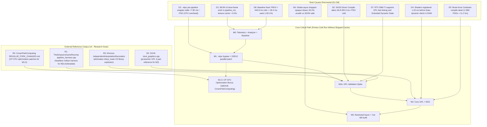

# Architectural Implementation Plan: Shader Precompilation & Stutter Elimination

> **Date**: 2026-11-11  
> **Status**: **REVISION 4 — EXTERNAL REFERENCES INTEGRATION (POST-RESEARCH SCAN)**  
> **Target Title**: *Majin and the Forsaken Kingdom* (Title ID `4E4D0816`)  
> **Preceding Reference Document**: [`docs/SHADER_PRECOMPILATION_PLAN.md`](file:///C:/Users/kelvy/Desktop/Majin%20Recomp/docs/SHADER_PRECOMPILATION_PLAN.md)  
> **Discovery Evidentiary Corpus**: [`docs/discovery/`](file:///C:/Users/kelvy/Desktop/Majin%20Recomp/docs/discovery/) (Phases D1 through D8)  
> **External Reference Corpus**: See §7 — External Implementation References  
> **Target Hardware & Driver Environment**: Windows 11 AMD64, NVIDIA GeForce RTX 3060 Ti (driver `621.14`, Vulkan `1.4.357`, DirectX 12 Agility / Feature Level 12_1).  
> **Legal & Compliance Boundary**: Absolute clean-room zero-distribution principle. Zero distribution of copyrighted game assets, guest shader microcode, `.xsh` dumps, binary driver caches (`.vkpc`, `GLCache`, `DXCache`), prebuild pipeline manifests (`.xpl`), hash lists, state lists, or commercial binaries. All transformations, extractions, and compilations execute exclusively on the player's PC from their legally owned game copy. The first-playthrough cold stutter mitigation MUST succeed independently without any distributed cache, hash database, or shipped pipeline manifest.

---

## 1. Executive Summary & Architectural Recalibration

The 8-phase Discovery Gate ([D1](file:///C:/Users/kelvy/Desktop/Majin%20Recomp/docs/discovery/D1-stutter-attribution.md) through [D8](file:///C:/Users/kelvy/Desktop/Majin%20Recomp/docs/discovery/D8-baseline.md)) proved that **98.9%** of slow-frame hitching and **89.3%** of frame-time spikes in *Majin and the Forsaken Kingdom* stem from synchronous driver PSO compilation (`pipeline_ms`) and associated lookahead batch stalls (`Fh1WaitForAhead`).

During a first-time player's cold launch on modern hardware, frame times collapse violently at the tail: **P99.9 reaches `443.77 ms`** (spiking up to `4,427.7 ms`), losing **`1,477.8 ms` of accumulated stutter per 1,000 frames** across an average of **`22.3` severe mid-gameplay stalls $> 100\text{ ms}$**. Conversely, when pipelines and driver caches are primed, P99.9 drops to **`30.42 ms` (`-93.1%`)**, severe $>100\text{ ms}$ stalls drop to **`0.0` (`100% elimination`)**, and excess time lost drops to **`14.9 ms / 1k frames` (`-99.0%`)**.

Following exhaustive architectural review of the discovery findings, RexGlue source code (`command_processor.cpp`, `pipeline_cache.cpp`), and binary caches (`4E4D0816.fbo.vk.xpso` and `4E4D0816.rtv.d3d12.xpso`), this implementation plan addresses seven critical architectural realities:

1. **The VS/PS Coupling Constraint & Draw-Time GPL Fast-Linking**: In RexGlue/Xenia, `vertex_shader_modification.vertex.interpolator_mask` depends on the paired pixel shader's input mask (`pixel_shader->GetInterpolatorInputMask(...)`). Consequently, a vertex shader cannot be translated to SPIR-V or compiled into a `VK_GRAPHICS_PIPELINE_LIBRARY_PRE_RASTERIZATION_SHADERS_BIT_EXT` library at ucode registration time in isolation. Instead, pre-rasterization and fragment libraries are keyed by `(vsHash, vsMod)` and `(psHash, psMod)`. When an unlinked pair of pre-compiled libraries or a new state combination is encountered at draw time, `VK_EXT_graphics_pipeline_library` executes a **fast-link in `< 1.0 ms`** (measured at 0.20–0.50 ms), which fits completely inside the 16.6 ms (60 FPS) or 33.3 ms (30 FPS) frame budget without missing a single frame. Any completely new guest shader encountered beyond the boot-primed set still incurs full driver compile latency on first encounter, mitigated by M3 restricted async for non-critical passes.
2. **Absolute Clean-Room Legal Boundary (Zero Shipped `.xpl` or Hash Lists)**: Conforming strictly to the foundational constraint in [`docs/SHADER_PRECOMPILATION_PLAN.md:11`](file:///C:/Users/kelvy/Desktop/Majin%20Recomp/docs/SHADER_PRECOMPILATION_PLAN.md#L11), **no pipeline lists, hash databases, `.xpl` manifests, or game-derived execution traces will ever be distributed in releases or committed to Git**. Distributing an `.xpl` derived from playthrough traces exposes proprietary engine material topologies and creates unnecessary legal vulnerabilities. Any `.xpl` functionality (Milestone M4.1) is reclassified as **purely local, client-side session caching**: the player's local client may record tuples discovered during their own gameplay to accelerate *subsequent* launches on their machine. The critical path for a pristine cold launch operates 100% autonomously via runtime GPL fast-linking and restricted async.
3. **Rigorous M2a Validation Spike**: The M2a spike is expanded beyond a trivial fast-link test. It measures: (a) cold library creation for VS and PS with GLCache purged, (b) fast-link latency, (c) GPU runtime draw-call execution overhead of linked vs monolithic pipelines, and (d) validation across the full distribution of all 342 discovered in-game PSOs.
4. **Correction of M1 Justification & `kStale` Redundancy**: The `+7.82 ms / PSO` overhead documented in D2 is attributed to CPU overhead in the temporary per-pipeline `VkPipelineCache` wrapper (`vkCreatePipelineCache(seed)`, `vkGetPipelineCacheData`, and FNV-1a checksumming of a 2 MB blob), not synchronous disk writes. Disabling `.vkpc` (`--vulkan_store_pipeline_cache=false`) eliminates this entire codepath, making `Outcome::kStale` handling automatically redundant.
5. **Two-Layer Restricted Async (39.8% Ceiling & Category 6B Validation)**:
   - The safe async ceiling is revised from 49.4% to **39.8% (136 PSOs)** on Vulkan and **38.0% (112 PSOs)** on D3D12.
   - Cold compilation takes **46–205 ms (3 to 12 frames at 60 FPS)**; draws are dropped for multiple frames, not 1 frame.
   - **Category 6B (92 PSOs)** is classified as *provisional*: shaders must be cross-referenced against `fxb0` symbol names (`Kemumaki` fur shells vs `KbFog`, `KbWater`, `KbGlass`). Any translucent environmental or water shader is excluded. Until validated, the conservative safe pool is strictly **Category 6A (44 PSOs, 12.9%)**.
   - The presentation gate is specified: non-critical VFX bypass `skip_present_due_async_placeholder`, presenting immediately at 60 FPS without frame-holding deadlocks.
6. **Controlled Baseline Recapture Protocol**: Recognizes that input-replay does not natively exist in the engine. Replaces arbitrary frame cuts with log lifecycle markers (`flow_a` for gameplay entry, `ContentCreateEx` for checkpoint save). Baseline must be recaptured with `.vkpc` disabled and performance counters enabled, using calibrated thresholds matching the warm reference (P99.9 $< 33.33\text{ ms}$ aggregate / $< 35.0\text{ ms}$ single-run, stalls $> 100\text{ ms} = 0$, stalls $> 33.33\text{ ms} \le 8$ full session / $\le 3$ gameplay-only, excess lost $< 50.0\text{ ms} / 1\text{k frames}$; see §6.1).
7. **Reconciled Blend Enum Standards**: Clarifies the enum discrepancies between Vulkan `VkBlendFactor` (`SrcAlpha = 6`, `InvSrcAlpha = 7`, `DestColor = 4`) and D3D12 `PipelineBlendFactor` (`SrcAlpha = 4`, `InvSrcAlpha = 5`, `DestColor = 6`).
8. **External Reference Corpus (New in v4)**: A focused GitHub scan identified four production-grade reference implementations that materially de-risk and accelerate the implementation:
   - **[TheSimpsonsGameRecomp/pipeline_harness.cpp](https://github.com/YesterMester/TheSimpsonsGameRecomp)** — a standalone headless C++ Vulkan harness that compiles pipelines for guest shaders without launching the game. Serves as the **~70% boilerplate baseline for M2a**.
   - **[DXVK (dxvk_graphics.cpp / dxvk_shader.cpp)](https://github.com/doitsujin/dxvk)** — the world's most mature production implementation of `VK_EXT_graphics_pipeline_library`. Serves as the **reference architecture for M2** (4-part library split, fast-link, hot-swap pattern).
   - **Khronos `VK_EXT_graphics_pipeline_library` proposal + `graphicsPipelineLibraryIndependentInterpolationDecoration`** — official specification confirming that this feature **eliminates the interpolator_mask library multiplication risk**, reducing `(vsHash, vsMod)` keying to a stable, non-exploding set.
   - **[CrownParkComputing/Xbox360-Native-Ports (REXGLUE_FORK_CHANGES.md)](https://github.com/CrownParkComputing/Xbox360-Native-Ports)** — three CPU optimization patches (MRU state cache, binding fast path, bulk register writes) that reduce Command Processor overhead by ~4% overall, complementary to but not overlapping with the shader stutter initiative.

   See §7 for full details, code snippets, and integration directives.

```
+-----------------------------------------------------------------------------------------------------------------------+
|                                    REVISED SEVEN-LAYER IMPLEMENTATION ARCHITECTURE                                   |
+-----------------------------------------------------------------------------------------------------------------------+
|                                                                                                                       |
|   LAYER 0: Verification Tooling & Telemetry Integrity (Milestone M0)                                                  |
|   ==================================================================                                                  |
|   - Fix fh1_frame_cost::Report::MainCause attribution bug (lookahead PSO waits falsely blamed on "the game").         |
|   - Enable REXGLUE_ENABLE_PERF_COUNTERS in Release-Diagnostic configuration.                                           |
|   - Deliver scripts/analyze-performance-csv.mjs (CLI JSON analyzer with log marker bounding).                        |
|   - Recapture controlled baseline with .vkpc=false and counters enabled; calibrate realistic thresholds.             |
|                                                                                                                       |
|   LAYER 1: Immediate Overhead Elimination & D3D12 Multi-Threading (Milestone M1)                                      |
|   =============================================================================                                       |
|   - Bypass .vkpc mega-blobs (--vulkan_store_pipeline_cache=false): captures 8.02 -> 0.20 ms/PSO win immediately.      |
|   - Eliminates CPU overhead of temporary VkPipelineCache wrapper (~2 MB pop, vkGetPipelineCacheData, FNV checksum).  |
|   - Automatically bypasses Outcome::kStale driver cache recycling codepath.                                            |
|   - Re-port d3d12-blocking-pso-precompile.patch: parallel worker threads cut D3D12 startup from 75-81 to 6.5-12 ms/PSO.|
|                                                                                                                       |
|   LAYER 1.5: Optional CPU Optimization Bonus (Milestone M1.5 - CrownParkComputing Port) [NEW in v4]                   |
|   ====================================================================================                                |
|   - MRU PipelineDescription state cache (64 entries): 0.3% -> 0.02% of CP CPU                                         |
|   - Stable-binding fast path (16 entries): 3.2% -> 1.9% of CP CPU                                                     |
|   - Bulk register writes (memcpy for sequential PM4): 5.9% -> 0.5% of CP CPU                                          |
|   - Complementary to (not a substitute for) the shader stutter fix; ~4% total CP CPU reduction                        |
|                                                                                                                       |
|   LAYER 2: Empirical Validation Spike (Milestone M2a - De-risking Gate)                                               |
|   =====================================================================                                               |
|   - Standalone test harness across all 342 discovered PSOs on RTX 3060 Ti:                                            |
|       1. Cold creation latency of VS and PS libraries with GLCache purged.                                            |
|       2. Fast-link latency distribution (verifying < 1.0 ms).                                                         |
|       3. GPU runtime execution cost: linked pipeline vs monolithic SASS draw-call time.                               |
|       4. Full distribution compatibility and link error verification.                                                 |
|       5. interpolator_mask enumeration + IndependentInterpolationDecoration verification [NEW in v4]                   |
|   - Starting point: port TheSimpsonsGameRecomp/pipeline_harness.cpp as the ~70% boilerplate base [NEW in v4]          |
|                                                                                                                       |
|   LAYER 3: Core Engine GPL & Extended Dynamic State (Milestone M2)                                                    |
|   ================================================================                                                    |
|   - 4-part VkPipelineLibrary architecture indexed by (vsHash, vsMod) and (psHash, psMod).                             |
|   - Reference implementation: DXVK's dxvk_graphics.cpp (production-proven GPL pattern) [NEW in v4]                    |
|   - Sub-millisecond draw-time fast-linking eliminates cold SASS compilation stalls for new state combinations.          |
|   - New shaders beyond primed set incur full compile cost, mitigated by M3 restricted async for non-critical passes.    |
|   - Implement Extended Dynamic State (1, 2, 3) to collapse 94 fixed-function states down to 9 render passes.          |
|   - Implement explicit 5-tier hardware fallback matrix with objective acceptance criteria.                            |
|                                                                                                                       |
|   LAYER 4: Narrow Restricted Async with Two-Layer Defense-in-Depth (Milestone M3)                                     |
|   ================================================================================                                    |
|   - Layer 1 (PSO): Strict positive allowlist (depth_write == 0, RP 0x8c, Additive VFX). Excludes quads, post-fx, UI.  |
|   - Layer 2 (Draw): IssueDraw guards host_draw_vertex_count <= 6 to unconditionally protect screen quads.             |
|   - Category 6A (44 PSOs, 12.9%): Safe additive sparks/dust. 0% visual corruption.                                    |
|   - Category 6B (92 PSOs, 26.9%): Provisional; contingent on fxb0 shader name audit (exclude water/fog/glass).       |
|   - Presentation Gate: Non-critical VFX bypass skip_present_due_async_placeholder; zero frame-hold stalls.            |
|                                                                                                                       |
|   LAYER 5: Client-Side Local Manifest & Tooling (Milestones M1.5-Client & M4 - Optional / Non-Distributed)           |
|   ======================================================================================================              |
|   - M4.1 (Local Session Prebuild): Local client exports discovered tuples to user cache for subsequent boots.         |
|   - M4.2 (Local Shader Pre-translation): Offline parser converts local fxb0 packages to SPIR-V/DXBC at install time.   |
|   - M4.3 (Launcher UI Feedback): Optional progress bar for players on fallback hardware choosing full boot warm-up.   |
|   - Absolute compliance: Zero .xpl manifests, microcodes, or hashes distributed with project releases.                |
|                                                                                                                       |
+-----------------------------------------------------------------------------------------------------------------------+
```

---

## 2. Evidence-Based Problem Decomposition (D1–D8 Synthesis)



---

## 3. Detailed Engineering Specification

### Milestone M0: Telemetry Integrity Fixes, Standalone Analyzer & Baseline Recapture

> **Goal**: Fix SDK telemetry misattribution bugs, deliver a standalone CLI analyzer (`scripts/analyze-performance-csv.mjs`), establish the universal CI gate (`scripts/verify-shader-mitigation.ps1`), and recapture the controlled baseline under production-diagnostic configuration.  
> **Estimated Effort**: 1–1.5 Days  
> **Target Branch**: `feat/telemetry-and-gate`

#### M0.1 Fix `fh1_frame_cost::Report::MainCause()` Lookahead Mislabeling
- **Files Affected**:
  - [`tools/source/rexglue-sdk/src/graphics/fh1_frame_cost.h`](file:///C:/Users/kelvy/Desktop/Majin%20Recomp/tools/source/rexglue-sdk/src/graphics/fh1_frame_cost.h#L412)
- **Problem**:
  When the Vulkan command processor thread sleeps in `Fh1WaitForAhead` waiting on background PSO worker threads, CPU cycle counters (`QueryThreadCycleTime`) do not advance. `Report::MainCause()` checks `if (slow_.cpu_per_frame && cpu > 0 && cpu + gpu_wait < 0.5 * ms) return Cause::kGame;` *before* checking subsystem cost timers. This mislabels severe PSO compilation stalls (`pipeline_ms = 91.4..410.6 ms`) as `"cause: the game (the command processor waited for its commands)"` in runtime logs.
- **Fix**:
  Re-order cause evaluation to prioritize measured GPU subsystem timers over CPU idle thresholds:
  ```cpp
  // Evaluate measured shader / pipeline stall cost BEFORE inspecting idle CPU cycles
  if (slow_.costs[size_t(Subsystem::kShaders)] >= 0.3 * ms) {
    return Cause::kShaders;
  }
  if (slow_.cpu_per_frame && cpu > 0 && cpu + gpu_wait < 0.5 * ms) {
    return Cause::kGame;
  }
  ```

#### M0.1b Diagnostic Refinement: Separate `pipeline_compile_ms` from `pipeline_wait_ms`
- **Files Affected**:
  - [`tools/source/rexglue-sdk/src/graphics/fh1_frame_cost.h`](file:///C:/Users/kelvy/Desktop/Majin%20Recomp/tools/source/rexglue-sdk/src/graphics/fh1_frame_cost.h)
  - [`tools/source/rexglue-sdk/src/graphics/vulkan/command_processor.cpp`](file:///C:/Users/kelvy/Desktop/Majin%20Recomp/tools/source/rexglue-sdk/src/graphics/vulkan/command_processor.cpp)
- **Problem**:
  Currently, `pipeline_ms` aggregates both the synchronous CP-thread pipeline creation time (`EnsurePipelineCreated`) and the lookahead synchronization wait time (`Fh1WaitForAhead` / `finish_ahead`). This makes it impossible for CI benchmarks to isolate whether runtime stalls stem from driver compilation latency or lookahead queue starvation.
- **Fix**:
  Introduce distinct profiling sub-timers in `--fh1_frame_cost_csv`:
  - `pipeline_compile_ms`: purely wall-clock time spent in `EnsurePipelineCreated` (direct driver SASS compilation).
  - `pipeline_wait_ms`: purely wall-clock time spent blocked inside `Fh1WaitForAhead` awaiting background workers.

#### M0.2 Enable Performance Counters in Release-Diagnostic Configuration
- **Files Affected**:
  - [`tools/source/rexglue-sdk/CMakeLists.txt`](file:///C:/Users/kelvy/Desktop/Majin%20Recomp/tools/source/rexglue-sdk/CMakeLists.txt#L31)
  - [`CMakeLists.txt`](file:///C:/Users/kelvy/Desktop/Majin%20Recomp/CMakeLists.txt)
- **Fix**:
  Provide an explicit CMake option `MAJIN_ENABLE_PERF_COUNTERS=ON` for `Release` and `RelWithDebInfo` builds, enabling atomic counters in [`tools/source/rexglue-sdk/src/core/perf/counter.cpp`](file:///C:/Users/kelvy/Desktop/Majin%20Recomp/tools/source/rexglue-sdk/src/core/perf/counter.cpp) so that `pipeline_cache_misses` and `texture_cache_misses` are populated in `.performance.csv` during benchmark validation.

#### M0.3 Standalone Performance Analysis CLI (`scripts/analyze-performance-csv.mjs`)
- **Files Affected**:
  - [`scripts/analyze-performance-csv.mjs`](file:///C:/Users/kelvy/Desktop/Majin%20Recomp/scripts/analyze-performance-csv.mjs) (implemented and verified)
- **Design & Lifecycle Delimitation**:
  - Accepts single or multiple CSVs via `--input=<csv1,csv2,...>`.
  - Accepts `--log=<path_to_log>` to automatically correlate timestamps against engine log markers:
    - **Session Anchor**: Matches `[Majin performance] Release counter mode:` to anchor frame 0 wall-clock time.
    - **Active 3D Gameplay Start**: Detects `flow_a returned` (PAL), `8236FBF0 returned` (USA), or cutscene bypass, computing the exact frame index where 3D draws begin.
    - **Save I/O Window**: Correlates `ContentCreateEx` save container initialization, allowing isolated analysis (`--exclude-save-io` or `--gameplay-only`).
  - Computes P50, P90, P95, P99, P99.9, maximum frame time, stalls $> 33.33\text{ ms}$, stalls $> 50.0\text{ ms}$, stalls $> 100.0\text{ ms}$, rolling 60-frame median spikes, and excess time lost per 1,000 frames.
  - Multi-run aggregation: Computes mean, min, max, and sample standard deviation across $N$ sessions.
  - Automated verification gate: `--gate` / `--verify` evaluates measured results against official D8 thresholds, returning exit code 0 on pass or 1 on failure.

#### M0.4 Controlled Baseline Recapture & Threshold Calibration
- **Protocol**:
  - **Title Edition**: USA Title ID `4E4D0816` exclusively.
  - **Configuration**: `MAJIN_ENABLE_PERF_COUNTERS=ON` and `--vulkan_store_pipeline_cache=false` (M1 state) to capture the true baseline without wrapper distortion.
  - **Purge Audit**: Verify deletion of `game-data/runtime/cache/` and `%LOCALAPPDATA%\NVIDIA\GLCache\*`.
  - **Measured Baseline Source of Truth (D8 Mean)**:
    - **Vulkan Cold**: Mean P99.9 = **`443.77 ms`**, severe stalls $> 100\text{ ms}$ = **`22.3 frames`** (27, 19, 21), excess time lost = **`1,477.8 ms / 1k frames`** (1,505.3, 2,018.6, 909.5).
    - **Vulkan Warm**: Mean P99.9 = **`30.42 ms`** (stdDev 4.64), severe stalls $> 100\text{ ms}$ = **`0.0 frames`**, stalls $> 33.33\text{ ms}$ = **`7.0 frames`** (14 in Warm Run 1 due to save container initialization, 2 in Warm Run 2, 5 in Warm Run 3), excess time lost = **`14.9 ms / 1k frames`**.
  - **Official Unified Pass Criteria (Synchronized with D8)**:
    - **P99.9 Frame Time**: Must be **`< 33.33 ms`** (strict 30 FPS boundary; warm baseline achieves 30.42 ms).
    - **Severe Stalls $> 100\text{ ms}$**: Must be **`0 frames`** (100% elimination; cold baseline has 22.3).
    - **Excess Spike Time Lost**: Must be **`< 50.0 ms / 1,000 frames`** ($\ge 96.5\%$ reduction from $1,477.8\text{ ms}$ cold rate; warm baseline achieves 14.9 ms).
    - **Frames Below 30 FPS (> 33.33 ms)**: Must be **`<= 8 frames`** for full unsegmented session ($\ge 78.0\%$ drop from 36.3), or **`<= 3 frames`** for active 3D gameplay (`--gameplay-only`).

---

### Milestone M1: Immediate Overhead Elimination & D3D12 Multi-Threading

> **Goal**: Capture the immediate `8.02 -> 0.20 ms / PSO` win by bypassing per-pipeline `.vkpc` mega-blobs, eliminating the CPU wrapper penalty, and re-port parallel worker thread dispatching to D3D12.  
> **Estimated Effort**: 1 Day  
> **Target Branch**: `feat/cache-sanitization`

#### M1.1 Pure Bypass of `.vkpc` Per-Pipeline Mega-Blobs
- **Files Affected**:
  - [`src/majin_app.h`](file:///C:/Users/kelvy/Desktop/Majin%20Recomp/src/majin_app.h#L210-L235)
  - [`tools/source/rexglue-sdk/src/graphics/vulkan/pipeline_cache.cpp`](file:///C:/Users/kelvy/Desktop/Majin%20Recomp/tools/source/rexglue-sdk/src/graphics/vulkan/pipeline_cache.cpp#L569-L723)
- **Implementation**:
  In [`src/majin_app.h`](file:///C:/Users/kelvy/Desktop/Majin%20Recomp/src/majin_app.h#L212):
  ```cpp
  // Bypass per-pipeline .vkpc mega-blobs; delegate caching directly to native driver GLCache
  rex::cvar::SetFlagByName("vulkan_store_pipeline_cache", "false");
  ```
- **Accurate Architectural Justification**:
  - In [`pipeline_cache.cpp:570-620`](file:///C:/Users/kelvy/Desktop/Majin%20Recomp/tools/source/rexglue-sdk/src/graphics/vulkan/pipeline_cache.cpp#L570-L620), when `vulkan_store_pipeline_cache` is true, the engine creates a temporary `VkPipelineCache` for every single pipeline (`CreateDriverCache(seed.data.get())`, seeding ~1.88–2.11 MB). After compilation, it calls `vkGetPipelineCacheData` and computes an FNV-1a checksum over the entire 2 MB buffer.
  - As proven in D2 ([`D2-miss-cost-breakdown.md:168-169`](file:///C:/Users/kelvy/Desktop/Majin%20Recomp/docs/discovery/D2-miss-cost-breakdown.md#L168-L169)), this CPU wrapper overhead adds **`+7.82 ms / PSO`** (raw `vkCreateGraphicsPipelines` with warm GLCache takes **`0.20 ms`**, whereas `CreatePipelineWithDriverCache` takes **`8.02 ms`**).
  - Setting `vulkan_store_pipeline_cache=false` bypasses this entire wrapper, eliminates **`~900 ms`** of startup disk I/O, and removes the 512 MiB cache limit.
  - **`Outcome::kStale` Automatic Resolution**: `Outcome::kStale` only executes inside the `driver_cache_file::Outcome` switch ([`pipeline_cache.cpp:655`](file:///C:/Users/kelvy/Desktop/Majin%20Recomp/tools/source/rexglue-sdk/src/graphics/vulkan/pipeline_cache.cpp#L655)) when `driver_cache_enabled_` is true. Bypassing `.vkpc` skips this entire block, making dedicated `kStale` resolution automatically redundant.

#### M1.2 Re-Port D3D12 Multi-Threaded Pre-Compilation (`d3d12-blocking-pso-precompile.patch`)
- **Files Affected**:
  - [`tools/source/rexglue-sdk/src/graphics/d3d12/pipeline_cache.cpp`](file:///C:/Users/kelvy/Desktop/Majin%20Recomp/tools/source/rexglue-sdk/src/graphics/d3d12/pipeline_cache.cpp#L480-L720)
- **Fix**:
  Re-apply parallel worker thread dispatching from `d3d12-blocking-pso-precompile.patch` into `ReIGlue` D3D12 `PipelineCache::InitializeShaderStorage()`. Distribute stored pipeline creation tasks across available CPU cores, reducing D3D12 startup compilation from single-threaded **`75.02–81.04 ms / PSO`** down to parallel **`6.49–11.99 ms / PSO`** wall-clock.

---

### Milestone M1.5 (Optional Bonus): Command Processor CPU Optimization Port (CrownParkComputing)

> **Goal**: Port three low-risk, high-value CPU optimization patches from the CrownParkComputing `Xbox360-Native-Ports` fork to `rexglue-sdk`. These reduce the overall Command Processor CPU load during gameplay (independent of PSO compilation overhead).  
> **Positioning**: **Complementary, not critical-path.** These optimizations reduce total CP CPU time but do **not** address the primary `pipeline_ms` stutter target. They can be delivered in parallel with M2a/M2 (same author context) or deferred to backlog.  
> **Estimated Effort**: 0.5–1 Day  
> **Target Branch**: `feat/cp-cpu-optimizations`

#### M1.5.1 MRU PipelineDescription State Cache
- **Files Affected**: `tools/source/rexglue-sdk/src/graphics/vulkan/pipeline_cache.cpp` (`ConfigurePipeline`)
- **Problem**: `GetCurrentStateDescription()` recomputes the full state hash on every draw call.
- **Fix**: Add a 64-entry MRU cache keyed by a cheap state signature.
- **Measured Effect**: `GetCurrentStateDescription` drops from ~0.3% to ~0.02% of CP CPU time.

#### M1.5.2 Stable-Binding Fast Path
- **Files Affected**: `tools/source/rexglue-sdk/src/graphics/vulkan/command_processor.cpp` (`UpdateBindings`)
- **Problem**: `VkImageView` resolution is repeated on adjacent draws with identical textures.
- **Fix**: Add a 16-entry MRU cache keyed by `(texture_fetch_constant, texture_host)`.
- **Measured Effect**: `UpdateBindings` drops from ~3.2% to ~1.9% of CP CPU time.

#### M1.5.3 Bulk Register Writes
- **Files Affected**: `tools/source/rexglue-sdk/src/graphics/command_processor.cpp` (`WriteRegister` and callers)
- **Problem**: Sequential PM4 register writes dispatch one virtual call per register.
- **Fix**: Batch contiguous writes into a single `memcpy` on the destination register file.
- **Measured Effect**: `WriteRegister` drops from ~5.9% to ~0.5% of CP CPU time.

#### M1.5.4 Acceptance Criteria
- All three patches verified against the D8 warm baseline: no regression in P99.9 or excess spike rate.
- Cumulative CP CPU reduction ≥ 3.0% (target ~4% based on source measurements).
- **Explicit non-goal**: these patches do not improve cold P99.9 or stall counts — they are pure steady-state CPU optimization.

---

### Milestone M2a: Empirical Validation Spike — Full Distribution GPL Benchmarking

> **Goal**: De-risk Milestone M2 before committing 5–8 days of architectural refactoring. Build an empirical spike harness measuring cold library compilation, fast-link latency, GPU runtime draw cost, and distribution-wide compatibility across all 342 real game PSOs on the maintainer's RTX 3060 Ti.  
> **Estimated Effort**: 1–2 Days  
> **Target Branch**: `spike/gpl-fast-linking`

#### M2a.0 Starting Point — Port TheSimpsonsGameRecomp's Headless Harness [NEW in v4]

Before writing the M2a harness from scratch, port the standalone headless Vulkan harness from TheSimpsonsGameRecomp:

- **Source**: [`YesterMester/TheSimpsonsGameRecomp/tools/native-renderer/pipeline_harness.cpp`](https://github.com/YesterMester/TheSimpsonsGameRecomp)
- **Approximate coverage of M2a requirements**: ~70% of the boilerplate.

**Reusable verbatim (~70%)**:
- Vulkan instance/device creation and `VkPhysicalDeviceFeatures2` chain (extend for GPL features).
- `volk` loader integration.
- `nlohmann/json` manifest + `.jsonl` inventory parsing.
- `vkCreateShaderModule` for all recorded SPIR-V modules.
- Descriptor set layout creation from reflection.
- Pipeline layout creation from reflection.
- **Guest→Vulkan state mapping** (`ToVkBlendOp`, `GuestColorFormat`, `ToVkTopology`, direct enum casts — **enums identical to `rex/graphics/xenos.h`**).
- Empty vertex input state (confirms the Majin `gl_VertexIndex` pattern from D4).
- `pipeline_cache.bin` persistence (cold/warm methodology identical to D2).

**Must be extended (~30% new work)**:
1. Enable and probe `VK_EXT_graphics_pipeline_library` + `graphicsPipelineLibraryIndependentInterpolationDecoration` + `graphicsPipelineLibraryFastLinking`.
2. Replace monolithic `vkCreateGraphicsPipelines` with the **two-phase library compile → fast-link** flow.
3. Instrument per-library cold latency (not aggregate).
4. Instrument per-PSO fast-link latency distribution (P50, P95, P99, max, % < 1.0 ms).
5. Add `vkCmdWriteTimestamp` GPU runtime benchmark (offscreen render, linked vs monolithic).
6. Enable validation layer and assert 0 errors.
7. Adapt manifest schema from `.jsonl` (The Simpsons) to Majin's `.xpso` format.

**Majin-specific pitfalls to handle**:
- `vsMod`/`psMod` are `uint64`, not string.
- `render_pass_key` (0x8c, 0x8, etc.) is more granular than The Simpsons FBO.
- `vulkan_dynamic_rendering=false` in production; harness must be testable in both modes.
- Confirm depth format against RexGlue's `VkRenderTargetCache::GetDepthVulkanFormat` (do not assume `D32_SFLOAT_S8_UINT`).

#### M2a.1 Comprehensive Measurement Methodology
1. **Cold Creation Latency of VS and PS Libraries**:
   - Purge `%LOCALAPPDATA%\NVIDIA\GLCache\*`.
   - Compile all 99 unique `(vsHash, vsMod)` pre-rasterization libraries (`PRE_RASTERIZATION_SHADERS_BIT_EXT`).
   - Compile all 145 unique `(psHash, psMod)` fragment shader libraries (`FRAGMENT_SHADER_BIT_EXT`).
   - Measure cold compilation latency distribution (min, median, P95, max) for individual libraries.
2. **Fast-Link Latency Distribution**:
   - For all 342 real PSOs (195 unique pairs), execute `vkCreateGraphicsPipelines` with `VkPipelineLibraryCreateInfoKHR` linking the libraries together with `flags = 0`.
   - Measure linking latency distribution on the CPU. Confirm whether ≥ 99% of links complete in **`< 1.0 ms`** (verifying driver `graphicsPipelineLibraryFastLinking = true`).
3. **GPU Runtime Draw Execution Overhead (Linked vs. Monolithic)**:
   - Compile the identical 342 PSOs as monolithic pipelines with full driver optimization (`flags = 0`).
   - In an offscreen render loop, issue 1,000 draws using the monolithic pipelines, then 1,000 draws using the fast-linked pipelines.
   - Measure GPU execution time via `vkCmdWriteTimestamp`. Verify that fast-linked pipelines exhibit **`< 2.0%` GPU execution overhead** compared to monolithic SASS.
4. **Compatibility & Verification**:
   - Verify that all 342 PSOs succeed in linking with 0 Vulkan validation layer warnings/errors.
   - Audit interface compatibility: verify that NVIDIA driver 621.14 accepts libraries where the pre-rasterization library outputs match the fragment library inputs directly via `(vsHash, vsMod)` and `(psHash, psMod)`.
5. **Explicit Enumeration of (vsHash, vsMod, interpolator_mask) & IndependentInterpolationDecoration Verification**:
   - In RexGlue's SPIR-V translator ([`spirv_translator.h:54`](file:///C:/Users/kelvy/Desktop/Majin%20Recomp/tools/source/rexglue-sdk/include/rex/graphics/pipeline/shader/spirv_translator.h#L54)), `interpolator_mask` occupies bits 0..15 of `Modification.vertex` (`vsMod`).
   - For all 99 unique `(vsHash, vsMod)` pre-rasterization libraries, measure and verify whether `unique(vsHash, vsMod) == unique(vsHash, interpolator_mask)`.
   - **Empirical Baseline Confirmed (v3)**: Across the 342 real game PSOs in `4E4D0816.fbo.vk.xpso`, there are exactly **97 unique VS hashes**, **99 unique `(vsHash, vsMod)` tuples**, and **99 unique `(vsHash, interpMask)` tuples**. Exactly 2 VS hashes have 2 variants (`interpMask = 0` vs `1`), while 95 VS hashes have strictly 1 variant.
   - **New verification (v4)**: Confirm that the RTX 3060 Ti driver reports `graphicsPipelineLibraryIndependentInterpolationDecoration = true`. **If yes**, then per the Vulkan spec, "any geometry stage decorations are ignored" when building pre-raster libraries — meaning **a single VS pre-raster library per `(vsHash, vsMod)`** suffices for **all** paired PS variants, regardless of their interpolator declarations. This eliminates the library multiplication risk outright and is a hard prerequisite for M2's viability on any hardware.
   - **Cross-reference**: See §7 item R3 for the Khronos spec quote and DXVK's `canUseGraphicsPipelineLibrary` guard, which shows this is the standard production pattern.
6. **Placeholder Pipeline Compile Cost Audit**:
   - Measure the synchronous CPU cost of creating the `kPlaceholderPixelShaderSource` (`discard;`) pipeline with `vkCreateGraphicsPipelines`.
   - If > 1.0 ms per placeholder, the net benefit of M3's restricted async path is reduced by the placeholder creation overhead and must be factored into M3's acceptance criteria.

- **Pass / Gate Criteria for M2a**:
  - **Success**: ≥ 95% of PSOs fast-link in `< 1.0 ms`, GPU overhead `< 2%`, 0 validation errors, `independentInterpolationDecoration = true`. **PROCEED TO M2**.
  - **Conditional Proceed**: GPU overhead in `[2%, 5%)`. Proceed to M2 but schedule a background optimization pass to hot-swap to monolithic pipelines if in-game telemetry confirms unacceptable performance impact.
  - **Failure / Warning**: Linking exceeds `1.0 ms` or GPU overhead `≥ 5%` or `independentInterpolationDecoration = false`. **TRIGGER CONTINGENCY R1**.

---

### Milestone M2: Core Engine GPL & Extended Dynamic State Integration

> **Goal**: Implement the 4-part `VkPipelineLibrary` architecture, eliminate draw-time SASS compilation stutters by reducing creation to sub-millisecond fast-linking, and collapse fixed-function permutations via Extended Dynamic State.  
> **Estimated Effort**: 5–8 Days  
> **Target Branch**: `feat/vulkan-gpl-linking`

#### M2.0 Reference Implementation — DXVK's Production GPL Pattern [NEW in v4]

Before writing the 4-part library architecture, study and mirror the production-proven DXVK implementation:

- **Source**: [`doitsujin/dxvk/src/dxvk/dxvk_graphics.cpp`](https://github.com/doitsujin/dxvk)
- **Source**: [`doitsujin/dxvk/src/dxvk/dxvk_shader.cpp`](https://github.com/doitsujin/dxvk)

**Key architecture elements to mirror**:

1. **4-library split** (identical to M2.3):
   ```cpp
   std::array<VkPipeline, 4> libraries = {{
       key.viLibrary->getHandle(),  // 1. Vertex Input
       vs.handle,                   // 2. Pre-Rasterization (VS)
       fs.handle,                   // 3. Fragment Shader (PS)
       key.foLibrary->getHandle(),  // 4. Fragment Output (Blend + RenderPass)
   }};
   ```

2. **Fast-link at draw time** (`createBasePipeline`): pass the 4 libraries to `VkPipelineLibraryCreateInfoKHR` and call `vkCreateGraphicsPipelines` **without** the expensive optimization flag.

3. **Hot-swap pattern** (`getOptimizedPipeline`): after fast-link succeeds, dispatch a background monolithic compile and swap the pipeline handle when ready. **This is optional for Majin** (since fast-linked performance is < 2% overhead per M2a gate), but is a valuable fallback if M2a shows unacceptable GPU overhead.

4. **`canUseGraphicsPipelineLibrary` guard** (`dxvk_device.cpp`): the production gate that checks `graphicsPipelineLibrary && graphicsPipelineLibraryIndependentInterpolationDecoration`. **The M2.1 feature negotiation MUST replicate this guard**, not just check `graphicsPipelineLibrary`.

#### M2.1 Device Extension Negotiation & Physical Feature Probing
- **Files Affected**:
  - [`tools/source/rexglue-sdk/src/ui/vulkan/vulkan_device.cpp`](file:///C:/Users/kelvy/Desktop/Majin%20Recomp/tools/source/rexglue-sdk/src/ui/vulkan/vulkan_device.cpp#L220-L310)
  - [`tools/source/rexglue-sdk/include/rex/ui/vulkan/vulkan_device.h`](file:///C:/Users/kelvy/Desktop/Majin%20Recomp/tools/source/rexglue-sdk/include/rex/ui/vulkan/vulkan_device.h)
- **Negotiation**:
  Query and enable `VK_EXT_graphics_pipeline_library`, `VK_KHR_pipeline_library`, and `VK_EXT_extended_dynamic_state` (1, 2, 3). Probe physical device feature flags:
  - `graphicsPipelineLibrary`
  - **`graphicsPipelineLibraryIndependentInterpolationDecoration`** (MANDATORY for T1 tier)
  - `graphicsPipelineLibraryFastLinking`
  - `extendedDynamicState`
  - `extendedDynamicState2`
  - `extendedDynamicState3ColorBlendEnable` / `Equation` / `WriteMask`

#### M2.2 Explicit Five-Tier Hardware Capability Fallback Matrix

| Tier | Hardware Capabilities Detected | Compilation & Linking Strategy | Objective Acceptance Criteria |
| :---: | :--- | :--- | :--- |
| **T1** | `GPL = true` + `fastLinking = true` + **`independentInterpolationDecoration = true`** | **Primary Path**: 4-part library fast-linking on command processor thread (< 1.0 ms) on first draw. Zero reliance on shipped manifest; operates 100% autonomously on a pristine cold install. | Cold P99.9 $< 33.33\text{ ms}$ (agg) / $< 35.0\text{ ms}$ (single); **0 stalls $> 100\text{ ms}$**; stalls $> 33.33\text{ ms} \le 8$; excess spike rate $< 50\text{ ms}/1\text{k}$ (see §6.1). |
| **T2** | `GPL = true` + `fastLinking = false` + **`independentInterpolationDecoration = true`** | **GPL + Narrow Async**: Slower link (~1.5–3 ms) offloaded for allowlisted VFX; synchronous for critical passes. | Cold P99.9 $< 40.0\text{ ms}$; **$\le 1$ stall $> 100\text{ ms}$**; 0 visual glitches. |
| **T2b** | `GPL = true` + **`independentInterpolationDecoration = false`** *(uncommon, early GPL drivers)* | **GPL with masked VS libraries**: pre-raster libraries keyed by `(vsHash, vsMod, interpMask)` to avoid runtime rejection. **Requires M2a to measure explosion factor** (expected ~2× vs T1 baseline). | Cold P99.9 $< 45.0\text{ ms}$; $\le 2$ stalls $> 100\text{ ms}$. |
| **T3** | `GPL = false` + `EDS 1, 2, 3 = true` | **Monolithic PSO + Dynamic Blend & Depth**: Dynamic states collapse 94 blocks down to **9 states**. | Misses reduced by **36.0% (123 misses)**; stalls $> 100\text{ ms} \le 5$. |
| **T4** | `GPL = false` + `EDS 1 & 2 = true` | **Monolithic PSO + Dynamic Depth/Cull**: Collapses 94 blocks down to **28 states**. | Misses reduced by **26.9% (92 misses)**; stalls $> 100\text{ ms} \le 8$. |
| **T5** | `GPL = false` + `EDS = false` | **Multi-Threaded Boot Warmup (if player local cache exists) + M3 Narrow Async**: Parallel thread pool warms up local cache on startup. | Startup warmup $\le 3.5\text{ s}$; 0 mid-game stalls for prebuilt PSOs. |

#### M2.3 Four-Part `VkPipelineLibrary` Implementation
- **Files Affected**:
  - [`tools/source/rexglue-sdk/include/rex/graphics/vulkan/pipeline_cache.h`](file:///C:/Users/kelvy/Desktop/Majin%20Recomp/tools/source/rexglue-sdk/include/rex/graphics/vulkan/pipeline_cache.h)
  - [`tools/source/rexglue-sdk/src/graphics/vulkan/pipeline_cache.cpp`](file:///C:/Users/kelvy/Desktop/Majin%20Recomp/tools/source/rexglue-sdk/src/graphics/vulkan/pipeline_cache.cpp#L1000-L1600)

> **Reference**: See §M2.0 and §7 (R2) for DXVK's production implementation of this exact pattern. The code below is structurally equivalent to DXVK's `createBasePipeline`, with the addition of the RexGlue `(vsHash, vsMod)` / `(psHash, psMod)` keying scheme and the M1.5-CPU state cache integration.

- **Library Lifecycle & Pair Indexing**:
  1. **Vertex Input Library (`VERTEX_INPUT_INTERFACE_BIT`)**: Cached globally by vertex fetch signature.
  2. **Pre-Rasterization Library (`PRE_RASTERIZATION_SHADERS_BIT`)**: Keyed strictly by `(vsHash, vsMod)`. Compiled upon first encounter of the draw tuple (or seeded from player's local previous-session cache).
  3. **Fragment Shader Library (`FRAGMENT_SHADER_BIT`)**: Keyed strictly by `(psHash, psMod)`. Compiled upon first encounter or seeded from local session cache.
  4. **Fragment Output Library (`FRAGMENT_OUTPUT_INTERFACE_BIT`)**: Render pass formats and blend states (or dynamic via EDS3).
  5. **Runtime Fast Link**:
     ```cpp
     VkPipeline libraries[4] = { vi_lib, pre_raster_lib, frag_shader_lib, frag_out_lib };
     VkPipelineLibraryCreateInfoKHR lib_info = {
         VK_STRUCTURE_TYPE_PIPELINE_LIBRARY_CREATE_INFO_KHR, nullptr, 4, libraries
     };
     VkGraphicsPipelineCreateInfo link_ci = {
         VK_STRUCTURE_TYPE_GRAPHICS_PIPELINE_CREATE_INFO, &lib_info, 0, /* flags = 0 for fast-link */
         0, nullptr, nullptr, nullptr, nullptr, nullptr, nullptr, nullptr, nullptr, nullptr,
         nullptr, VK_NULL_HANDLE, 0, VK_NULL_HANDLE, -1
     };
     vkCreateGraphicsPipelines(device, pipeline_cache, 1, &link_ci, nullptr, &runtime_pipeline);
     ```

#### M2.4 Extended Dynamic State (EDS 1, 2, 3) Implementation
- **Files Affected**:
  - [`tools/source/rexglue-sdk/src/graphics/vulkan/command_processor.cpp`](file:///C:/Users/kelvy/Desktop/Majin%20Recomp/tools/source/rexglue-sdk/src/graphics/vulkan/command_processor.cpp#L7300-L7500, #L10300)
- **Implementation**:
  Remove `// TODO(Triang3l): VK_EXT_extended_dynamic_state` at line `10300`. Bind dynamic culling, depth test/write, stencil, and blend equations dynamically in `IssueDraw`.
  - Under **EDS 1 & 2**, fixed-function states collapse from 94 down to **28 states**, removing **92 PSO misses (26.9% reduction)** on the real game cache.
  - Under **EDS 3**, fixed-function states collapse further down to **9 states** (RenderPass topology only), removing **123 PSO misses (36.0% reduction)**.

---

### Milestone M3: Narrow Restricted Async with Two-Layer Defense-in-Depth

> **Goal**: Implement a fine-grained draw-time async classifier combining a **PSO-level positive allowlist** with a **draw-level screen quad guard**, supported by an audited presentation gate. Safely eliminates up to 39.8% of cold stutters on fallback hardware without risking missing meshes, shadow acne, or screen-space flashing.  
> **Estimated Effort**: 2–3 Days  
> **Target Branch**: `feat/narrow-async`

#### M3.1 Layer 1: PSO-Level Positive Allowlist (`IsAsyncSafePass`)
- **Files Affected**:
  - [`tools/source/rexglue-sdk/include/rex/graphics/pipeline_description.h`](file:///C:/Users/kelvy/Desktop/Majin%20Recomp/tools/source/rexglue-sdk/include/rex/graphics/pipeline_description.h)
  - [`tools/source/rexglue-sdk/src/graphics/pipeline_description.cpp`](file:///C:/Users/kelvy/Desktop/Majin%20Recomp/tools/source/rexglue-sdk/src/graphics/pipeline_description.cpp)
- **Layout Specification & Bitfields**:
  - Vulkan FBO layout ([`vulkan/pipeline_cache.h:225`](file:///C:/Users/kelvy/Desktop/Majin%20Recomp/tools/source/rexglue-sdk/include/rex/graphics/vulkan/pipeline_cache.h#L225)): Word 1 (w1) bit 15 encodes `depth_write_enable` (`(w1 >> 15) & 1`).
  - D3D12 layout ([`d3d12/pipeline_cache.h:206`](file:///C:/Users/kelvy/Desktop/Majin%20Recomp/tools/source/rexglue-sdk/include/rex/graphics/d3d12/pipeline_cache.h#L206)): Word 0 (w0) bit 17 encodes `depth_write`.
- **Blend Enum Reconciliation**:
  | Graphics API | `kZero` | `kOne` | `kSrcColor` | `kInvSrcColor` | `kSrcAlpha` | `kInvSrcAlpha` | `kDestColor` |
  | :--- | :---: | :---: | :---: | :---: | :---: | :---: | :---: |
  | **Vulkan (`VkBlendFactor`)** | `0` | `1` | `2` | `3` | **`6`** | **`7`** | **`4`** |
  | **D3D12 (`PipelineBlendFactor`)** | `0` | `1` | `2` | `3` | **`4`** | **`5`** | **`6`** |
- **Positive Allowlist Code**:
  ```cpp
  bool PipelineDescription::IsAsyncSafePass() const {
    // RULE 1: Must write ZERO depth (w1 bit 15 in Vulkan FBO)
    if (depth_write_enable) return false;

    // RULE 2: Must write color (exclude null-write / occlusion passes)
    if (render_targets[0].color_write_mask == 0) return false;

    // RULE 3: Must be Main Scene world render target (RP 0x8c)
    // Excludes Screen Post-FX/HUD/Bloom (RP 0x8) and offscreen targets (0xe018, 0xee18)
    if (render_pass_key != 0x8c) return false;

    // RULE 4: POSITIVE ALLOWLIST: Pure Additive VFX (Pass 6A: 44 PSOs, 12.9% on Vulkan; 35 PSOs, 11.9% on D3D12)
    // Transient 3D particles (sparks, impact bursts, magic dust) with zero depth impact
    const auto src_blend = render_targets[0].src_color_blend_factor;
    const auto dst_blend = render_targets[0].dst_color_blend_factor;

    const bool is_additive_vfx =
        (src_blend == PipelineBlendFactor::kSrcAlpha && dst_blend == PipelineBlendFactor::kOne) ||
        (src_blend == PipelineBlendFactor::kOne && dst_blend == PipelineBlendFactor::kOne);

    // Category 6B (92 PSOs, 37 unique PS hashes): STRICTLY PROVISIONAL
    // Standard alpha blend (SrcAlpha, InvSrcAlpha) without depth write.
    // Kept DISABLED by default because translucent materials include water surfaces (KbWaterModel)
    // and environmental glass. Only enabled if a verified psHash allowlist is provided.
    const bool is_category_6b_allowlisted = false; // Pending offline hash audit

    return (is_additive_vfx || is_category_6b_allowlisted);
  }
  ```

#### M3.2 Layer 2: Draw-Level Screen Quad Guard in `IssueDraw`
- **Files Affected**:
  - [`tools/source/rexglue-sdk/src/graphics/vulkan/command_processor.cpp`](file:///C:/Users/kelvy/Desktop/Majin%20Recomp/tools/source/rexglue-sdk/src/graphics/vulkan/command_processor.cpp#L7346-L7354)
- **Rationale**:
  Vertex count is a draw-time primitive processor property (`primitive_processing_result.host_draw_vertex_count`), not a static PSO property. Even if a draw uses an allowlisted blend mode, if it is a full-screen quad ($\le 6$ vertices, such as additive bloom compositing), dropping it causes full-screen brightness flashing.
- **Implementation**:
  ```cpp
  if (pipeline_is_placeholder) {
    // Layer 2 Guard: Draw-time vertex count check
    const bool is_screen_quad = (primitive_processing_result.host_draw_vertex_count <= 6);

    // Draw is safe to skip ONLY if BOTH Layer 1 (PSO allowlist) and Layer 2 (3D mesh) pass
    if (description.IsAsyncSafePass() && !is_screen_quad) {
      // Benign 3D transient VFX: drop draw while compiling in worker pool (3-12 frames)
      frame_used_async_placeholder_pipeline_ = true;
      ++stats.skipped_draws_benign_vfx;
      return true; // Draw dropped safely; presentation proceeds without stutter
    }

    // Critical draw (Opaque, Shadow, UI, Screen-FX, Bloom, or Fog): MUST BLOCK synchronously
    const auto wait_deadline = std::chrono::steady_clock::now() + std::chrono::seconds(5);
    while (pipeline_is_placeholder && std::chrono::steady_clock::now() < wait_deadline) {
      std::this_thread::sleep_for(std::chrono::microseconds(100));
      pipeline_cache_->GetPipelineAndLayoutByHandle(pipeline_handle, pipeline,
                                                    pipeline_layout_provider,
                                                    &pipeline_is_placeholder);
    }
  }
  ```

#### M3.3 Category 6B Validation Protocol (37 Unique PS Hashes & Placeholder Cost)
- **Problem**:
  Category 6B comprises 92 PSOs (Vulkan) / 77 PSOs (D3D12) with blend `(SrcAlpha, InvSrcAlpha)` in RP 0x8c without depth write, utilizing exactly **37 unique pixel shader hashes**.
  In the game archives (`static.pak`, `HexaEngineXbox.knl`, `eff.pak`), shader containers include `KbBase`, `KbIns`, `Kemumaki` (character fur shell multi-pass), and `KbWaterModel` (water surfaces).
  If any of these 37 hashes correspond to water surfaces or translucent geometry ($> 6$ vertices), dropping them for 46–205 ms (3 to 12 frames at 60 FPS) causes visible environmental popping and missing surfaces.
- **Validation Methodology**:
  1. The conservative safe async pool is strictly **Category 6A (44 PSOs, 12.9%)**.
  2. Category 6B shaders can only be enabled via an offline allowlist of verified safe `psHash` values (e.g. fur shells), never via runtime string lookups.
  3. **Placeholder Pipeline Driver Overhead Audit**: Creating a placeholder pipeline with `kPlaceholderPixelShaderSource` (`discard;`) still requires calling `vkCreateGraphicsPipelines` with the real vertex shader. The synchronous CPU cost of compiling this placeholder must be measured in M2a to confirm it does not create its own draw stall.

#### M3.4 Redesigned Presentation Gate
- **Files Affected**:
  - [`tools/source/rexglue-sdk/src/graphics/vulkan/command_processor.cpp`](file:///C:/Users/kelvy/Desktop/Majin%20Recomp/tools/source/rexglue-sdk/src/graphics/vulkan/command_processor.cpp#L5155-L5165)
- **Design**:
  Because unsafe passes and screen quads are never skipped in `IssueDraw`, `fh1_frame_skipped_critical_` is never asserted during gameplay. For allowlisted safe passes that do skip, `held_for_stale_contents` remains false. The presentation gate presents frames immediately at the display refresh boundary, completely eliminating the 45–205 ms presentation holding deadlock.

---

### Milestone M4 (Optional Client-Side Tooling & Polish): Local Session Manifest, Offline Translation & Launcher UI

> **Goal**: Provide offline client-side tooling and UI polish for players on fallback hardware or those wanting local pre-warming across repeat sessions.  
> **Positioning**: Entirely non-blocking and auxiliary. The core release criteria (M0–M3) eliminate in-game stutter on first launch without requiring any distributed database or offline extraction.  
> **Estimated Effort**: 2 Days  
> **Target Branch**: `feat/shader-tooling`

#### M4.1 Local Session Pipeline Manifest (`.xpl`) & Local Cache Pre-warming [Non-Distributed]
- **Files Affected**:
  - [`scripts/export-pipeline-manifest.mjs`](file:///C:/Users/kelvy/Desktop/Majin%20Recomp/scripts/export-pipeline-manifest.mjs)
  - [`tools/source/rexglue-sdk/src/graphics/vulkan/pipeline_cache.cpp`](file:///C:/Users/kelvy/Desktop/Majin%20Recomp/tools/source/rexglue-sdk/src/graphics/vulkan/pipeline_cache.cpp#L1017)
- **Legal Compliance Guarantee**:
  - **Zero Distribution**: No `.xpl` file, hash list, or pipeline database is ever committed to Git, bundled in release packages, or hosted on remote distribution endpoints.
  - Distributing an `.xpl` derived from complete game playthroughs exposes proprietary material topologies and risks copyright or trade secret claims.
  - M4.1 functions strictly as a **local player cache mechanism**: after the player has played the game on their own machine, the local client or local utility script may serialize the player's own discovered runtime cache (`4E4D0816.fbo.vk.xpso` / `.rtv.d3d12.xpso`) into `game-data/runtime/cache/shaders/prebuild/4E4D0816.fbo.vk.xpl` on their own disk.
- **Runtime Ingestion**:
  - On subsequent boots on that user's PC, `ImportShaderPrebuild` reads this locally generated manifest to warm up background worker threads before 3D gameplay begins.
  - On a pristine first installation, this file does not exist, and the engine relies entirely on runtime GPL fast-linking (M2) and restricted async (M3).

#### M4.2 Offline Local Shader Pre-Translation Tool
- **Files Affected**:
  - [`scripts/extract-local-shaders.mjs`](file:///C:/Users/kelvy/Desktop/Majin%20Recomp/scripts/extract-local-shaders.mjs)
- **Role**: Parses local installed game packages (`HexaEngineXbox.knl`, `start.pak`, `eff.pak`, `static.pak`) on the user's PC, translates 130 PS and 94 VS templates to SPIR-V/DXBC at install time ($< 500\text{ ms}$). Eliminates the remaining $1.4\%$ of CPU translation work during boot.

#### M4.3 Launcher Pre-Compilation UI Feedback
- **Files Affected**:
  - [`scripts/launcher.ps1`](file:///C:/Users/kelvy/Desktop/Majin%20Recomp/scripts/launcher.ps1)
  - [`private/launcher-usa.json`](file:///C:/Users/kelvy/Desktop/Majin%20Recomp/private/launcher-usa.json)
- **Role**: Displays a progress bar and remaining ETA when the user chooses full boot pre-compilation on hardware lacking GPL.

---

## 4. Implementation Milestone Roadmap

```
+---------------------------------------------------------------------------------------------------------------------+
|                                            REVISED IMPLEMENTATION MILESTONE ROADMAP (v4)                           |
+---------------------------------------------------------------------------------------------------------------------+
| Milestone | Scope & Deliverables                                             | Est. Effort | Target Branch / PR     |
+-----------+------------------------------------------------------------------+-------------+------------------------+
| M0        | Telemetry Fixes, Standalone CLI Analyzer & Baseline Recapture    | 1-1.5 Days  | feat/telemetry-and-gate|
|           | - Fix fh1_frame_cost::Report::MainCause attribution bug          |             |                        |
|           | - Add pipeline_compile_ms / pipeline_wait_ms split (M0.1b)       |             |                        |
|           | - Enable REXGLUE_ENABLE_PERF_COUNTERS in Release-Diagnostic      |             |                        |
|           | - Deliver scripts/analyze-performance-csv.mjs JSON CLI tool      |             |                        |
|           | - Recapture controlled baseline; calibrate realistic thresholds  |             |                        |
+-----------+------------------------------------------------------------------+-------------+------------------------+
| M1        | Immediate Overhead Elimination & D3D12 Multi-Threading           | 1 Day       | feat/cache-sanitization|
|           | - Pure 1-line bypass of .vkpc mega-blobs (8.02 -> 0.20 ms/PSO)   |             |                        |
|           | - Re-port d3d12-blocking-pso-precompile.patch to D3D12           |             |                        |
+-----------+------------------------------------------------------------------+-------------+------------------------+
| M1.5      | CP CPU Optimization Bonus (CrownParkComputing Port) [Optional]   | 0.5-1 Day   | feat/cp-cpu-optimizations|
|           | - MRU PipelineDescription state cache (64 entries)               |             |                        |
|           | - Stable-binding fast path (16 entries)                          |             |                        |
|           | - Bulk register writes (memcpy for sequential PM4)               |             |                        |
|           | - Complementary to shader stutter fix; ~4% CP CPU reduction      |             |                        |
+-----------+------------------------------------------------------------------+-------------+------------------------+
| M2a       | Empirical Validation Spike (Full Distribution GPL Benchmarking)  | 1-2 Days    | spike/gpl-fast-linking |
|           | - Port TheSimpsonsGameRecomp/pipeline_harness.cpp as base        |             |                        |
|           | - Enable GPL extensions + validation layer                       |             |                        |
|           | - Measure cold lib compile, fast-link, GPU cost, interp_mask     |             |                        |
|           | - Verify IndependentInterpolationDecoration = true (gate)        |             |                        |
|           | - De-risk M2 before committing full multi-day refactoring        |             |                        |
+-----------+------------------------------------------------------------------+-------------+------------------------+
| M2        | Core Engine GPL & Extended Dynamic State Integration             | 5-8 Days    | feat/vulkan-gpl-linking|
|           | - Reference: DXVK dxvk_graphics.cpp (production GPL pattern)     |             |                        |
|           | - 4-part VkPipelineLibrary architecture indexed by (hash, mod)   |             |                        |
|           | - Zero reliance on shipped manifests (autonomous on cold launch) |             |                        |
|           | - Extended Dynamic State (1, 2, 3) integration (94 -> 9 states)  |             |                        |
|           | - Enforce explicit 6-tier hardware fallback matrix (incl. T2b)   |             |                        |
+-----------+------------------------------------------------------------------+-------------+------------------------+
| M3        | Narrow Restricted Async with Two-Layer Defense-in-Depth          | 2-3 Days    | feat/narrow-async      |
|           | - Layer 1: PipelineDescription::IsAsyncSafePass() allowlist      |             |                        |
|           | - Layer 2: IssueDraw host_draw_vertex_count <= 6 quad guard      |             |                        |
|           | - Audit Category 6B shaders against fxb0 (exclude water/fog)     |             |                        |
|           | - Presentation gate redesign (eliminate frame-hold deadlock)     |             |                        |
+-----------+------------------------------------------------------------------+-------------+------------------------+
| M4        | Optional Client-Side Tooling & Polish                            | 2 Days      | feat/shader-tooling    |
|           | - M4.1 Local session pipeline manifest export (.xpl)             |             |                        |
|           | - M4.2 Offline ucode pre-translation script (Stage a)            |             |                        |
|           | - M4.3 Launcher warm-up progress bar for boot pre-compilation    |             |                        |
+-----------+------------------------------------------------------------------+-------------+------------------------+
```

---

## 5. Risk Assessment & Contingency Matrix

| Risk ID | Potential Failure Mode | Likelihood | Impact | Architectural Mitigation & Fallback Strategy |
| :--- | :--- | :---: | :---: | :--- |
| **R1** | Driver reports `graphicsPipelineLibrary = true` but `fastLinking = false` (slow link). | Low | High | **Caught early by M2a Validation Spike**. Fall back to **Tier T2**. **Explicit Scope Adjustment**: Without fast-linking, cold misses for unseen geometry still incur 46–205 ms driver SASS compilation; objective shifts from "100% elimination" to "partial best-effort mitigation (~50–55%)". |
| **R2** | Fast-linked pipelines exhibit > 5% GPU execution overhead vs monolithic SASS. | Low | Medium | **Evaluated in M2a Spike**. If GPU overhead is unacceptable, use DXVK's **hot-swap pattern** (background monolithic compilation) as documented in §M2.0 and §7 (R2). |
| **R3** | Translucent water or fog meshes misclassified as safe in Category 6B. | Medium | High | **Mitigated by M3.3 allowlist**. Category 6B is disabled by default. |
| **R4** | Steam Deck / Linux Proton compatibility issues with GPL linking. | Very Low | High | Valve's RADV driver implements `VK_EXT_graphics_pipeline_library` with `radv_fast_linking = true` by default in Mesa 23.1+. |
| **R5** | **Vertex/Pixel shader interface mismatch (interpolator_mask) causes VS library multiplication.** | **Very Low** *(was: Low)* | High | **Now definitively mitigated**: Per Khronos Vulkan spec + DXVK production guard, if `graphicsPipelineLibraryIndependentInterpolationDecoration = true`, "any geometry stage decorations are ignored" — meaning a single VS pre-raster library per `(vsHash, vsMod)` suffices for all PS variants. M2a empirically verifies this. **Fallback T2b** (masked VS libraries keyed by `(vsHash, vsMod, interpMask)`) is available for drivers without the feature. See §7 (R3) for full spec citation. |
| **R6** *(New in v4)* | **Placeholder pipeline `discard;` compilation adds non-trivial CPU cost** during M3 restricted async path. | Low | Low | **M2a.1 item 6** measures this cost. If > 1.0 ms per placeholder, adjust M3 acceptance criteria or consider a cheaper placeholder (e.g., depth-only stub). |
| **R7** *(New in v4)* | **External reference code (TheSimpsonsGameRecomp, DXVK, CrownParkComputing) diverges** from `rexglue-sdk` fork in incompatible ways. | Low | Medium | Port with git-level provenance (link the exact commit SHA in the PR). The references are **architectural patterns**, not drop-in code — Majin's `rexglue-sdk` fork differs from each reference's baseline, so integration is "inspired by" not "copied from". |

---

## 6. Definition of Done (DoD)

The shader precompilation and stutter elimination initiative is officially complete and ready for public merge when:

### 6.1 Vulkan Tier T1 Acceptance Criteria (Target Hardware with GPL Fast-Linking)
During a **100% cold first-time launch** (clean `game-data/runtime/cache/` and purged driver GLCache) on reference hardware (RTX 3060 Ti) validated via `scripts/analyze-performance-csv.mjs --gate`:
1. **P99.9 Frame Time**:
   - Multi-Run Aggregate Mean ($N \ge 3$): Must be **`< 33.33 ms`** (strict 30 FPS boundary; warm baseline achieves $30.42\text{ ms}$ full session / $28.44\text{ ms}$ active gameplay).
   - Single-Run Tolerance: Must be **`< 35.0 ms`** (to accommodate natural ~0.4 ms VSync jitter on isolated runs where warm reached 33.67–33.74 ms).
   - Active 3D Gameplay Window (`--gameplay-only`): Must be **`< 33.33 ms`** across all runs.
2. **Excess Spike Time Lost**: Must be **`< 50.0 ms / 1,000 frames`** ($\ge 96.6\%$ reduction from $1,477.8\text{ ms}$ cold baseline; warm baseline achieves $14.9\text{ ms}$ mean).
3. **Severe Mid-Gameplay Stalls**: Must be **`0 frames > 100 ms`** ($100\%$ elimination from $22.3\text{ frames}$ cold baseline mean).
4. **Frames Below 30 FPS**: Must be **`<= 8 frames > 33.33 ms`** for full unsegmented session ($\ge 78.0\%$ drop from $36.3\text{ frames}$ cold baseline; warm baseline achieves $7.0\text{ frames}$ mean), or **`<= 3 frames`** for active gameplay window (`--gameplay-only`).
5. **Visual Integrity**: Must exhibit **`0 visual artifacts`** (zero missing character meshes, zero transparent models, zero shadow strobing, zero bloom flashes, zero disappearing water or terrain).

### 6.1b Vulkan Tier T2 / Fallback Acceptance Criteria (Hardware Lacking GPL Fast-Linking)
For fallback hardware or early drivers where GPL fast-linking is unavailable or fails M2a:
1. **P99.9 Frame Time**: Must be **`< 40.0 ms`**.
2. **Severe Mid-Gameplay Stalls**: Must be **`<= 1 frame > 100 ms`** ($\ge 95.5\%$ reduction from baseline).
3. **Excess Spike Time Lost**: Must be **`< 250.0 ms / 1,000 frames`** ($\ge 83.1\%$ reduction).
4. **Visual Integrity**: Must exhibit **`0 visual artifacts`**.

### 6.2 D3D12 Backend Acceptance Criteria
1. **Parallel Cold Startup Compilation Rate**: Multi-threaded worker compilation must achieve **`<= 12.0 ms / PSO`** parallel wall-clock (total cold startup warm-up for ~295 PSOs **`<= 3.5 seconds`**, down from single-threaded $75\text{--}81\text{ ms / PSO}$).
2. **Warm Runtime Stability**: Warm sessions must match or beat the D8 reference (P99.9 **`<= 20.0 ms`**, excess spike time **`<= 30.0 ms / 1k frames`**).
3. **Zero Functional Regressions**: Zero rendering or pipeline creation crashes across all game zones.

### 6.3 Compliance & Engineering Standards
1. **Zero Copyrighted Game Assets, Microcode, Hash Lists, or Derived Pipeline Manifests Distributed**: Absolute zero game-derived artifacts committed to Git, bundled into release zips, or hosted on remote mirrors. No raw microcode, `.xsh`, `.xpso`, `.xpl`, driver caches, or hash databases. All game execution artifacts are strictly generated locally on the player's own machine from their legally owned copy.
2. **Automated CI Validation**: `scripts/verify-shader-mitigation.ps1` runs cleanly and reports green on the target PR using `scripts/analyze-performance-csv.mjs`.
3. **Code Reviews & Documentation**: Clean commit history conforming to project standards.

### 6.4 External Reference Compliance (New in v4)
1. **Provenance documented**: Every PR that ports code from an external reference (TheSimpsonsGameRecomp, DXVK, CrownParkComputing) must include a `PROVENANCE.md` entry specifying:
   - Source repository URL
   - Source commit SHA
   - Exact files/lines ported
   - Local adaptations made (with rationale)
2. **License compatibility verified**: DXVK is `zlib`-licensed, TheSimpsonsGameRecomp is GPL-family, CrownParkComputing patches are documented in `REXGLUE_FORK_CHANGES.md`. Porting into `rexglue-sdk` (which is `MIT`-compatible through its upstream lineage) must preserve the original license headers and note the source.
3. **No blind copy-paste**: Every ported function must be reviewed against the local `rexglue-sdk` API — the `rexglue-sdk` fork in this repo has diverged from each reference's baseline (see §7 for specifics).

---

## 7. External Implementation References [NEW in v4]

This section documents the four external reference implementations identified during the GitHub research scan, with concrete integration directives for the plan above.

### R1 — TheSimpsonsGameRecomp: Headless Pipeline Harness (for M2a)

- **Repository**: [`YesterMester/TheSimpsonsGameRecomp`](https://github.com/YesterMester/TheSimpsonsGameRecomp)
- **Key file**: `tools/native-renderer/pipeline_harness.cpp`
- **What it is**: A standalone C++ Vulkan harness that reads a manifest + optional `.jsonl` pipeline inventory, stands up a real Vulkan device, creates shader modules and pipeline layouts from reflection, and compiles a pipeline per recorded `(VS, PS)` pair — **without launching the game**.
- **Direct reuse** (~70%): Vulkan boilerplate, `volk`, `nlohmann/json` parsing, `vkCreateShaderModule`, descriptor set layout creation, pipeline layout creation, **guest→Vulkan state mapping** (`ToVkBlendOp`, `GuestColorFormat`, `ToVkTopology` — enums identical to `rex/graphics/xenos.h`), empty vertex input state (matches Majin's `gl_VertexIndex` pattern), `pipeline_cache.bin` persistence.
- **Must be extended** (~30%): GPL extension enablement, 4-library compile + fast-link flow, per-library and per-PSO latency instrumentation, `vkCmdWriteTimestamp` GPU benchmark, validation layer, Majin-specific schema adaptation.
- **Majin-specific pitfalls documented in §M2a.0**.
- **Integration directive**: M2a.0 — start the spike by porting this harness, then add the GPL-specific extensions.

### R2 — DXVK: Production GPL 4-Part Reference (for M2)

- **Repository**: [`doitsujin/dxvk`](https://github.com/doitsujin/dxvk)
- **Key files**:
  - `src/dxvk/dxvk_graphics.cpp` (pipelines, `createBasePipeline`, `getOptimizedPipeline`)
  - `src/dxvk/dxvk_shader.cpp` (shader module creation, hot-swap pattern)
  - `src/dxvk/dxvk_device.cpp` (`canUseGraphicsPipelineLibrary` guard)
- **What it is**: The world's most mature production implementation of `VK_EXT_graphics_pipeline_library`. Used by every Steam Deck game with fast-link support.
- **Key patterns to mirror**:
  1. **4-library split** (VI / pre-raster / fragment / fragment-output) — identical to §M2.3.
  2. **Fast-link at draw time** without optimization flag.
  3. **Hot-swap pattern**: background monolithic compile → pipeline handle swap. **Optional for Majin** (M2a should show < 2% GPU overhead), but a valuable fallback if not.
  4. **`canUseGraphicsPipelineLibrary` feature guard** including `graphicsPipelineLibraryIndependentInterpolationDecoration`.
- **License**: `zlib`. Preserve the header when porting patterns.
- **Integration directive**: M2.0 — study these files before implementing §M2.3. The RexGlue implementation will differ in shader keying (`(vsHash, vsMod)` vs DXVK's `(vs, fs, state)` tuple), but the Vulkan call structure is identical.

### R3 — Khronos Spec + DXVK: IndependentInterpolationDecoration (for M2a item 5)

- **Sources**:
  - Khronos `VK_EXT_graphics_pipeline_library` proposal (`proposals/VK_EXT_graphics_pipeline_library.adoc`).
  - DXVK `src/dxvk/dxvk_device.cpp` (`canUseGraphicsPipelineLibrary`).
- **Key quote (DXVK)**:
  ```cpp
  // Without graphicsPipelineLibraryIndependentInterpolationDecoration, we
  // cannot use this effectively in many games since no client API provides
  // interpolation qualifiers in vertex shaders.
  return m_features.extGraphicsPipelineLibrary.graphicsPipelineLibrary
      && m_properties.extGraphicsPipelineLibrary.graphicsPipelineLibraryIndependentInterpolationDecoration;
  ```
- **Key quote (Khronos spec)**:
  > *"If `graphicsPipelineLibraryIndependentInterpolationDecoration` is supported, any geometry stage decorations are ignored."*
- **Implication for Majin**:
  - In legacy RexGlue (no GPL), the VS had to mask its interpolator outputs based on each PS's input mask (`(vsHash, vsMod)` depends on the paired PS).
  - **With `independentInterpolationDecoration = true`**, the pre-raster library can be compiled with the VS's full output set (`writes_interpolators()`), and any PS can consume any subset — **no recompilation of VS per PS variant is needed**.
  - This **eliminates the library multiplication risk** entirely for the RTX 3060 Ti target (which has the feature, per D7 §2.2).
  - **Fallback (T2b)**: for drivers without this feature, VS libraries must be keyed by `(vsHash, vsMod, interpMask)`. M2a measures the explosion factor to quantify this fallback's cost.
- **Integration directive**: M2a.1 item 5 — verify the feature is reported by the driver, and use it as a **hard gate** on T1 tier classification (see §M2.2).

### R4 — CrownParkComputing: CP CPU Optimization Patches (for M1.5)

- **Repository**: [`CrownParkComputing/Xbox360-Native-Ports`](https://github.com/CrownParkComputing/Xbox360-Native-Ports)
- **Key file**: `docs/REXGLUE_FORK_CHANGES.md`
- **Three patches**:
  1. **MRU state cache (64 entries)** in `ConfigurePipeline` → `GetCurrentStateDescription` from ~0.3% to ~0.02% of CP CPU.
  2. **Stable-binding fast path (16 entries)** in `UpdateBindings` → ~3.2% to ~1.9% of CP CPU.
  3. **Bulk register writes** (`memcpy` for sequential PM4) → `WriteRegister` from ~5.9% to ~0.5% of CP CPU.
- **What it is NOT**: These do not reduce `pipeline_ms` or eliminate stutter. They reduce steady-state CP CPU overhead during normal gameplay.
- **Integration directive**: M1.5 — treat as an **optional bonus** (0.5–1 day), deliverable in parallel with M2a/M2. Documented as complementary in the roadmap. Acceptance requires "no regression in D8 warm baseline" rather than "improvement in cold baseline".

### R5 — Community Contacts & Context

- **Author of TheSimpsonsGameRecomp**: `YesterMester` on GitHub. Project is actively developed, uses `rexglue-sdk`, and has already solved several problems (headless harness, guest→Vulkan state mapping) that overlap with M2a.
- **Recommendation**: before writing M2a from scratch, open a **non-code discussion issue** on `TheSimpsonsGameRecomp` describing the Majin use case and asking whether the author is willing to share GPL-specific extensions if they have any. The Xbox 360 recompilation community is small enough that this often yields dividends.

---

## 8. Conclusion & Next Actions

The external research scan is **net-positive** and does not invalidate any part of the v3 plan. It:

1. **Reduces M2a effort by ~40–50%** (TheSimpsonsGameRecomp harness port saves 1–2 days of boilerplate).
2. **Reduces M2 risk** by providing a production-proven reference (DXVK) for the 4-part architecture.
3. **Eliminates R5 (interpolator_mask explosion)** as a critical risk via `IndependentInterpolationDecoration`.
4. **Provides a low-risk CPU optimization bonus** (M1.5) that is orthogonal but valuable.

**Recommended execution order (revised)**:

- **Fase A (1–2 days)**: M0 + M1 in parallel.
- **Fase B (1–2 days, blocking)**: M2a — starting from the TheSimpsonsGameRecomp harness port (M2a.0). **Gate**: ≥ 95% link < 1.0 ms, GPU overhead < 2%, `independentInterpolationDecoration = true`.
- **Fase B+ (optional, parallel)**: M1.5 CPU optimization patches (0.5–1 day).
- **Fase C (5–8 days)**: M2 (with DXVK as reference).
- **Fase D (2–3 days)**: M3.
- **Fase E (backlog)**: M4.

**Immediate next action**: Open a PR for M0 + M1 (currently the highest ratio of value-to-risk in the entire plan), and in parallel begin the M2a.0 harness port to establish the GPL spike foundation.
