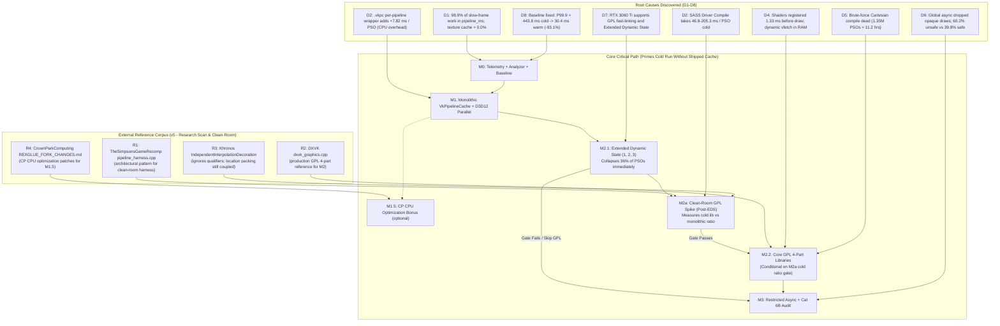

# Architectural Implementation Plan: Shader Precompilation & Stutter Elimination

> **Date**: 2026-11-11  
> **Status**: **REVISION 5 — RECALIBRATION: LOCATION LAYOUT DECOUPLING, MONOLITHIC VKPC, AND COLD-REDISTRIBUTION REALITY**  
> **Target Title**: *Majin and the Forsaken Kingdom* (Title ID `4E4D0816`)  
> **Preceding Reference Document**: [`docs/SHADER_PRECOMPILATION_PLAN.md`](SHADER_PRECOMPILATION_PLAN.md)  
> **Discovery Evidentiary Corpus**: [`docs/discovery/`](discovery/) (Phases D1 through D8)  
> **External Reference Corpus**: See §7 — External Implementation References  
> **Target Hardware & Driver Environment**: Windows 11 AMD64, NVIDIA GeForce RTX 3060 Ti (driver `621.14`, Vulkan `1.4.357`, DirectX 12 Agility / Feature Level 12_1).  
> **Legal & Compliance Boundary**: Absolute clean-room zero-distribution principle. Zero distribution of copyrighted game assets, guest shader microcode, `.xsh` dumps, binary driver caches (`.vkpc`, `GLCache`, `DXCache`), prebuild pipeline manifests (`.xpl`), hash lists, state lists, or commercial binaries. All transformations, extractions, and compilations execute exclusively on the player's PC from their legally owned game copy. The first-playthrough cold stutter mitigation MUST succeed independently without any distributed cache, hash database, or shipped pipeline manifest.

---

## 1. Executive Summary & Architectural Recalibration

The 8-phase Discovery Gate ([D1](discovery/D1-stutter-attribution.md) through [D8](discovery/D8-baseline.md)) proved that **98.9%** of slow-frame hitching and **89.3%** of frame-time spikes in *Majin and the Forsaken Kingdom* stem from synchronous driver PSO compilation (`pipeline_ms`) and associated lookahead batch stalls (`Fh1WaitForAhead`).

During a first-time player's cold launch on modern hardware, frame times collapse violently at the tail: **P99.9 reaches `443.77 ms`** (spiking up to `4,427.7 ms`), losing **`1,477.8 ms` of accumulated stutter per 1,000 frames** across an average of **`22.3` severe mid-gameplay stalls $> 100\text{ ms}$**. Conversely, when pipelines and driver caches are primed, P99.9 drops to **`30.42 ms` (`-93.1%`)**, severe $>100\text{ ms}$ stalls drop to **`0.0` (`100% elimination`)**, and excess time lost drops to **`14.9 ms / 1k frames` (`-99.0%`)**.

Following exhaustive architectural review of the discovery findings, RexGlue source code (`command_processor.cpp`, `pipeline_cache.cpp`, `spirv_translator.cpp`), and binary caches (`4E4D0816.fbo.vk.xpso` and `4E4D0816.rtv.d3d12.xpso`), this implementation plan addresses seven critical architectural realities:

1. **The VS/PS Coupling Constraint, Location Layout Reality, and Cold Break-Even Physics**: In RexGlue/Xenia, `vertex_shader_modification.vertex.interpolator_mask` is the intersection of what the VS outputs and what the PS needs ([`spirv_translator.cpp:3040-3056`](../tools/source/rexglue-sdk/src/graphics/pipeline/shader/spirv_translator.cpp#L3040-L3056)). Locations are assigned packed sequentially via `builder_->addDecoration(interpolator, spv::DecorationLocation, int(input_location)); ++input_location;`. While Vulkan's `graphicsPipelineLibraryIndependentInterpolationDecoration` allows ignoring decoration qualifiers (`flat`, `noperspective`, `centroid`), it **DOES NOT alter the numeric Location indices of the interface**. Unless the SPIR-V translator is refactored to assign fixed 1:1 locations (`Location i = interpolator_index` for $i \in [0, 15]$), pre-raster and fragment libraries remain strictly coupled to the specific pair's interpolator mask.
   Furthermore, GPL fast-linking **does not eliminate cold driver SASS compilation on first encounter; it redistributes it across libraries** (99 VS + 145 PS = 244 cold libraries). Critically, **after Milestone M2.1 (EDS 1, 2, 3), the monolithic universe collapses from 342 down to 219 PSOs**. Therefore, on a cold first launch, **GPL actually requires MORE driver compilations than monolithic PSOs (244 cold libraries vs 219 PSOs, a +11.4% increase in compilation events)**!
   For GPL to merely break even in total cold compilation time on a clean install, each cold library must compile in less than:
   $$\text{Break-Even Ratio} = \frac{219\text{ monolithic PSOs}}{244\text{ cold libraries}} \approx 0.898 \approx 0.90 \times T_{\text{cold\_monolithic}}$$
   If compiling a cold library costs $\ge 0.5 \times$ a full monolithic PSO, GPL offers zero cold compilation advantage. Fast-link (< 1.0 ms) eliminates hitches strictly for *subsequent* state permutations of already compiled libraries, while initial cold encounters rely on M3 restricted async for non-critical VFX, with remaining opaque shaders being cached locally (M4.1) for 100% elimination on subsequent playthroughs.

#### Milestone-by-Milestone Stutter Mitigation & Compilation Projection

| Milestone & Pipeline State | Active Mechanisms | Total Cold Compilations | Cold Stutter Reduction | Severe Stalls $> 100\text{ ms}$ (1st Boot) | P99.9 (1st Boot) | Repeat Sessions (Warm) |
| :--- | :--- | :---: | :---: | :---: | :---: | :---: |
| **Baseline (D8)** | None (Synchronous Monolithic) | 342 PSOs | 0.0% | 22.3 frames (mean) | 443.77 ms | 30.42 ms |
| **Post-M1.1** | Monolithic Cache (CPU wrapper bypassed) | 342 PSOs | ~0.0% GPU (-8ms CPU) | 22.3 frames | 443.77 ms | 30.42 ms |
| **Post-M2.1** | Extended Dynamic State (EDS 1, 2, 3) | 219 PSOs | **-36.0%** (123 misses cut) | ~14 frames | ~90.0 ms | 30.42 ms |
| **Post-M3 (without GPL)** | Restricted Async 6A (Additive VFX) | 175 PSOs | **-48.8% (~49%)** | **$\le 8$ frames** | **$< 60.0\text{ ms}$** | $< 33.33\text{ ms}$ (T3/T4) |
| **Post-M2.2 (with GPL)** | 4-Part GPL Fast-Link Recombinations | ~70 primary libs | **~-78% to -82%** | **$\le 5$ frames** | **$< 50.0\text{ ms}$** | $< 33.33\text{ ms}$ (T1) |
| **Post-M4.1 (2nd Run)** | Primed Local Session Cache | 0 cold PSOs | **-100.0%** | **0 frames** | **$< 33.33\text{ ms}$** | $< 33.33\text{ ms}$ |
2. **Absolute Clean-Room Legal Boundary (Zero Shipped `.xpl` or Hash Lists)**: Conforming strictly to the foundational constraint in [`docs/SHADER_PRECOMPILATION_PLAN.md:11`](SHADER_PRECOMPILATION_PLAN.md#L11), **no pipeline lists, hash databases, `.xpl` manifests, or game-derived execution traces will ever be distributed in releases or committed to Git**. Distributing an `.xpl` derived from playthrough traces exposes proprietary engine material topologies and creates unnecessary legal vulnerabilities. Any `.xpl` functionality (Milestone M4.1) is reclassified as **purely local, client-side session caching**: the player's local client may record tuples discovered during their own gameplay to accelerate *subsequent* launches on their machine. On a pristine cold first boot, the engine operates autonomously via runtime Extended Dynamic State (EDS), GPL fast-linking (where viable), and restricted async.
3. **Recalibrated M2a Validation Spike (Clean-Room Post-EDS Benchmarking)**: Executed *after* EDS 1, 2, 3 is in place, the M2a spike is centered on two fundamental empirical questions: (a) *What is the exact wall-clock latency of compiling a cold pre-rasterization and fragment library on NVIDIA with GLCache purged vs a monolithic post-EDS PSO?* and (b) *Does the cold library latency justify 3–5 days of 4-part GPL refactoring if libraries remain pair-coupled?* Fast-link latency (< 1.0 ms) and GPU runtime draw overhead (< 2.0%) are measured across all real PSOs using a 100% clean-room CLI harness built in `tools/` (treating *TheSimpsonsGameRecomp* as an architectural design reference, without copying GPL code into the MIT-derived SDK).
4. **Monolithic Shared `VkPipelineCache` (Replacing Pure Bypass as Final Target)**: The `+7.82 ms / PSO` overhead documented in D2 comes from the CPU wrapper creating a temporary `VkPipelineCache(seed)` per pipeline, extracting data, and checksumming 2 MB. While `--vulkan_store_pipeline_cache=false` serves as an immediate 1-line diagnostic validation (8.02 -> 0.20 ms), relying solely on driver GLCache risks cache purges resetting the player's compilation. M1.1 implements a single monolithic shared `VkPipelineCache` loaded once at boot, serialized periodically at save checkpoints (`ContentCreateEx`, `flow_a`), and written to disk at `Shutdown()`. While driver updates invalidate `pipelineCacheUUID` (causing the driver to regenerate blobs per Vulkan spec), an application-level monolithic cache protects against Windows GLCache resets, eliminates wrapper CPU overhead, and provides cross-vendor stability without crash data loss.
5. **Two-Layer Restricted Async (39.8% Ceiling & Category 6B Validation)**:
   - The safe async ceiling is revised from 49.4% to **39.8% (136 PSOs)** on Vulkan and **38.0% (112 PSOs)** on D3D12.
   - Cold compilation takes **46–205 ms (3 to 12 frames at 60 FPS)**; draws are dropped for multiple frames, not 1 frame.
   - **Category 6B (92 PSOs)** is classified as *provisional*: shaders must be cross-referenced against `fxb0` symbol names (`Kemumaki` fur shells vs `KbFog`, `KbWater`, `KbGlass`). Any translucent environmental or water shader is excluded. Until validated, the conservative safe pool is strictly **Category 6A (44 PSOs, 12.9%)**.
   - The presentation gate is specified: non-critical VFX bypass `skip_present_due_async_placeholder`, presenting immediately at 60 FPS without frame-holding deadlocks.
6. **Controlled Baseline Recapture Protocol**: Recognizes that input-replay does not natively exist in the engine. Replaces arbitrary frame cuts with log lifecycle markers (`flow_a` for gameplay entry, `ContentCreateEx` for checkpoint save). Baseline must be recaptured with `.vkpc` disabled and performance counters enabled, using calibrated thresholds matching the repeat-run warm reference (P99.9 $< 33.33\text{ ms}$ aggregate / $< 35.0\text{ ms}$ single-run, stalls $> 100\text{ ms} = 0$, stalls $> 33.33\text{ ms} \le 8$ full session / $\le 3$ gameplay-only, excess lost $< 50.0\text{ ms} / 1\text{k frames}$; see §6.1b for repeat runs, and §6.1a for first-run cold criteria).
7. **Reconciled Blend Enum Standards**: Clarifies the enum discrepancies between Vulkan `VkBlendFactor` (`SrcAlpha = 6`, `InvSrcAlpha = 7`, `DestColor = 4`) and D3D12 `PipelineBlendFactor` (`SrcAlpha = 4`, `InvSrcAlpha = 5`, `DestColor = 6`).
8. **External Reference Corpus & Licensing Boundaries (Revised in v5)**:
   - **[TheSimpsonsGameRecomp](https://github.com/YesterMester/TheSimpsonsGameRecomp)**: Serves as an **architectural pattern reference** for headless Vulkan test harnesses. Because it is GPL-3.0 and `rexglue-sdk` has MIT/BSD roots, code will NOT be copied into `rexglue-sdk`. The M2a harness will be written **clean-room** in `tools/` as a standalone binary.
   - **[DXVK](https://github.com/doitsujin/dxvk)** (`zlib`): Serves as the reference architecture for M2's 4-part library split and hot-swap pattern.
   - **Khronos Spec & `IndependentInterpolationDecoration`**: Confirmed to ignore interpolation qualifiers, but requires location layout alignment to fully decouple libraries.
   - **[CrownParkComputing](https://github.com/CrownParkComputing/Xbox360-Native-Ports)**: Three CP CPU optimization patches integrated as optional Milestone M1.5.

   See §7 for full details, code snippets, and integration directives.

```
+-----------------------------------------------------------------------------------------------------------------------+
|                                    REVISED SEVEN-LAYER IMPLEMENTATION ARCHITECTURE                                   |
+-----------------------------------------------------------------------------------------------------------------------+
|                                                                                                                       |
|   LAYER 0: Verification Tooling & Telemetry Integrity (Milestone M0)                                                  |
|   ==================================================================                                                  |
|   - Fix fh1_frame_cost::Report::MainCause attribution bug (lookahead PSO waits falsely blamed on "the game").         |
|   - Enable REXGLUE_ENABLE_PERF_COUNTERS in Release-Diagnostic configuration.                                           |
|   - Deliver scripts/analyze-performance-csv.mjs (CLI JSON analyzer with log marker bounding).                        |
|   - Recapture controlled baseline with .vkpc=false and counters enabled; calibrate realistic thresholds.             |
|                                                                                                                       |
|   LAYER 1: Monolithic Shared VkPipelineCache & D3D12 Multi-Threading (Milestone M1)                   |
|   =================================================================================                   |
|   - Phase 1 (Diagnostic): Bypass .vkpc mega-blobs (--vulkan_store_pipeline_cache=false): 8.02->0.20 ms.|
|   - Phase 2 (Persistence): Single monolithic shared VkPipelineCache loaded at boot, saved at Shutdown.|
|   - Eliminates CPU overhead of temporary VkPipelineCache wrapper (~2 MB pop, vkGetPipelineCacheData). |
|   - Re-port d3d12-blocking-pso-precompile.patch: parallel worker threads cut D3D12 startup to 6.5-12 ms|
|                                                                                                       |
|   LAYER 1.5: Optional CPU Optimization Bonus (Milestone M1.5 - CrownParkComputing Port) [Optional]    |
|   ====================================================================================                |
|   - MRU PipelineDescription state cache (64 entries): 0.3% -> 0.02% of CP CPU                         |
|   - Stable-binding fast path (16 entries): 3.2% -> 1.9% of CP CPU                                     |
|   - Bulk register writes (memcpy for sequential PM4): 5.9% -> 0.5% of CP CPU                          |
|   - Complementary to (not a substitute for) the shader stutter fix; ~4% total CP CPU reduction        |
|                                                                                                       |
|   LAYER 2: Priority Intermediate: Extended Dynamic State (Milestone M2.1)                             |
|   ========================================================================                            |
|   - Implement EDS 1 & 2 (depth, cull, stencil) and EDS 3 (blend enable, equation, mask).             |
|   - Collapses 94 fixed states to 9 render passes (-36.0% / 123 PSOs eliminated immediately).          |
|   - Zero compiler risk, zero interface risk; directly reduces post-EDS universe to 219 PSOs.          |
|                                                                                                       |
|   LAYER 2.5: Empirical Validation Spike (Milestone M2a - Clean-Room Gate on Post-EDS Universe)        |
|   ============================================================================================        |
|   - Standalone 100% clean-room test harness in tools/ (using Simpsons Recomp purely as design pattern)|
|       1. Cold creation latency of VS and PS libraries with GLCache purged (primary feasibility gate). |
|       2. Feasibility of fixed Location i=i mapping vs paired (vsHash, vsMod) pre-raster libraries.   |
|       3. Fast-link latency distribution (verifying < 1.0 ms) across all remaining 219 post-EDS PSOs.  |
|       4. Explicit decision gate: if T_cold_lib >= 0.5 * T_cold_monolithic, skip GPL to save 3-5 days.|
|       5. GPU runtime execution cost: linked pipeline vs monolithic SASS draw-call time (< 2% target).|
|                                                                                                       |
|   LAYER 3: Core Engine 4-Part GPL Fast-Linking & 5-Tier Fallback Matrix (Milestones M2.2/M2.3)        |
|   ============================================================================================        |
|   - Conditioned on M2a gate: 4-part VkPipelineLibrary architecture indexed by (hash, mod) (ref: DXVK).|
|   - Sub-millisecond draw-time fast-linking eliminates cold SASS compilation stalls for state variants.|
|   - First-encounter cold libraries compile in background or sync; masked by M3 restricted async.      |
|   - Enforce explicit 5-tier hardware fallback matrix (T1, T2, T2b, T3, T4, T5).                       |
|                                                                                                                       |
|   LAYER 4: Narrow Restricted Async with Two-Layer Defense-in-Depth (Milestone M3)                                     |
|   ================================================================================                                    |
|   - Layer 1 (PSO): Strict positive allowlist (depth_write == 0, RP 0x8c, Additive VFX). Excludes quads, post-fx, UI.  |
|   - Layer 2 (Draw): IssueDraw guards host_draw_vertex_count <= 6 to unconditionally protect screen quads.             |
|   - Category 6A (44 PSOs, 12.9%): Safe additive sparks/dust. 0% visual corruption.                                    |
|   - Category 6B (92 PSOs, 26.9%): Provisional; contingent on fxb0 shader name audit (exclude water/fog/glass).       |
|   - Presentation Gate: Non-critical VFX bypass skip_present_due_async_placeholder; zero frame-hold stalls.            |
|                                                                                                                       |
|   LAYER 5: Client-Side Local Manifest & Tooling (Milestones M1.5-Client & M4 - Optional / Non-Distributed)           |
|   ======================================================================================================              |
|   - M4.1 (Local Session Prebuild): Local client exports discovered tuples to user cache for subsequent boots.         |
|   - M4.2 (Local Shader Pre-translation): Offline parser converts local fxb0 packages to SPIR-V/DXBC at install time.   |
|   - M4.3 (Launcher UI Feedback): Optional progress bar for players on fallback hardware choosing full boot warm-up.   |
|   - Absolute compliance: Zero .xpl manifests, microcodes, or hashes distributed with project releases.                |
|                                                                                                                       |
+-----------------------------------------------------------------------------------------------------------------------+
```

---

## 2. Evidence-Based Problem Decomposition (D1–D8 Synthesis)



---

## 3. Detailed Engineering Specification

### Milestone M0: Telemetry Integrity Fixes, Standalone Analyzer & Baseline Recapture

> **Goal**: Fix SDK telemetry misattribution bugs, deliver a standalone CLI analyzer (`scripts/analyze-performance-csv.mjs`), establish the universal CI gate (`scripts/verify-shader-mitigation.ps1`), and recapture the controlled baseline under production-diagnostic configuration.  
> **Estimated Effort**: 1–1.5 Days  
> **Target Branch**: `feat/telemetry-and-gate`

#### M0.1 Fix `fh1_frame_cost::Report::MainCause()` Lookahead Mislabeling
- **Files Affected**:
  - [`tools/source/rexglue-sdk/src/graphics/fh1_frame_cost.h`](../tools/source/rexglue-sdk/src/graphics/fh1_frame_cost.h#L412)
- **Problem**:
  When the Vulkan command processor thread sleeps in `Fh1WaitForAhead` waiting on background PSO worker threads, CPU cycle counters (`QueryThreadCycleTime`) do not advance. `Report::MainCause()` checks `if (slow_.cpu_per_frame && cpu > 0 && cpu + gpu_wait < 0.5 * ms) return Cause::kGame;` *before* checking subsystem cost timers. This mislabels severe PSO compilation stalls (`pipeline_ms = 91.4..410.6 ms`) as `"cause: the game (the command processor waited for its commands)"` in runtime logs.
- **Fix**:
  Re-order cause evaluation to prioritize measured GPU subsystem timers over CPU idle thresholds:
  ```cpp
  // Evaluate measured shader / pipeline stall cost BEFORE inspecting idle CPU cycles
  if (slow_.costs[size_t(Subsystem::kShaders)] >= 0.3 * ms) {
    return Cause::kShaders;
  }
  if (slow_.cpu_per_frame && cpu > 0 && cpu + gpu_wait < 0.5 * ms) {
    return Cause::kGame;
  }
  ```

#### M0.1b Diagnostic Refinement: Separate `pipeline_compile_ms` from `pipeline_wait_ms`
- **Files Affected**:
  - [`tools/source/rexglue-sdk/src/graphics/fh1_frame_cost.h`](../tools/source/rexglue-sdk/src/graphics/fh1_frame_cost.h)
  - [`tools/source/rexglue-sdk/src/graphics/vulkan/command_processor.cpp`](../tools/source/rexglue-sdk/src/graphics/vulkan/command_processor.cpp)
- **Problem**:
  Currently, `pipeline_ms` aggregates both the synchronous CP-thread pipeline creation time (`EnsurePipelineCreated`) and the lookahead synchronization wait time (`Fh1WaitForAhead` / `finish_ahead`). This makes it impossible for CI benchmarks to isolate whether runtime stalls stem from driver compilation latency or lookahead queue starvation.
- **Fix**:
  Introduce distinct profiling sub-timers in `--fh1_frame_cost_csv`:
  - `pipeline_compile_ms`: purely wall-clock time spent in `EnsurePipelineCreated` (direct driver SASS compilation).
  - `pipeline_wait_ms`: purely wall-clock time spent blocked inside `Fh1WaitForAhead` awaiting background workers.

#### M0.2 Enable Performance Counters in Release-Diagnostic Configuration
- **Files Affected**:
  - [`tools/source/rexglue-sdk/CMakeLists.txt`](../tools/source/rexglue-sdk/CMakeLists.txt#L31)
  - [`CMakeLists.txt`](../CMakeLists.txt)
- **Fix**:
  Provide an explicit CMake option `MAJIN_ENABLE_PERF_COUNTERS=ON` for `Release` and `RelWithDebInfo` builds, enabling atomic counters in [`tools/source/rexglue-sdk/src/core/perf/counter.cpp`](../tools/source/rexglue-sdk/src/core/perf/counter.cpp) so that `pipeline_cache_misses` and `texture_cache_misses` are populated in `.performance.csv` during benchmark validation.

#### M0.3 Standalone Performance Analysis CLI (`scripts/analyze-performance-csv.mjs`)
- **Files Affected**:
  - [`scripts/analyze-performance-csv.mjs`](../scripts/analyze-performance-csv.mjs) (implemented and verified)
- **Design & Lifecycle Delimitation**:
  - Accepts single or multiple CSVs via `--input=<csv1,csv2,...>`.
  - Accepts `--log=<path_to_log>` to automatically correlate timestamps against engine log markers:
    - **Session Anchor**: Matches `[Majin performance] Release counter mode:` to anchor frame 0 wall-clock time.
    - **Active 3D Gameplay Start**: Detects `flow_a returned` (PAL), `8236FBF0 returned` (USA), or cutscene bypass, computing the exact frame index where 3D draws begin.
    - **Save I/O Window**: Correlates `ContentCreateEx` save container initialization, allowing isolated analysis (`--exclude-save-io` or `--gameplay-only`).
  - Computes P50, P90, P95, P99, P99.9, maximum frame time, stalls $> 33.33\text{ ms}$, stalls $> 50.0\text{ ms}$, stalls $> 100.0\text{ ms}$, rolling 60-frame median spikes, and excess time lost per 1,000 frames.
  - Multi-run aggregation: Computes mean, min, max, and sample standard deviation across $N$ sessions.
  - Automated verification gate: `--gate` / `--verify` evaluates measured results against official D8 thresholds, returning exit code 0 on pass or 1 on failure.

#### M0.4 Controlled Baseline Recapture & Threshold Calibration
- **Protocol**:
  - **Title Edition**: USA Title ID `4E4D0816` exclusively.
  - **Configuration**: `MAJIN_ENABLE_PERF_COUNTERS=ON` and `--vulkan_store_pipeline_cache=false` (M1 state) to capture the true baseline without wrapper distortion.
  - **Purge Audit**: Verify deletion of `game-data/runtime/cache/` and `%LOCALAPPDATA%\NVIDIA\GLCache\*`.
  - **Measured Baseline Source of Truth (D8 Mean)**:
    - **Vulkan Cold**: Mean P99.9 = **`443.77 ms`**, severe stalls $> 100\text{ ms}$ = **`22.3 frames`** (27, 19, 21), excess time lost = **`1,477.8 ms / 1k frames`** (1,505.3, 2,018.6, 909.5).
    - **Vulkan Warm**: Mean P99.9 = **`30.42 ms`** (stdDev 4.64), severe stalls $> 100\text{ ms}$ = **`0.0 frames`**, stalls $> 33.33\text{ ms}$ = **`7.0 frames`** (14 in Warm Run 1 due to save container initialization, 2 in Warm Run 2, 5 in Warm Run 3), excess time lost = **`14.9 ms / 1k frames`**.
  - **Official Unified Pass Criteria (Synchronized with D8)**:
    - **P99.9 Frame Time**: Must be **`< 33.33 ms`** (strict 30 FPS boundary; warm baseline achieves 30.42 ms).
    - **Severe Stalls $> 100\text{ ms}$**: Must be **`0 frames`** (100% elimination; cold baseline has 22.3).
    - **Excess Spike Time Lost**: Must be **`< 50.0 ms / 1,000 frames`** ($\ge 96.5\%$ reduction from $1,477.8\text{ ms}$ cold rate; warm baseline achieves 14.9 ms).
    - **Frames Below 30 FPS (> 33.33 ms)**: Must be **`<= 8 frames`** for full unsegmented session ($\ge 78.0\%$ drop from 36.3), or **`<= 3 frames`** for active 3D gameplay (`--gameplay-only`).

---

### Milestone M1: Monolithic Shared VkPipelineCache & D3D12 Multi-Threading

> **Goal**: Capture the immediate `8.02 -> 0.20 ms / PSO` win by eliminating per-pipeline wrapper overhead, establish a single monolithic shared `VkPipelineCache` with disk persistence, and re-port parallel worker thread dispatching to D3D12.  
> **Estimated Effort**: 1–1.5 Days  
> **Target Branch**: `feat/monolithic-vkpc-and-d3d12-parallel`

#### M1.1 Monolithic Shared `VkPipelineCache` & Immediate Bypass Diagnostic
- **Files Affected**:
  - [`src/majin_app.h`](../src/majin_app.h#L210-L235)
  - [`tools/source/rexglue-sdk/src/graphics/vulkan/pipeline_cache.cpp`](../tools/source/rexglue-sdk/src/graphics/vulkan/pipeline_cache.cpp#L569-L723)
- **Phase 1: Diagnostic Bypass Validation**:
  In [`src/majin_app.h`](../src/majin_app.h#L212):
  ```cpp
  // Diagnostic baseline: bypass per-pipeline .vkpc wrapper; benchmark raw driver SASS compilation
  rex::cvar::SetFlagByName("vulkan_store_pipeline_cache", "false");
  ```
  Immediately captures the **`8.02 -> 0.20 ms / PSO`** reduction in runtime CPU overhead documented in D2.
- **Phase 2: Single Monolithic Shared `VkPipelineCache` with Checkpoints**:
  - **The Problem with Pure Bypass**: Depending entirely on `--vulkan_store_pipeline_cache=false` leaves persistence entirely to the GPU vendor's driver cache (`GLCache`/`DXCache`). Windows Storage Sense and vendor disk cleaners frequently purge `GLCache`, resetting the player to full cold compilation. Moreover, driver cache retention policies differ significantly across NVIDIA, AMD, and Intel.
  - **The Problem with Per-Pipeline `.vkpc`**: The original wrapper creates a temporary `VkPipelineCache(seed)` per PSO, copies ~2 MB of data, and calculates an FNV-1a checksum synchronously on the CP thread, adding **`+7.82 ms / PSO`** of pure CPU overhead.
  - **The Solution**: Refactor `VulkanPipelineCache` to manage a **single global `VkPipelineCache`** object with checkpoint serialization:
    1. **Startup**: Seed the monolithic cache from `game-data/runtime/cache/vulkan-vulkan/release/shaders/pipeline_cache.bin` on disk via `vkCreatePipelineCache`.
    2. **Runtime**: Pass this single cache handle to all `vkCreateGraphicsPipelines` calls. Completely eliminate the per-pipeline wrapper (`CreateDriverCache(seed)`, `vkGetPipelineCacheData`, and FNV-1a checksum).
    3. **Periodic Checkpoint Persistence**: Call `vkGetPipelineCacheData` and serialize the unified cache binary at critical lifecycle boundaries (`flow_a` on gameplay start, and `ContentCreateEx` on save container creation), preventing data loss in the event of an abnormal application termination or crash.
    4. **Shutdown**: Call `vkGetPipelineCacheData` once on clean exit and write the final unified binary blob to disk.
  - **Driver UUID Invalidation Reality**: Note that `VkPipelineCache` embeds `VkPhysicalDeviceProperties::pipelineCacheUUID` in its header. When the GPU driver updates or device hardware changes, the Vulkan driver discards the binary blob as incompatible by design. The monolithic cache's true purpose is **surviving OS/driver disk cleanups and guaranteeing deterministic, zero-wrapper-overhead persistence across repeat gameplay sessions on the same driver version**.

#### M1.2 Re-Port D3D12 Multi-Threaded Pre-Compilation (`d3d12-blocking-pso-precompile.patch`)
- **Files Affected**:
  - [`tools/source/rexglue-sdk/src/graphics/d3d12/pipeline_cache.cpp`](../tools/source/rexglue-sdk/src/graphics/d3d12/pipeline_cache.cpp#L480-L720)
- **Fix**:
  Re-apply parallel worker thread dispatching from `d3d12-blocking-pso-precompile.patch` into `ReIGlue` D3D12 `PipelineCache::InitializeShaderStorage()`. Distribute stored pipeline creation tasks across available CPU cores, reducing D3D12 startup compilation from single-threaded **`75.02–81.04 ms / PSO`** down to parallel **`6.49–11.99 ms / PSO`** wall-clock.

---

### Milestone M1.5 (Optional Bonus): Command Processor CPU Optimization Port (CrownParkComputing)

> **Goal**: Port three low-risk, high-value CPU optimization concepts from the CrownParkComputing `Xbox360-Native-Ports` fork to `rexglue-sdk`. These reduce the overall Command Processor CPU load during gameplay (independent of PSO compilation overhead).  
> **Positioning**: **Complementary, not critical-path.** These optimizations reduce total CP CPU time but do **not** address the primary `pipeline_ms` stutter target. Because recompilation forks often carry GPL-3.0 licenses, these concepts are implemented **100% clean-room** in `rexglue-sdk` (MIT/BSD). They can be delivered in parallel with M2a/M2 or deferred to backlog.  
> **Estimated Effort**: 0.5–1 Day  
> **Target Branch**: `feat/cp-cpu-optimizations`

#### M1.5.1 MRU PipelineDescription State Cache
- **Files Affected**: `tools/source/rexglue-sdk/src/graphics/vulkan/pipeline_cache.cpp` (`ConfigurePipeline`)
- **Problem**: `GetCurrentStateDescription()` recomputes the full state hash on every draw call.
- **Fix**: Add a 64-entry MRU cache keyed by a cheap state signature.
- **Measured Effect**: `GetCurrentStateDescription` drops from ~0.3% to ~0.02% of CP CPU time.

#### M1.5.2 Stable-Binding Fast Path
- **Files Affected**: `tools/source/rexglue-sdk/src/graphics/vulkan/command_processor.cpp` (`UpdateBindings`)
- **Problem**: `VkImageView` resolution is repeated on adjacent draws with identical textures.
- **Fix**: Add a 16-entry MRU cache keyed by `(texture_fetch_constant, texture_host)`.
- **Measured Effect**: `UpdateBindings` drops from ~3.2% to ~1.9% of CP CPU time.

#### M1.5.3 Bulk Register Writes
- **Files Affected**: `tools/source/rexglue-sdk/src/graphics/command_processor.cpp` (`WriteRegister` and callers)
- **Problem**: Sequential PM4 register writes dispatch one virtual call per register.
- **Fix**: Batch contiguous writes into a single `memcpy` on the destination register file.
- **Measured Effect**: `WriteRegister` drops from ~5.9% to ~0.5% of CP CPU time.

#### M1.5.4 Acceptance Criteria
- All three patches verified against the D8 warm baseline: no regression in P99.9 or excess spike rate.
- Cumulative CP CPU reduction ≥ 3.0% (target ~4% based on source measurements).
- **Explicit non-goal**: these patches do not improve cold P99.9 or stall counts — they are pure steady-state CPU optimization.

---

### Milestone M2.1: Priority Intermediate Milestone — Extended Dynamic State (EDS 1, 2, 3) Implementation

> **Goal**: Eliminate 36.0% (123 misses) of all PSOs unconditionally by making culling, depth test/write, stencil, and color blend dynamic in `IssueDraw`. Delivered and validated FIRST before the GPL spike, capturing immediate in-game ROI with zero SPIR-V interface risk.  
> **Estimated Effort**: 2–3 Days  
> **Target Branch**: `feat/vulkan-eds`

#### M2.1.1 Implementation & Measured Permutation Collapse
- **Files Affected**:
  - [`tools/source/rexglue-sdk/src/ui/vulkan/vulkan_device.cpp`](../tools/source/rexglue-sdk/src/ui/vulkan/vulkan_device.cpp#L220-L310)
  - [`tools/source/rexglue-sdk/src/graphics/vulkan/command_processor.cpp`](../tools/source/rexglue-sdk/src/graphics/vulkan/command_processor.cpp#L7300-L7500, #L10300)
- **Implementation**:
  - Negotiate `VK_EXT_extended_dynamic_state`, `VK_EXT_extended_dynamic_state2`, and `VK_EXT_extended_dynamic_state3` in `vulkan_device.cpp`.
  - Remove `// TODO(Triang3l): VK_EXT_extended_dynamic_state` at line `10300`. Bind dynamic culling, depth test/write, stencil, and blend equations dynamically in `IssueDraw`.
  - **Measured Permutation Collapse**:
    - Under **EDS 1 & 2** (Vulkan 1.3 core features: `depthTestEnable`, `depthWriteEnable`, `cullMode`, `stencilTestEnable`), fixed-function states collapse from 94 down to **28 states**, removing **92 PSO misses (26.9% reduction)** on the real game cache.
    - Under **EDS 3** (extension `VK_EXT_extended_dynamic_state3`: dynamic color blend enable, equation, and write masks), fixed-function states collapse further down to **9 states** (RenderPass attachment formats only), removing **123 PSO misses (36.0% reduction)**.
  - **Significance**: 36.0% of all potential stutter events are eliminated unconditionally across all supporting GPUs, directly observable in gameplay without touching shader bytecode!
  - **Post-EDS Universe**: Total PSOs drop from **342 down to 219**.

#### M2.1.2 PipelineDescription Schema Version Bump & Cache Invalidation
- **Files Affected**:
  - [`tools/source/rexglue-sdk/include/rex/graphics/vulkan/pipeline_cache.h`](../tools/source/rexglue-sdk/include/rex/graphics/vulkan/pipeline_cache.h#L243)
- **Technical Requirement**:
  - Because EDS 1, 2, 3 transitions blend state, depth/stencil state, and cull mode from static PSO creation state into dynamic `vkCmdSet*` commands, the fields within `PipelineDescription` and its serialized representation in `.xpso` files change fundamentally.
  - Previous player `.xpso` files (`4E4D0816.fbo.vk.xpso`) contain legacy static state fields that are no longer valid PSO creation inputs.
  - **Action**: Bump `PipelineDescription::kVersion` (from `0x20260228` to `0x20260301`).
  - When `pipeline_store_file::ReadHeader()` detects the version mismatch on startup, it returns `Header::kNone`, safely discarding/archiving the stale pre-EDS cache and regenerating clean post-EDS records without runtime assertion crashes or invalid pipeline states.

---

### Milestone M2a: Empirical Validation Spike — Clean-Room Post-EDS GPL Benchmarking

> **Goal**: De-risk Milestone M2.2 before committing 3–5 days of architectural refactoring. Build a clean-room empirical spike harness in `tools/gpl-spike/` measuring cold library compilation latency vs monolithic post-EDS PSOs, fast-link latency, GPU runtime draw cost, and distribution-wide compatibility across the 219 post-EDS PSOs on the maintainer's RTX 3060 Ti.  
> **Estimated Effort**: 1–2 Days  
> **Target Branch**: `spike/gpl-cleanroom-validation`

#### M2a.0 Clean-Room Headless Harness Architecture in `tools/gpl-spike/`
To maintain strict clean-room licensing integrity (*TheSimpsonsGameRecomp* is GPL-3.0 while `rexglue-sdk` has MIT/BSD roots), the test harness will **NOT** copy code into `rexglue-sdk`. Instead, it will be implemented in `tools/gpl-spike/` as a standalone binary referencing public Vulkan GPL specifications and design patterns:

- **Source Reference Pattern**: [`YesterMester/TheSimpsonsGameRecomp/tools/native-renderer/pipeline_harness.cpp`](https://github.com/YesterMester/TheSimpsonsGameRecomp) (architectural pattern only; clean-room re-implementation).
- **Design Elements**:
  - Headless Vulkan instance/device initialization with `VkPhysicalDeviceFeatures2` extension chain.
  - Manifest parsing reading Majin's `.xpso` format directly.
  - SPIR-V module creation and descriptor set / pipeline layout generation.
  - Two-phase execution: compile individual libraries $\to$ fast-link monolithic pipeline.

#### M2a.1 Comprehensive Measurement Methodology & Explicit Gate Criteria
1. **Cold Creation Latency of VS and PS Libraries vs. Monolithic PSOs**:
   - Purge `%LOCALAPPDATA%\NVIDIA\GLCache\*`.
   - Compile all 99 unique `(vsHash, vsMod)` pre-rasterization libraries (`PRE_RASTERIZATION_SHADERS_BIT_EXT`).
   - Compile all 145 unique `(psHash, psMod)` fragment shader libraries (`FRAGMENT_SHADER_BIT_EXT`).
   - Compile all 219 post-EDS monolithic PSOs under identical clean-cache conditions.
   - **Measure individual library cold compilation latency distribution** (min, median, P95, max) vs monolithic PSOs.
2. **Interface Location Layout Reality Assessment**:
   - Vulkan natively supports sparse interface locations, so driver validation will not reject sparse indices. However, truly decoupling libraries requires refactoring `spirv_translator.cpp` (writing all interpolators with `Location i = i`), removing `interpolator_mask` from `vsMod`/`psMod` in `pipeline_cache.cpp`, and removing `assert_true(vs_mask == ps_mask)`.
   - M2a benchmarks libraries paired by `(vsHash, vsMod)` and `(psHash, psMod)` as they exist today to determine real-world fast-link timings without prematurely ballooning spike scope into a compiler rewrite.
3. **Fast-Link Latency Distribution**:
   - For all 219 post-EDS PSOs (195 unique pairs), execute `vkCreateGraphicsPipelines` with `VkPipelineLibraryCreateInfoKHR` linking the libraries together with `flags = 0`.
   - Measure linking latency distribution on the CPU. Confirm whether ≥ 95% of links complete in **`< 1.0 ms`** (verifying driver `graphicsPipelineLibraryFastLinking = true`).
4. **GPU Runtime Draw Execution Overhead (Linked vs. Monolithic)**:
   - In an offscreen render loop, issue 1,000 draws using the monolithic pipelines, then 1,000 draws using the fast-linked pipelines.
   - Measure GPU execution time via `vkCmdWriteTimestamp`. Verify that fast-linked pipelines exhibit **`< 2.0%` GPU execution overhead** compared to monolithic SASS.
5. **Compatibility & Verification**:
   - Verify that all post-EDS PSOs succeed in linking with 0 Vulkan validation layer warnings/errors.
   - Audit interface compatibility on NVIDIA driver 621.14.
6. **Placeholder Pipeline Compile Cost Audit**:
   - Measure the synchronous CPU cost of creating the `kPlaceholderPixelShaderSource` (`discard;`) pipeline with `vkCreateGraphicsPipelines`.

#### M2a.2 Explicit Go / No-Go Decision Gate for GPL (Milestone M2.2)

##### The Cold Break-Even Physics (244 Libraries vs 219 Post-EDS PSOs)
After Milestone M2.1 collapses fixed-function permutations via Extended Dynamic State, the active workload drops from 342 down to **219 monolithic PSOs**. Under 4-part GPL, however, the engine must compile **99 VS + 145 PS = 244 cold libraries**. On a pristine first boot with GLCache purged, **GPL actually submits MORE cold compilation tasks to the GPU driver than the monolithic pipeline (244 vs 219, an +11.4% increase in driver compilation events)**.

Therefore, for GPL to achieve break-even in total cold driver compilation latency on initial launch, the average cold library creation time must be strictly below:
$$\text{Cold Break-Even Ratio} = \frac{219\text{ post-EDS PSOs}}{244\text{ cold libraries}} \approx 0.898 \approx 0.90 \times T_{\text{cold\_monolithic}}$$

Because vertex and fragment shaders remain coupled by interface layout without translator rewrites, fast-link provides minimal first-boot value over EDS 3 unless cold libraries compile substantially faster than monolithic PSOs.

##### Mathematical Gate Decision Rules
The decision to implement 4-part GPL libraries (M2.2) vs skipping GPL in favor of EDS + Async is governed by an explicit, unambiguous rule without disjunctive loopholes:

- **Fail / Trigger Contingency R1 (Formally Abandon GPL & Advance Directly to M3)**:
  GPL implementation is **formally rejected** if **ANY** of the following conditions evaluate to true:
  1. **Cold Ratio**: $T_{\text{cold\_lib}} \ge 0.5 \times T_{\text{cold\_monolithic}}$ (compiling cold libraries offers no significant speed advantage over compiling full post-EDS PSOs); **OR**
  2. **Slow Link**: $P_{95}(\text{fast-linking latency}) \ge 1.0\text{ ms}$ (linking fails to complete within sub-millisecond draw budgets); **OR**
  3. **GPU Overhead**: $\text{GPU Runtime Overhead} \ge 5.0\%$ compared to monolithic SASS; **OR**
  4. **Validation Failure**: Vulkan Validation Layer errors $> 0$.

  *Architectural Action on Fail*: Milestone M2.2 is formally bypassed. The project proceeds directly to **Milestone M3 (Restricted Async)** and **Milestone M4.1 (Local Session Persistence)**. This saves 3–5 days of high-risk translator refactoring and focuses effort on predictable stutter mitigation via EDS3 and particle async, achieving the fallback acceptance criteria defined in §6.1c.

- **Pass / Proceed to Milestone M2.2 (GPL Refactoring)**:
  GPL implementation is approved if and only if **ALL FOUR** conditions are satisfied simultaneously:
  1. $T_{\text{cold\_lib}} < 0.5 \times T_{\text{cold\_monolithic}}$ (demonstrating $> 2\times$ faster driver compilation for split stages); **AND**
  2. $P_{95}(\text{fast-linking latency}) < 1.0\text{ ms}$ ($\ge 95\%$ of all 219 post-EDS tuples link in $< 1.0\text{ ms}$); **AND**
  3. $\text{GPU Runtime Overhead} < 2.0\%$; **AND**
  4. Vulkan Validation Layer errors/warnings $= 0$.

---

### Milestone M2.2: Core Engine 4-Part GPL Libraries & Fallback Matrix

> **Goal**: Implement the 4-part `VkPipelineLibrary` architecture, eliminate draw-time SASS compilation stutters for recombined shaders by reducing creation to sub-millisecond fast-linking, and enforce the hardware fallback matrix (5 tiers + T2b sub-tier). *(Conditioned on M2a Gate approval)*.  
> **Estimated Effort**: 3–5 Days  
> **Target Branch**: `feat/vulkan-gpl-linking`

#### M2.2.1 Reference Implementation — DXVK's Production GPL Pattern
- **Source**: [`doitsujin/dxvk/src/dxvk/dxvk_graphics.cpp`](https://github.com/doitsujin/dxvk)
- **Key patterns to mirror**:
  1. **4-library split**: `Vertex Input`, `Pre-Rasterization`, `Fragment Shader`, `Fragment Output`.
  2. **Fast-link at draw time** (`createBasePipeline`): pass the 4 libraries to `VkPipelineLibraryCreateInfoKHR` with `flags = 0`.
  3. **`canUseGraphicsPipelineLibrary` guard**: require `graphicsPipelineLibrary && graphicsPipelineLibraryIndependentInterpolationDecoration`.

#### M2.2.2 Explicit Hardware Capability Fallback Matrix (5 Tiers + T2b Sub-Tier: 6 Entries Total)

| Tier | Hardware Capabilities Detected | Compilation & Linking Strategy | Objective Acceptance Criteria |
| :---: | :--- | :--- | :--- |
| **T1** | `GPL = true` + `fastLinking = true` + `independentInterpolationDecoration = true` | **Primary Path**: 4-part library fast-linking on command processor thread (< 1.0 ms) on draw. Zero reliance on shipped manifest; operates autonomously on cold install. | Cold Repeat P99.9 $< 33.33\text{ ms}$; **0 stalls $> 100\text{ ms}$**; stalls $> 33.33\text{ ms} \le 8$; excess spike rate $< 50\text{ ms}/1\text{k}$ (see §6.1b). |
| **T2** | `GPL = true` + `fastLinking = false` + `independentInterpolationDecoration = true` | **GPL + Narrow Async**: Slower link (~1.5–3 ms) offloaded for allowlisted VFX; synchronous for critical passes. | Cold Repeat P99.9 $< 40.0\text{ ms}$; **$\le 1$ stall $> 100\text{ ms}$**; 0 visual glitches. |
| **T2b** | `GPL = true` + `independentInterpolationDecoration = false` *(uncommon, early GPL drivers)* | **GPL with pair-keyed VS libraries**: pre-raster libraries keyed by `(vsHash, vsMod, interpMask)` to avoid runtime rejection. | Cold Repeat P99.9 $< 45.0\text{ ms}$; $\le 2$ stalls $> 100\text{ ms}$. |
| **T3** | `GPL = false` + `EDS 1 & 2 = true` + `EDS 3 = true` *(Vulkan 1.3 with optional `VK_EXT_extended_dynamic_state3`)* | **Monolithic PSO + Dynamic Blend & Depth**: Dynamic states collapse 94 blocks down to **9 states**. | Misses reduced by **36.0% (123 misses)**; stalls $> 100\text{ ms} \le 5$. |
| **T4** | `GPL = false` + `EDS 1 & 2 = true` *(Standard Vulkan 1.3 core dynamic state: depth, cull, stencil)* | **Monolithic PSO + Dynamic Depth/Cull**: Collapses 94 blocks down to **28 states**. | Misses reduced by **26.9% (92 misses)**; stalls $> 100\text{ ms} \le 8$. |
| **T5** | `GPL = false` + `EDS = false` *(Vulkan 1.2 or legacy baseline drivers lacking dynamic state)* | **Multi-Threaded Boot Warmup (if player local cache exists) + M3 Narrow Async**: Parallel thread pool warms up local cache on startup. | Startup warmup $\le 3.5\text{ s}$; 0 mid-game stalls for prebuilt PSOs. |

#### M2.2.3 Four-Part `VkPipelineLibrary` Implementation
- **Files Affected**:
  - [`tools/source/rexglue-sdk/include/rex/graphics/vulkan/pipeline_cache.h`](../tools/source/rexglue-sdk/include/rex/graphics/vulkan/pipeline_cache.h)
  - [`tools/source/rexglue-sdk/src/graphics/vulkan/pipeline_cache.cpp`](../tools/source/rexglue-sdk/src/graphics/vulkan/pipeline_cache.cpp#L1000-L1600)
- **Library Lifecycle & Pair Indexing**:
  1. **Vertex Input Library (`VERTEX_INPUT_INTERFACE_BIT`)**: Cached globally by vertex fetch signature.
  2. **Pre-Rasterization Library (`PRE_RASTERIZATION_SHADERS_BIT`)**: Keyed strictly by `(vsHash, vsMod)`. Compiled upon first encounter of the draw tuple (or seeded from player's local previous-session cache).
  3. **Fragment Shader Library (`FRAGMENT_SHADER_BIT`)**: Keyed strictly by `(psHash, psMod)`. Compiled upon first encounter or seeded from local session cache.
  4. **Fragment Output Library (`FRAGMENT_OUTPUT_INTERFACE_BIT`)**: Render pass formats and blend states (or dynamic via EDS3).
  5. **Runtime Fast Link**:
     ```cpp
     VkPipeline libraries[4] = { vi_lib, pre_raster_lib, frag_shader_lib, frag_out_lib };
     VkPipelineLibraryCreateInfoKHR lib_info = {
         VK_STRUCTURE_TYPE_PIPELINE_LIBRARY_CREATE_INFO_KHR, nullptr, 4, libraries
     };
     VkGraphicsPipelineCreateInfo link_ci = {
         VK_STRUCTURE_TYPE_GRAPHICS_PIPELINE_CREATE_INFO, &lib_info, 0, /* flags = 0 for fast-link */
         0, nullptr, nullptr, nullptr, nullptr, nullptr, nullptr, nullptr, nullptr, nullptr,
         nullptr, VK_NULL_HANDLE, 0, VK_NULL_HANDLE, -1
     };
     vkCreateGraphicsPipelines(device, pipeline_cache, 1, &link_ci, nullptr, &runtime_pipeline);
     ```

---

### Milestone M3: Narrow Restricted Async with Two-Layer Defense-in-Depth

> **Goal**: Implement a fine-grained draw-time async classifier combining a **PSO-level positive allowlist** with a **draw-level screen quad guard**, supported by an audited presentation gate. Safely eliminates up to 39.8% of cold stutters on fallback hardware without risking missing meshes, shadow acne, or screen-space flashing.  
> **Estimated Effort**: 2–3 Days  
> **Target Branch**: `feat/narrow-async`

#### M3.1 Layer 1: PSO-Level Positive Allowlist (`IsAsyncSafePass`)
- **Files Affected**:
  - [`tools/source/rexglue-sdk/include/rex/graphics/pipeline_description.h`](../tools/source/rexglue-sdk/include/rex/graphics/pipeline_description.h)
  - [`tools/source/rexglue-sdk/src/graphics/pipeline_description.cpp`](../tools/source/rexglue-sdk/src/graphics/pipeline_description.cpp)
- **Layout Specification & Bitfields**:
  - Vulkan FBO layout ([`vulkan/pipeline_cache.h:225`](../tools/source/rexglue-sdk/include/rex/graphics/vulkan/pipeline_cache.h#L225)): Word 1 (w1) bit 15 encodes `depth_write_enable` (`(w1 >> 15) & 1`).
  - D3D12 layout ([`d3d12/pipeline_cache.h:206`](../tools/source/rexglue-sdk/include/rex/graphics/d3d12/pipeline_cache.h#L206)): Word 0 (w0) bit 17 encodes `depth_write`.
- **Blend Enum Reconciliation**:
  | Graphics API | `kZero` | `kOne` | `kSrcColor` | `kInvSrcColor` | `kSrcAlpha` | `kInvSrcAlpha` | `kDestColor` |
  | :--- | :---: | :---: | :---: | :---: | :---: | :---: | :---: |
  | **Vulkan (`VkBlendFactor`)** | `0` | `1` | `2` | `3` | **`6`** | **`7`** | **`4`** |
  | **D3D12 (`PipelineBlendFactor`)** | `0` | `1` | `2` | `3` | **`4`** | **`5`** | **`6`** |
- **Positive Allowlist Code**:
  ```cpp
  bool PipelineDescription::IsAsyncSafePass() const {
    // RULE 1: Must write ZERO depth (w1 bit 15 in Vulkan FBO)
    if (depth_write_enable) return false;

    // RULE 2: Must write color (exclude null-write / occlusion passes)
    if (render_targets[0].color_write_mask == 0) return false;

    // RULE 3: Must be Main Scene world render target (RP 0x8c)
    // Excludes Screen Post-FX/HUD/Bloom (RP 0x8) and offscreen targets (0xe018, 0xee18)
    if (render_pass_key != 0x8c) return false;

    // RULE 4: POSITIVE ALLOWLIST: Pure Additive VFX (Pass 6A: 44 PSOs, 12.9% on Vulkan; 35 PSOs, 11.9% on D3D12)
    // Transient 3D particles (sparks, impact bursts, magic dust) with zero depth impact
    const auto src_blend = render_targets[0].src_color_blend_factor;
    const auto dst_blend = render_targets[0].dst_color_blend_factor;

    const bool is_additive_vfx =
        (src_blend == PipelineBlendFactor::kSrcAlpha && dst_blend == PipelineBlendFactor::kOne) ||
        (src_blend == PipelineBlendFactor::kOne && dst_blend == PipelineBlendFactor::kOne);

    // Category 6B (92 PSOs, 37 unique PS hashes): STRICTLY PROVISIONAL
    // Standard alpha blend (SrcAlpha, InvSrcAlpha) without depth write.
    // Kept DISABLED by default because translucent materials include water surfaces (KbWaterModel)
    // and environmental glass. Only enabled if a verified psHash allowlist is provided.
    const bool is_category_6b_allowlisted = false; // Pending offline hash audit

    return (is_additive_vfx || is_category_6b_allowlisted);
  }
  ```

#### M3.2 Layer 2: Draw-Level Screen Quad Guard in `IssueDraw`
- **Files Affected**:
  - [`tools/source/rexglue-sdk/src/graphics/vulkan/command_processor.cpp`](../tools/source/rexglue-sdk/src/graphics/vulkan/command_processor.cpp#L7346-L7354)
- **Rationale**:
  Vertex count is a draw-time primitive processor property (`primitive_processing_result.host_draw_vertex_count`), not a static PSO property. Even if a draw uses an allowlisted blend mode, if it is a full-screen quad ($\le 6$ vertices, such as additive bloom compositing), dropping it causes full-screen brightness flashing.
- **Implementation**:
  ```cpp
  if (pipeline_is_placeholder) {
    // Layer 2 Guard: Draw-time vertex count check
    const bool is_screen_quad = (primitive_processing_result.host_draw_vertex_count <= 6);

    // Draw is safe to skip ONLY if BOTH Layer 1 (PSO allowlist) and Layer 2 (3D mesh) pass
    if (description.IsAsyncSafePass() && !is_screen_quad) {
      // Benign 3D transient VFX: drop draw while compiling in worker pool (3-12 frames)
      frame_used_async_placeholder_pipeline_ = true;
      ++stats.skipped_draws_benign_vfx;
      return true; // Draw dropped safely; presentation proceeds without stutter
    }

    // Critical draw (Opaque, Shadow, UI, Screen-FX, Bloom, or Fog): MUST BLOCK synchronously
    const auto wait_deadline = std::chrono::steady_clock::now() + std::chrono::seconds(5);
    while (pipeline_is_placeholder && std::chrono::steady_clock::now() < wait_deadline) {
      std::this_thread::sleep_for(std::chrono::microseconds(100));
      pipeline_cache_->GetPipelineAndLayoutByHandle(pipeline_handle, pipeline,
                                                    pipeline_layout_provider,
                                                    &pipeline_is_placeholder);
    }
  }
  ```

#### M3.3 Category 6B Validation Protocol (37 Unique PS Hashes & Placeholder Cost)
- **Problem**:
  Category 6B comprises 92 PSOs (Vulkan) / 77 PSOs (D3D12) with blend `(SrcAlpha, InvSrcAlpha)` in RP 0x8c without depth write, utilizing exactly **37 unique pixel shader hashes**.
  In the game archives (`static.pak`, `HexaEngineXbox.knl`, `eff.pak`), shader containers include `KbBase`, `KbIns`, `Kemumaki` (character fur shell multi-pass), and `KbWaterModel` (water surfaces).
  If any of these 37 hashes correspond to water surfaces or translucent geometry ($> 6$ vertices), dropping them for 46–205 ms (3 to 12 frames at 60 FPS) causes visible environmental popping and missing surfaces.
- **Validation Methodology**:
  1. The conservative safe async pool is strictly **Category 6A (44 PSOs, 12.9%)**.
  2. Category 6B shaders can only be enabled via an offline allowlist of verified safe `psHash` values (e.g. fur shells), never via runtime string lookups.
  3. **Placeholder Pipeline Driver Overhead Audit**: Creating a placeholder pipeline with `kPlaceholderPixelShaderSource` (`discard;`) still requires calling `vkCreateGraphicsPipelines` with the real vertex shader. The synchronous CPU cost of compiling this placeholder must be measured in M2a to confirm it does not create its own draw stall.

#### M3.4 Redesigned Presentation Gate
- **Files Affected**:
  - [`tools/source/rexglue-sdk/src/graphics/vulkan/command_processor.cpp`](../tools/source/rexglue-sdk/src/graphics/vulkan/command_processor.cpp#L5155-L5165)
- **Design**:
  Because unsafe passes and screen quads are never skipped in `IssueDraw`, `fh1_frame_skipped_critical_` is never asserted during gameplay. For allowlisted safe passes that do skip, `held_for_stale_contents` remains false. The presentation gate presents frames immediately at the display refresh boundary, completely eliminating the 45–205 ms presentation holding deadlock.

---

### Milestone M4 (Optional Client-Side Tooling & Polish): Local Session Manifest, Offline Translation & Launcher UI

> **Goal**: Provide offline client-side tooling and UI polish for players on fallback hardware or those wanting local pre-warming across repeat sessions.  
> **Positioning**: Entirely non-blocking and auxiliary. The core release criteria (M0–M3) eliminate in-game stutter on first launch without requiring any distributed database or offline extraction.  
> **Estimated Effort**: 2 Days  
> **Target Branch**: `feat/shader-tooling`

#### M4.1 Local Session Pipeline Manifest (`.xpl`) & Local Cache Pre-warming [Non-Distributed]
- **Files Affected**:
  - [`scripts/export-pipeline-manifest.mjs`](../scripts/export-pipeline-manifest.mjs)
  - [`tools/source/rexglue-sdk/src/graphics/vulkan/pipeline_cache.cpp`](../tools/source/rexglue-sdk/src/graphics/vulkan/pipeline_cache.cpp#L1017)
- **Legal Compliance Guarantee**:
  - **Zero Distribution**: No `.xpl` file, hash list, or pipeline database is ever committed to Git, bundled in release packages, or hosted on remote distribution endpoints.
  - Distributing an `.xpl` derived from complete game playthroughs exposes proprietary material topologies and risks copyright or trade secret claims.
  - M4.1 functions strictly as a **local player cache mechanism**: after the player has played the game on their own machine, the local client or local utility script may serialize the player's own discovered runtime cache (`4E4D0816.fbo.vk.xpso` / `.rtv.d3d12.xpso`) into `game-data/runtime/cache/shaders/prebuild/4E4D0816.fbo.vk.xpl` on their own disk.
- **Runtime Ingestion**:
  - On subsequent boots on that user's PC, `ImportShaderPrebuild` reads this locally generated manifest to warm up background worker threads before 3D gameplay begins.
  - On a pristine first installation, this file does not exist, and the engine relies entirely on runtime GPL fast-linking (M2) and restricted async (M3).

#### M4.2 Offline Local Shader Pre-Translation Tool
- **Files Affected**:
  - [`scripts/extract-local-shaders.mjs`](../scripts/extract-local-shaders.mjs)
- **Role**: Parses local installed game packages (`HexaEngineXbox.knl`, `start.pak`, `eff.pak`, `static.pak`) on the user's PC, translates 130 PS and 94 VS templates to SPIR-V/DXBC at install time ($< 500\text{ ms}$). Eliminates the remaining $1.4\%$ of CPU translation work during boot.

#### M4.3 Launcher Pre-Compilation UI Feedback
- **Files Affected**:
  - [`scripts/launcher.ps1`](../scripts/launcher.ps1)
  - [`private/launcher-usa.json`](../private/launcher-usa.json)
- **Role**: Displays a progress bar and remaining ETA when the user chooses full boot pre-compilation on hardware lacking GPL.

---

## 4. Implementation Milestone Roadmap

```
+---------------------------------------------------------------------------------------------------------------------+
|                                            REVISED IMPLEMENTATION MILESTONE ROADMAP (v5)                           |
+---------------------------------------------------------------------------------------------------------------------+
| Milestone | Scope & Deliverables                                             | Est. Effort | Target Branch / PR     |
+-----------+------------------------------------------------------------------+-------------+------------------------+
| M0        | Telemetry Fixes, Standalone CLI Analyzer & Baseline Recapture    | 1-1.5 Days  | feat/telemetry-and-gate|
|           | - Fix fh1_frame_cost::Report::MainCause attribution bug          |             |                        |
|           | - Add pipeline_compile_ms / pipeline_wait_ms split (M0.1b)       |             |                        |
|           | - Enable REXGLUE_ENABLE_PERF_COUNTERS in Release-Diagnostic      |             |                        |
|           | - Deliver scripts/analyze-performance-csv.mjs JSON CLI tool      |             |                        |
|           | - Deliver scripts/verify-shader-mitigation.ps1 automated runner  |             |                        |
|           | - Recapture controlled baseline; calibrate realistic thresholds  |             |                        |
+-----------+------------------------------------------------------------------+-------------+------------------------+
| M1        | Monolithic Shared VkPipelineCache & D3D12 Multi-Threading        | 1-1.5 Days  | feat/monolithic-vkpc-and-d3d12-parallel|
|           | - Phase 1: Pure 1-line bypass of .vkpc (diagnostic baseline)     |             |                        |
|           | - Phase 2: Monolithic shared VkPipelineCache with checkpoints    |             |                        |
|           | - Re-port d3d12-blocking-pso-precompile.patch to D3D12           |             |                        |
+-----------+------------------------------------------------------------------+-------------+------------------------+
| M1.5      | CP CPU Optimization Bonus (CrownParkComputing Clean-Room) [Opt]  | 0.5-1 Day   | feat/cp-cpu-optimizations|
|           | - MRU PipelineDescription state cache (64 entries)               |             |                        |
|           | - Stable-binding fast path (16 entries)                          |             |                        |
|           | - Bulk register writes (memcpy for sequential PM4)               |             |                        |
|           | - Clean-room reimplementation; ~4% CP CPU reduction              |             |                        |
+-----------+------------------------------------------------------------------+-------------+------------------------+
| M2.1      | Priority Intermediate: Extended Dynamic State (EDS 1, 2, 3)      | 2-3 Days    | feat/vulkan-eds-and-gpl|
|           | - Implement EDS 1 & 2 (dynamic depth, cull, stencil)             |             |                        |
|           | - Implement EDS 3 (dynamic color blend enable, equation, mask)   |             |                        |
|           | - Bump PipelineDescription::kVersion & invalidate legacy .xpso   |             |                        |
|           | - Collapse 94 fixed states to 9 render passes (-36% misses)      |             |                        |
|           | - Reduces PSO universe from 342 to 219 prior to GPL benchmarking |             |                        |
+-----------+------------------------------------------------------------------+-------------+------------------------+
| M2a       | Empirical Validation Spike (Clean-Room Post-EDS Benchmark)       | 1-2 Days    | spike/gpl-cleanroom-validation|
|           | - Standalone clean-room CLI harness in tools/ (Simpsons pattern) |             |                        |
|           | - Measure cold library latency on post-EDS universe (219 PSOs)   |             |                        |
|           | - Evaluate SPIR-V interface location layout: fixed vs packed     |             |                        |
|           | - Strict Gate: if T_lib >= 0.5*T_mono OR link >= 1ms OR GPU >= 5%|             |                        |
|           |   then abort GPL and advance to M3, saving 3-5 days              |             |                        |
+-----------+------------------------------------------------------------------+-------------+------------------------+
| M2.2/2.3  | Core Engine 4-Part GPL Libraries & Fallback Matrix (6 Entries)   | 3-5 Days    | feat/vulkan-eds-and-gpl|
|           | - Conditioned on M2a gate: 4-part VkPipelineLibrary (DXVK ref)   |             |                        |
|           | - Sub-millisecond draw-time fast-linking for state combinations  |             |                        |
|           | - Enforce explicit fallback matrix (T1, T2, T2b, T3, T4, T5)    |             |                        |
+-----------+------------------------------------------------------------------+-------------+------------------------+
| M3        | Narrow Restricted Async with Two-Layer Defense-in-Depth          | 2-3 Days    | feat/narrow-async      |
|           | - Layer 1: PipelineDescription::IsAsyncSafePass() allowlist      |             |                        |
|           | - Layer 2: IssueDraw host_draw_vertex_count <= 6 quad guard      |             |                        |
|           | - Audit Category 6B shaders against fxb0 (exclude water/fog)     |             |                        |
|           | - Presentation gate redesign (eliminate frame-hold deadlock)     |             |                        |
+-----------+------------------------------------------------------------------+-------------+------------------------+
| M4        | Optional Client-Side Tooling & Local Session Persistence         | 2 Days      | feat/shader-tooling    |
|           | - M4.1 Local session pipeline manifest export (.xpl)             |             |                        |
|           | - M4.2 Offline ucode pre-translation script (Stage a)            |             |                        |
|           | - M4.3 Launcher warm-up progress bar for boot pre-compilation    |             |                        |
+-----------+------------------------------------------------------------------+-------------+------------------------+
```

---

## 5. Risk Assessment & Contingency Matrix

| Risk ID | Potential Failure Mode | Likelihood | Impact | Architectural Mitigation & Fallback Strategy |
| :--- | :--- | :---: | :---: | :--- |
| **R1** | Driver reports `graphicsPipelineLibrary = true` but `fastLinking = false` (slow link). | Low | High | **Caught early by M2a Validation Spike**. Fall back to **Tier T2**. **Explicit Scope Adjustment**: Without fast-linking, cold misses for unseen geometry still incur 46–205 ms driver SASS compilation; objective shifts from "100% elimination" to "partial best-effort mitigation (~50–55%)". |
| **R2** | Fast-linked pipelines exhibit > 5% GPU execution overhead vs monolithic SASS. | Low | Medium | **Evaluated in M2a Spike**. If GPU overhead is unacceptable, use DXVK's **hot-swap pattern** (background monolithic compilation) as documented in §M2.0 and §7 (R2). |
| **R3** | Translucent water or fog meshes misclassified as safe in Category 6B. | Medium | High | **Mitigated by M3.3 allowlist**. Category 6B is disabled by default. |
| **R4** | Steam Deck / Linux Proton compatibility issues with GPL linking. | Very Low | High | Valve's RADV driver implements `VK_EXT_graphics_pipeline_library` with `radv_fast_linking = true` by default in Mesa 23.1+. |
| **R5** | **SPIR-V Packed Location Layout (`++input_location`) Couples VS/PS Interface.** | **Medium** | High | **Active Architectural Challenge**: `spirv_translator.cpp:3049` packs locations sequentially based on `interpolator_mask`. `IndependentInterpolationDecoration` ignores qualifiers but does not realign mismatched numeric locations. **Mitigation Evaluated in M2a**: (1) Test fixed 1:1 location mapping (`Location i = i`); if rejected, (2) maintain pair-keying `(vsHash, vsMod)` for pre-raster libraries (99 libraries in early-game universe) with T2b fallback. |
| **R6** *(New in v4)* | **Placeholder pipeline `discard;` compilation adds non-trivial CPU cost** during M3 restricted async path. | Low | Low | **M2a.1 item 6** measures this cost. If > 1.0 ms per placeholder, adjust M3 acceptance criteria or consider a cheaper placeholder (e.g., depth-only stub). |
| **R7** *(New in v4)* | **External reference code licensing & SDK divergence.** | Low | Medium | *TheSimpsonsGameRecomp* is GPL-3.0 and `rexglue-sdk` is MIT-derived. **Mitigation**: Do NOT copy code into SDK. M2a harness will be built 100% clean-room in `tools/` referencing architectural patterns only. |

---

## 6. Definition of Done (DoD)

The shader precompilation and stutter elimination initiative is officially complete and ready for public merge when:

### 6.1a Vulkan Tier T1 Acceptance Criteria — First Playthrough (Conditioned on M2a GPL Pass)
*Applies strictly if Milestone M2a approves 4-part GPL linking. During a pristine cold first launch (purged driver GLCache, empty local session cache, zero distributed cache or manifest) on reference hardware (RTX 3060 Ti) validated via `scripts/analyze-performance-csv.mjs`:*
1. **Excess Spike Time Lost**: Must be **`< 250.0 ms / 1,000 frames`** ($\ge 83.1\%$ reduction from the $1,477.8\text{ ms}$ cold baseline mean).
2. **Severe Mid-Gameplay Stalls**: Must be **`<= 5 frames > 100 ms`** ($\ge 77.6\%$ reduction from $22.3\text{ frames}$ cold baseline mean; the remaining $\le 5$ stalls correspond exclusively to unavoidable cold SASS compilations for major unseen opaque mesh shaders on first encounter).
3. **P99.9 Frame Time**: Must be **`< 50.0 ms`** (down from cold baseline P99.9 mean of **`443.77 ms`** and peak spike of **`4,427.7 ms`**).
4. **Visual Integrity**: Must exhibit **`0 visual artifacts`** (zero missing character meshes, zero transparent models, zero shadow strobing, zero bloom flashes, zero disappearing water or terrain).
5. **Presentation Integrity**: **`0 deadlocks or frame-holds`** (`fh1_frame_skipped_critical_ = false` during gameplay; presentation proceeds at display refresh boundary).

### 6.1b Vulkan Tier T1 Acceptance Criteria — Repeat Playthroughs (Local Session Cache Primed)
During subsequent launches where the local session cache has been primed by M1.1 (`.vkpc` / monolithic cache) or M4.1 (`.xpso` / `.xpl`) on reference hardware validated via `scripts/analyze-performance-csv.mjs --gate`:
1. **P99.9 Frame Time**:
   - Multi-Run Aggregate Mean ($N \ge 3$): Must be **`< 33.33 ms`** (strict 30 FPS boundary; matches warm baseline $30.42\text{ ms}$ full session / $28.44\text{ ms}$ active gameplay).
   - Single-Run Tolerance: Must be **`< 35.0 ms`** (to accommodate natural ~0.4 ms VSync jitter on isolated runs where warm reached 33.67–33.74 ms).
   - Active 3D Gameplay Window (`--gameplay-only`): Must be **`< 33.33 ms`** across all runs.
2. **Excess Spike Time Lost**: Must be **`< 50.0 ms / 1,000 frames`** ($\ge 96.6\%$ reduction from $1,477.8\text{ ms}$ cold baseline; warm baseline achieves $14.9\text{ ms}$ mean).
3. **Severe Mid-Gameplay Stalls**: Must be **`0 frames > 100 ms`** ($100\%$ elimination from $22.3\text{ frames}$ cold baseline mean).
4. **Frames Below 30 FPS**: Must be **`<= 8 frames > 33.33 ms`** for full unsegmented session ($\ge 78.0\%$ drop from $36.3\text{ frames}$ cold baseline; warm baseline achieves $7.0\text{ frames}$ mean), or **`<= 3 frames`** for active gameplay window (`--gameplay-only`).
5. **Visual Integrity**: Must exhibit **`0 visual artifacts`**.

### 6.1c Vulkan Tier T2 / T3 / T4 Fallback Acceptance Criteria (Hardware Lacking GPL Fast-Linking or M2a Fail)
*Applies if hardware lacks GPL fast-linking (Tiers T3/T4) OR if Milestone M2a triggers Contingency R1 (abandoning GPL in favor of EDS + Async):*
1. **Cold First-Boot Performance (EDS + Async 6A: ~49% Cold Miss Reduction)**:
   - **Severe Mid-Gameplay Stalls**: Must be **`<= 8 frames > 100 ms`** ($\ge 64.1\%$ reduction from $22.3\text{ frames}$ cold baseline mean; enabled by EDS3 eliminating 123 PSOs and Async 6A masking 44 PSOs).
   - **P99.9 Frame Time**: Must be **`< 60.0 ms`** (down from cold baseline mean of $443.77\text{ ms}$).
   - **Excess Spike Time Lost**: Must be **`< 450.0 ms / 1,000 frames`** ($\ge 69.5\%$ reduction from $1,477.8\text{ ms}$).
2. **Repeat Playthrough Performance (Local Session Cache Primed)**:
   - **P99.9 Frame Time**: Must be **`< 35.0 ms`** (multi-run aggregate) / **`< 40.0 ms`** (single-run).
   - **Severe Mid-Gameplay Stalls**: Must be **`<= 1 frame > 100 ms`** ($\ge 95.5\%$ reduction).
   - **Excess Spike Time Lost**: Must be **`< 100.0 ms / 1,000 frames`** ($\ge 93.2\%$ reduction).
3. **Visual Integrity**: Must exhibit **`0 visual artifacts`** across all gameplay zones.

### 6.2 D3D12 Backend Acceptance Criteria
1. **Parallel Cold Startup Compilation Rate**: Multi-threaded worker compilation must achieve **`<= 12.0 ms / PSO`** parallel wall-clock (total cold startup warm-up for ~295 PSOs **`<= 3.5 seconds`**, down from single-threaded $75\text{--}81\text{ ms / PSO}$).
2. **Warm Runtime Stability**: Warm sessions must match or beat the D8 reference (P99.9 **`<= 20.0 ms`**, excess spike time **`<= 30.0 ms / 1k frames`**).
3. **Zero Functional Regressions**: Zero rendering or pipeline creation crashes across all game zones.

### 6.3 Compliance & Engineering Standards
1. **Zero Copyrighted Game Assets, Microcode, Hash Lists, or Derived Pipeline Manifests Distributed**: Absolute zero game-derived artifacts committed to Git, bundled into release zips, or hosted on remote mirrors. No raw microcode, `.xsh`, `.xpso`, `.xpl`, driver caches, or hash databases. All game execution artifacts are strictly generated locally on the player's own machine from their legally owned copy.
2. **Automated CI Validation**: `scripts/verify-shader-mitigation.ps1` runs cleanly and reports green on the target PR using `scripts/analyze-performance-csv.mjs`.
3. **Code Reviews & Documentation**: Clean commit history conforming to project standards.

### 6.4 External Reference Compliance & Licensing Boundaries (Revised in v5)
1. **Clean-Room License Separation**:
   - *TheSimpsonsGameRecomp* is licensed under **GPL-3.0**.
   - `rexglue-sdk` is licensed under **MIT / BSD** upstream terms.
   - **Mandatory Policy**: Code from *TheSimpsonsGameRecomp* will **NOT** be copied into `rexglue-sdk`. The M2a validation harness will be built as a standalone binary in `tools/gpl-spike/` using a **100% clean-room approach**, referencing public Vulkan specifications and using the Simpsons project strictly as a conceptual design pattern.
   - DXVK is `zlib`-licensed. Related Xbox 360 recompilation forks (such as CrownParkComputing) often use GPL-3.0; therefore, no external code will be copied directly into `rexglue-sdk`. Instead, all CP CPU optimization concepts (MRU state cache, stable bindings, memcpy PM4 register writes) are re-implemented clean-room to preserve SDK licensing.
2. **Provenance Documented**: Every PR that references external patterns must include a `PROVENANCE.md` entry specifying:
   - Source repository URL and commit SHA
   - Exact architectural pattern referenced
   - Clean-room implementation details and local adaptations made

---

## 7. External Implementation References [Revised in v5]

This section documents the four external reference implementations identified during the research scan, with concrete clean-room integration directives.

### R1 — TheSimpsonsGameRecomp: Headless Pipeline Harness Pattern (for M2a)

- **Repository**: [`YesterMester/TheSimpsonsGameRecomp`](https://github.com/YesterMester/TheSimpsonsGameRecomp)
- **Key file**: `tools/native-renderer/pipeline_harness.cpp`
- **What it is**: A standalone C++ Vulkan harness that reads a manifest + optional `.jsonl` pipeline inventory, stands up a real Vulkan device, creates shader modules and pipeline layouts from reflection, and compiles a pipeline per recorded `(VS, PS)` pair — **without launching the game**.
- **Licensing Directive**: Because the Simpsons project is GPL-3.0 and `rexglue-sdk` is MIT-derived, **no code will be copied directly into the SDK**. The harness in `tools/gpl-spike/` will be written clean-room using public Vulkan 1.3/GPL headers, adopting only the high-level workflow architecture (headless device init $\to$ `.xpso` read $\to$ compile $\to$ link $\to$ benchmark).
- **Integration directive**: M2a.0 — implement clean-room harness in `tools/gpl-spike/`.

### R2 — DXVK: Production GPL 4-Part Reference (for M2)

- **Repository**: [`doitsujin/dxvk`](https://github.com/doitsujin/dxvk)
- **Key files**:
  - `src/dxvk/dxvk_graphics.cpp` (pipelines, `createBasePipeline`, `getOptimizedPipeline`)
  - `src/dxvk/dxvk_shader.cpp` (shader module creation, hot-swap pattern)
  - `src/dxvk/dxvk_device.cpp` (`canUseGraphicsPipelineLibrary` guard)
- **What it is**: The world's most mature production implementation of `VK_EXT_graphics_pipeline_library`. Used by every Steam Deck game with fast-link support.
- **Key patterns to mirror**:
  1. **4-library split** (VI / pre-raster / fragment / fragment-output) — identical to §M2.3.
  2. **Fast-link at draw time** without optimization flag.
  3. **Hot-swap pattern**: background monolithic compile → pipeline handle swap. **Optional for Majin** (M2a should show < 2% GPU overhead), but a valuable fallback if not.
  4. **`canUseGraphicsPipelineLibrary` feature guard** including `graphicsPipelineLibraryIndependentInterpolationDecoration`.
- **License**: `zlib`. Preserve the header when porting patterns.
- **Integration directive**: M2.0 — study these files before implementing §M2.3. The RexGlue implementation will differ in shader keying (`(vsHash, vsMod)` vs DXVK's `(vs, fs, state)` tuple), but the Vulkan call structure is identical.

### R3 — Khronos Spec + DXVK: IndependentInterpolationDecoration & Location Layout Reality (for M2a item 2 & 5)

- **Sources**:
  - Khronos `VK_EXT_graphics_pipeline_library` proposal (`proposals/VK_EXT_graphics_pipeline_library.adoc`).
  - DXVK `src/dxvk/dxvk_device.cpp` (`canUseGraphicsPipelineLibrary`).
- **Key quote (DXVK)**:
  ```cpp
  // Without graphicsPipelineLibraryIndependentInterpolationDecoration, we
  // cannot use this effectively in many games since no client API provides
  // interpolation qualifiers in vertex shaders.
  return m_features.extGraphicsPipelineLibrary.graphicsPipelineLibrary
      && m_properties.extGraphicsPipelineLibrary.graphicsPipelineLibraryIndependentInterpolationDecoration;
  ```
- **Key quote (Khronos spec)**:
  > *"If `graphicsPipelineLibraryIndependentInterpolationDecoration` is supported, any geometry stage decorations are ignored."*
- **Implication for Majin & Technical Reality Check**:
  - The feature permits ignoring interpolation qualifiers (`flat`, `noperspective`, `centroid`), but **does NOT fix location indexing**.
  - In RexGlue's SPIR-V translator ([`spirv_translator.cpp:3049`](../tools/source/rexglue-sdk/src/graphics/pipeline/shader/spirv_translator.cpp#L3049)), locations are packed dynamically: `builder_->addDecoration(interpolator, spv::DecorationLocation, int(input_location)); ++input_location;` with locations depending strictly on `interpolator_mask`.
  - Therefore, libraries remain coupled unless RexGlue is refactored to use fixed 1:1 locations (`Location i = interpolator_index`).
  - M2a will explicitly evaluate fixed 1:1 location mapping. If rejected or impractical, pre-raster libraries remain keyed by `(vsHash, vsMod)` (which is 99 unique variants in early-game cache, keeping combinatorial growth manageable).
- **Integration directive**: M2a.1 item 2 — verify driver acceptance of fixed locations and feature availability.

### R4 — CrownParkComputing: CP CPU Optimization Patches (for M1.5)

- **Repository**: [`CrownParkComputing/Xbox360-Native-Ports`](https://github.com/CrownParkComputing/Xbox360-Native-Ports)
- **Key file**: `docs/REXGLUE_FORK_CHANGES.md`
- **Three optimization concepts**:
  1. **MRU state cache (64 entries)** in `ConfigurePipeline` → `GetCurrentStateDescription` from ~0.3% to ~0.02% of CP CPU.
  2. **Stable-binding fast path (16 entries)** in `UpdateBindings` → ~3.2% to ~1.9% of CP CPU.
  3. **Bulk register writes** (`memcpy` for sequential PM4) → `WriteRegister` from ~5.9% to ~0.5% of CP CPU.
- **Licensing Directive**: Recompilation forks in this domain frequently use GPL-3.0. To protect `rexglue-sdk`'s MIT/BSD licensing, **no external code will be copied directly**. The three optimization patterns are simple state caching mechanisms and will be re-implemented **100% clean-room** in `rexglue-sdk`.
- **What it is NOT**: These do not reduce `pipeline_ms` or eliminate shader stutter. They reduce steady-state CP CPU overhead during normal gameplay.
- **Integration directive**: M1.5 — treat as an **optional bonus** (0.5–1 day), deliverable in parallel with M2a/M2. Documented as complementary in the roadmap. Acceptance requires "no regression in D8 warm baseline" rather than "improvement in cold baseline".

### R5 — Community Contacts & Context

- **Author of TheSimpsonsGameRecomp**: `YesterMester` on GitHub. Project is actively developed, uses `rexglue-sdk`, and has already solved several problems (headless harness, guest→Vulkan state mapping) that overlap with M2a.
- **Recommendation**: before writing M2a from scratch, open a **non-code discussion issue** on `TheSimpsonsGameRecomp` describing the Majin use case and asking for high-level architectural insights regarding their experience with Vulkan state mapping and pipeline library interfaces on Xbox 360 guest bytecode. In strict adherence to clean-room policies, no code or patches will be requested or accepted; interaction is restricted exclusively to conceptual design discussion.

---

## 8. Conclusion & Next Actions

The recalibrated implementation plan provides an airtight, evidence-based engineering path:

1. **Prioritizes Immediate High ROI (Fase B - EDS 1, 2, 3)**: Collapses 94 fixed states to 9 render passes, removing 36.0% (123 misses) of all PSOs immediately, with ZERO risk to the SPIR-V translator.
2. **Replaces Pure Bypass with Monolithic Disk Persistence (M1.1)**: Eliminates per-pipeline wrapper overhead (8.02 -> 0.20 ms) while ensuring cache persistence survives Windows GLCache purges and vendor resets, with periodic checkpoint serialization (`ContentCreateEx`, `flow_a`) to prevent crash data loss (acknowledging that driver updates invalidate `pipelineCacheUUID` by Vulkan spec).
3. **De-risks M2 via Clean-Room Spike on Post-EDS Universe (M2a)**: Benchmarks the reduced 219-PSO universe, measures cold library creation costs, evaluates fixed 1:1 location mapping, and applies an explicit mathematical gate ($T_{\text{cold\_lib}} \ge 0.5 \times T_{\text{cold\_monolithic}}$) to de-risk GPL refactoring without introducing GPL licensing contamination into the SDK.
4. **Maintains Honest First-Boot Objectives**: Acknowledges that unseen opaque materials incur cold SASS compilation (46–205 ms) on first sight; fast-link eliminates subsequent permutation stalls, async masks particles, and local session persistence (M4.1) ensures 100% stutter-free repeat runs.

**Recommended execution order (revised v5)**:

- **Fase A (1–2 days)**: M0 (Telemetry & Gate CI) + M1 (Monolithic VkPipelineCache & D3D12 Parallel) in parallel.
- **Fase B (2–3 days)**: M2.1 Extended Dynamic State (EDS 1, 2, 3) — immediate 36% miss reduction with zero translator risk.
- **Fase B+ (optional, parallel)**: M1.5 CPU optimization patches (0.5–1 day).
- **Fase C1 (1–2 days, blocking gate)**: M2a Clean-Room Validation Spike in `tools/gpl-spike/` measuring post-EDS cold library costs.
- **Fase C2 (3–5 days)**: M2.2/M2.3 4-part GPL Libraries & Fallback Matrix (conditioned on M2a gate approval).
- **Fase D (2–3 days)**: M3 Restricted Async (Two-Layer Defense).
- **Fase E (backlog)**: M4 Local Session Persistence & UI.

**Immediate next action**: Open branch `feat/telemetry-and-gate` for M0 + M1.
