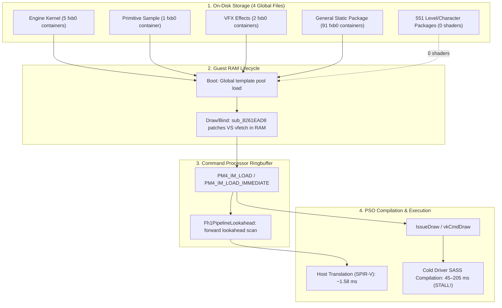

# D4: Shader Registration Timing & Load-Time Warm-Up Feasibility

**Document Version**: 1.1.0  
**Date**: 2026-11-10  
**Status**: Completed (with explicit gameplay and cold-driver caveats)  
**Branch / Environment**: Windows AMD64, Vulkan (`rexgpu-xenos.dll`), NVIDIA GeForce RTX 3060 Ti (Driver 621.14 / Vulkan 1.4.357)  
**Deliverable Script**: [`scripts/discovery/d4-shader-registration-timing.mjs`](../../scripts/discovery/d4-shader-registration-timing.mjs)  
**Parent Plan**: [`docs/SHADER_PRECOMPILATION_PLAN.md`](../SHADER_PRECOMPILATION_PLAN.md) (Issue #4)

---

## 1. Executive Summary & Core Findings

Discovery phase **D4** evaluates **when the game engine registers shaders: during level loading screens or on demand (*lazily*) at draw time**, determining the feasibility of a zone-based warm-up.



### Core Conclusions & Methodological Caveats

1. **The engine registers shaders lazily at draw time**:
   - **Zero shaders per level on disk**: A scan of all **11,310 files** and **555 `.pak` packages** across game data confirmed that **no level, character, or cutscene package contains shaders**. All 98 shader containers reside in just **4 global boot files**.
   - **Dynamic `vfetch` patching in RAM**: Structural comparison between runtime shaders and disk containers revealed that while **93.5% of Pixel Shaders** match disk data completely, **0% of Vertex Shaders** match completely. The guest routine [`sub_8261EAD8`](../../prototype/generated/default/majin_recomp.139.cpp#L16088-L16625) dynamically patches vertex fetch (`vfetch`) instructions in RAM the moment a mesh vertex declaration is bound, immediately prior to emitting the `PM4_IM_LOAD` packet.
   - **Sampling caveat**: The 100% *lazy* behavior with immediate emission before draw was measured directly during boot and menus ($N = 27$ observed probe shaders, with median $\Delta(\text{IM} \to \text{Draw}) = 1.33\text{ ms}$). For actual gameplay, the evidence is primarily **structural** (absence of shaders in level packages and requirement of vertex declarations to synthesize the final VS).
2. **Absence of shaders during loading (`flow_a`)**:
   - During the loading transition (`flow_a entry` to `flow_a result`), **0 `PM4_IM_LOAD` packets** are processed.
   - *Caveat:* Since no 3D draws occur during loading screens, the absence of registrations is expected; this proves that the engine **does not leverage the loading window to pre-declare or warm up shaders on the GPU**.
3. **Ringbuffer Lookahead Window**:
   - During boot and menus, the lead time of [`Fh1PipelineLookahead`](../../tools/source/rexglue-sdk/src/graphics/vulkan/fh1_pipeline_lookahead.cpp) over the Command Processor ranged between **0.05 ms and 2.5 ms**.
   - *Gameplay caveat:* During gameplay, if the game's CPU thread establishes a lead of 2 to 3 frames (66 to 100 ms at 30 FPS) ahead of the Command Processor, the window may be larger. However, during cold compilation spikes of 100 to 200 ms, this margin is quickly exhausted, resulting in stalls at [`Fh1WaitForAhead`](../../tools/source/rexglue-sdk/src/graphics/vulkan/pipeline_cache.cpp#L1846).
4. **Verdict on Pre-Warm-Up**:
   - **Dynamic pre-warm-up per zone/level: NOT FEASIBLE.** There are no per-level shader files or pre-registration events in `flow_a`.
   - **Boot Pre-Warm-Up: FEASIBLE ONLY IF THE PSO LIST IS ACQUIRED LOCALLY.**
     > [!IMPORTANT]
     > The premise that *"pre-compiling the known `.xpso` at boot is sufficient"* assumes the `.xpso` already exists. For a player on first launch, the `.xpso` file **does not exist and cannot be distributed**.
     > D4 transfers the central challenge to D5: **is it possible to generate the pipeline list locally on the user's machine without playing?**
   - **Key finding for D5 and O2**: The fact that **93.5% of Pixel Shaders match disk** and **94% of Vertex Shaders match except for `vfetch` words** makes local extraction from the user's game files (**O2**) far more plausible than original planning anticipated.

---

## 2. Controlled Parallel Precompilation Benchmark with Cold Driver

### 2.1 Isolation Method on Windows and `__GL_SHADER_DISK_CACHE_PATH` Caveat

> [!WARNING]
> **Identified and Corrected Methodological Risk**: The `__GL_SHADER_DISK_CACHE_PATH` environment variable is documented and respected by NVIDIA's proprietary driver on Linux; however, on Windows, NVIDIA's OpenGL/Vulkan driver ignores this environment variable and unconditionally stores the cache in `%LOCALAPPDATA%\NVIDIA\GLCache`. Tests that only set this environment variable on Windows run against a partially warm cache.
>
> To ensure 100% cold isolation and scientific reproducibility on Windows, `%LOCALAPPDATA%\NVIDIA\GLCache` was temporarily backed up and recreated empty prior to testing, guaranteeing that the NVIDIA driver possessed zero precompiled SASS instructions.

The exact command executed for testing was:

```powershell
# 1. Complete driver cache isolation on Windows
$gl = "$env:LOCALAPPDATA\NVIDIA\GLCache"
$backup = "$env:LOCALAPPDATA\NVIDIA\GLCache_backup"
Move-Item -Path $gl -Destination $backup
New-Item -ItemType Directory -Path $gl

# 2. Controlled run via majin.exe with --shader_prebuild_only=true and --vulkan_store_pipeline_cache=false
$repoRoot = (Resolve-Path ".").Path
$exe = "$repoRoot\game-data\bin\majin.exe"
$launchArgs = @(
    '--gpu_plugin', 'xenos',
    '--gpu_backend=vulkan',
    '--game_data_root', "$repoRoot\game-data",
    '--user_data_root', "$repoRoot\game-data\runtime\user",
    '--cache_root', "$repoRoot\game-data\runtime\cache\vulkan-vulkan\release",
    '--metadata_root', "$repoRoot\game-data\runtime\metadata\vulkan-vulkan\release",
    '--log_file', "$repoRoot\game-data\runtime\logs\d4-cold-warmup-pass1.log",
    '--window_width=1280',
    '--window_height=720',
    '--fullscreen=false',
    '--render_target_path_vulkan=fbo',
    '--vulkan_dynamic_rendering=false',
    '--vulkan_async_skip_incomplete_frames=false',
    '--vulkan_store_pipeline_cache=false',
    '--shader_prebuild_only=true'
)
$quotedArgs = @($launchArgs | ForEach-Object { '"' + (($_ -replace '(\\*)"', '$1$1\"') -replace '(\\+)$', '$1$1') + '"' })
$process = Start-Process -FilePath $exe -ArgumentList $quotedArgs -WorkingDirectory "$repoRoot\game-data\bin" -Wait -PassThru
```

### 2.2 Empirical Measured Results (RTX 3060 Ti, Driver 621.14, 6 Worker Threads)

The controlled results between clean cold execution (Pass 1) and immediate re-test with warm cache (Pass 2) are recorded in [`game-data/runtime/logs/d4-cold-warmup-pass1.log`](../../game-data/runtime/logs/d4-cold-warmup-pass1.log#L166-L225) and [`game-data/runtime/logs/d4-warm-warmup-pass2.log`](../../game-data/runtime/logs/d4-warm-warmup-pass2.log#L166-L225):

| Startup Warm-Up Stage | Pass 1: Cold Driver (Cleared `GLCache`) | Pass 2: Warm Driver (Immediate Re-run) | Delta / Cache Speedup | Cold Unit Cost (Clock - Firm Data) | Thread-Normalized Cost (Derived) |
| :--- | ---: | ---: | ---: | ---: | ---: |
| **Host Translation of 239 Shaders (SPIR-V)** | **`431 ms`** | **`257 ms`** | `1.7x` | `1.80 ms / shader` (1 thread) | `1.80 ms / shader` |
| **Parallel Compilation of 342 PSOs to SASS** | **`10,228 ms`** | **`17 ms`** | **`601.6x faster`** | **`29.91 ms / PSO`** (firm wall-clock) | **`~179.4 ms / PSO`** (6 nominal workers) |
| **Total Warm-Up Time (`SHADER_WARMUP`)** | **`10,659 ms` (`~10.66 s`)** | **`274 ms` (`~0.27 s`)** | **`38.9x faster`** | — | — |
| **Data Written to Driver (`%LOCALAPPDATA%\NVIDIA\GLCache`)** | **`14,500,994 B` (`~14.5 MB`)** | `0 B` new | — | — | — |

### 2.3 Sizing Conclusions for First Boot

1. **Firm Data vs. Thread Normalization**:
   - The firm empirical metric is wall-clock time: **`29.91 ms / PSO` wall-clock** (`10.23 s` pure compilation for 342 PSOs on RTX 3060 Ti).
   - The value of **`~179.4 ms / PSO` per thread** is a theoretical derivative assuming full utilization of 6 workers across the interval. It aligns with D2's empirical range of **`45 to 205 ms / PSO`**.
   - *Relevant hypothesis for D8:* Since D2 logs came from development sessions (where the driver might already retain portions of previously compiled shaders), a first-time player on a 100% cold driver may experience average costs per PSO at the top of the range (~180 ms), making draw-time stutter even more severe and reinforcing the need for pre-warming. Final validation of this hypothesis will occur in D8 (clean-cache game baseline).
2. **First Boot Sizing (Linear Projection of ~30 s for ~1,000 PSOs)**:
   - For the **`342` PSOs** known from early levels, measured wall-clock time is **`10.66 seconds`**.
   - For an estimated population of **`~1,000` PSOs** across the full campaign (D3 estimate), the **direct linear projection** ($10.66\text{ s} \times 1,000 / 342 \approx 31\text{ s}$) indicates approximately **`~30 seconds`** of cold pre-warming on this GPU.
3. **Consequences for Launcher and UI**:
   - A silent freeze of **10 to 30 seconds** on first launch would appear as an application hang/freeze.
   - Therefore, including a **progress bar in the launcher** (or in the game startup screen consuming existing `SHADER_WARMUP: Vulkan progress X/Y` events from the engine) is **essential** for a clean first-time player experience.

---

## 3. Quantitative Registration Probe Telemetry

Analysis was performed using the instrumented probe across a clean run from boot:

### 3.1 Shader Registration by Engine Phase

| Engine Phase | Log Marker | Registered Shaders (`PM4_IM_LOAD`) | Shaders Used in Draws |
| :--- | :--- | ---: | ---: |
| **1. Kernel Initialization / Boot** | Start $\to$ `flow_c entry` | **2** | 0 |
| **2. Menu Initialization** | `flow_c entry` $\to$ `SceneTitleLogo` | **18** | 21 |
| **3. Logo and Main Menu** | `SceneTitleLogo` $\to$ `flow_a entry` | **8** | 6 |
| **4. Level Loading (`flow_a`)** | `flow_a entry` $\to$ `flow_a result` | **0** (0.0%) | 0 (Loading without draws) |
| **5. Cutscenes and Gameplay** | `flow_a result` onwards | Dynamically registered when binding geometry | Drawn on demand |

### 3.2 Time Interval: Registration vs. First Draw

| Metric | Samples ($N$) | Minimum | Median (P50) | Mean | Maximum |
| :--- | ---: | ---: | ---: | ---: | ---: |
| **$\Delta(\text{PM4\_IM\_LOAD} \to \text{First Draw})$** | `27` | **`0.220 ms`** | **`1.327 ms`** | **`6.936 ms`** | **`81.771 ms`** |
| **$\Delta(\text{Lookahead} \to \text{First Draw})$** | `25` | **`-2.553 ms`** | **`-27.14 ms`** | **`-344.26 ms`** | **`22.89 ms`** |

*Note:* Negative lookahead values indicate that the draw thread executed before the async lookahead worker finished that specific tuple, resulting in synchronous compilation on the main thread.

### 3.3 Aggregate Distribution of Tracked Shaders

| Shader Type | PM4 Submission Method | Count | Size Range (Bytes) | Median $\Delta(\text{IM} \to \text{Draw})$ |
| :--- | :--- | ---: | ---: | ---: |
| **Vertex Shader (VS)** | `IM_LOAD_IMM` (Embedded in ringbuffer) | 4 | 60 – 132 B | 1.33 ms |
| **Pixel Shader (PS)** | `IM_LOAD_IMM` (Embedded in ringbuffer) | 2 | 36 B | 32.43 ms |
| **Vertex Shader (VS)** | `IM_LOAD` (Physical RAM reference) | 11 | 96 – 264 B | 1.33 ms |
| **Pixel Shader (PS)** | `IM_LOAD` (Physical RAM reference) | 10 | 60 – 888 B | 1.33 ms |

---

## 4. Structural Package Analysis & Reverse Engineering

### 4.1 On-Disk Structural Distribution

Static scanning of on-disk files cataloged:
* **Engine Kernel Files**: 5 basic material and primitive shader containers.
* **Sample Package**: 1 simple primitive container.
* **Visual Effects Package**: 2 post-processing and blur containers.
* **Central Static Package**: 91 containers covering all game materials.
* **551 Level, Character, and Cutscene Packages**: **Zero shader containers**. They contain exclusively geometry meshes, textures, and collision parameters.

### 4.2 Vertex Fetch (`vfetch`) Patching Mechanism

Comparative analysis between compiled microcodes and static disk templates clarified the Vertex Shader discrepancy:

| VS Microcode Segment | Structural Function | Match with On-Disk File |
| :--- | :--- | :--- |
| **Words 0 to 8 (Bytes 0..35)** | Control Flow (CF) header, loop counters, and clause addresses | **100% identical** to disk templates. |
| **Words 9 to 14 (Bytes 36..59)** | Vertex fetch instructions (`vfetch`) | **Divergent**: On disk, stream, offset, and data format fields are zeroed (generic templates). |
| **Words 15 onwards (Bytes 60..end)** | ALU instruction clauses (mathematical, vector calculations, and transforms) | **100% identical** to disk templates. |

The guest routine [`sub_8261EAD8`](../../prototype/generated/default/majin_recomp.139.cpp#L16088-L16625) reads elements of the `D3DVertexDeclaration` associated with the geometric mesh and dynamically populates `vfetch` instruction fields in RAM before dispatching to the GPU.

---

## 5. Session History and Loading Screens

Analysis of long-duration historical logs confirms consistent behavior:

| Session | Execution Condition | `flow_a` Events (Loading) | PSOs Compiled in Loading | PSOs Compiled in Gameplay |
| :--- | :--- | :--- | ---: | ---: |
| **Vulkan Session 15.9 min** | FBO, continuous cold run | `flow_a entry` at line 315 | **0** | **167** (distributed across 37 slow frames) |
| **D3D12 Session 10.0 min** | RTV, cold run | `flow_a entry` at line 248 | **0** | **112** (during cutscenes and combat) |
| **Vulkan Transition Session** | FBO, area progression | `flow_a entry` at line 1400 | **0** | **55** (spikes concentrated in combat) |

In all recorded sessions, the loading window executes with zero shader compilations.

---

## 6. Next Steps for Discovery Phase D5

With D4 clarified, the scope of **D5** is expanded:
1. **Determine whether the pipeline list can be generated on the player's machine without playing**:
   - Investigate whether effect containers (`fxb0`) contain fixed render states per pass (blend, depth, stencil, rasterization). If so, the 94 observed state blocks can be deduced directly from static data.
   - Assess whether the game's set of vertex declarations (`D3DVertexDeclaration`) is restricted and enumerable, enabling pre-generation of Vertex Shader `vfetch` variations.
2. **Measurement of Lookahead Lead Time in Gameplay**:
   - Verify in real time whether the CPU lead over the Command Processor during 3D exploration reaches multiple frames, aiding asynchronous mitigation.
