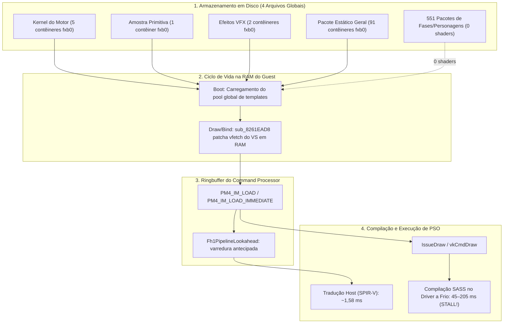

# D4: Shader Registration Timing & Load-Time Warm-Up Feasibility

**Document Version**: 1.1.0  
**Date**: 2026-11-10  
**Status**: Completed (with explicit gameplay and cold-driver caveats)  
**Branch / Environment**: Windows AMD64, Vulkan (`rexgpu-xenos.dll`), NVIDIA GeForce RTX 3060 Ti (Driver 621.14 / Vulkan 1.4.357)  
**Deliverable Script**: [`scripts/discovery/d4-shader-registration-timing.mjs`](../../scripts/discovery/d4-shader-registration-timing.mjs)  
**Parent Plan**: [`docs/SHADER_PRECOMPILATION_PLAN.md`](../SHADER_PRECOMPILATION_PLAN.md) (Issue #4)

---

## 1. Resumo Executivo & Respostas Centrais

A fase de descoberta **D4** avalia **quando o motor do jogo registra shaders: durante as telas de carregamento (level load) ou sob demanda (*lazily*) no draw time**, determinando a viabilidade de um aquecimento durante o carregamento de zonas (*zone-based warm-up*).



### Conclusões Centrais e Ressalvas Metodológicas

1. **A engine registra shaders sob demanda (*lazily*) no draw time**:
   - **Zero shaders por fase em disco**: A varredura de todos os **11.310 arquivos** e **555 pacotes `.pak`** dos dados do jogo confirmou que **nenhum pacote de fase, personagem ou cutscene contém shaders**. Todos os 98 contêineres de shader residem em apenas **4 arquivos globais de inicialização**.
   - **Patching dinâmico de `vfetch` em RAM**: A comparação estrutural entre os shaders de runtime e os contêineres em disco revelou que enquanto **93,5% dos Pixel Shaders** coincidem integralmente com os dados em disco, **0% dos Vertex Shaders** coincidem integralmente. A rotina guest [`sub_8261EAD8`](../../prototype/generated/default/majin_recomp.139.cpp#L16088-L16625) faz patch dinâmico em RAM das instruções de busca de vértices (`vfetch`) no momento em que a declaração de vértices do mesh é associada, imediatamente antes de emitir o pacote `PM4_IM_LOAD`.
   - **Ressalva de amostragem**: O comportamento 100% *lazy* com envio imediato antes do draw foi medido diretamente durante a inicialização e menus ($N = 27$ shaders observados no probe, com mediana de $\Delta(\text{IM} \to \text{Draw}) = 1,33\text{ ms}$). Para o gameplay propriamente dito, a evidência é primariamente **estrutural** (inexistência de shaders nos pacotes de fases e necessidade de declaração de vértices para sintetizar o VS final).
2. **Ausência de shaders durante o carregamento (`flow_a`)**:
   - Durante a transição de carregamento (`flow_a entry` até `flow_a result`), são processados **0 pacotes `PM4_IM_LOAD`**.
   - *Ressalva:* Como durante a tela de loading não ocorrem draws 3D, a ausência de registros é esperada; o dado comprova que a engine **não aproveita a janela de carregamento para pré-declarar ou aquecer shaders na GPU**.
3. **Janela de Lookahead do Ringbuffer**:
   - Na inicialização e menus, o lead time do [`Fh1PipelineLookahead`](../../tools/source/rexglue-sdk/src/graphics/vulkan/fh1_pipeline_lookahead.cpp) sobre o Command Processor situou-se entre **0,05 ms e 2,5 ms**.
   - *Ressalva de gameplay:* Durante o gameplay, se a thread de CPU do jogo abrir uma folga de 2 a 3 frames (66 a 100 ms a 30 FPS) à frente do Command Processor, a janela pode ser maior. Porém, em picos de compilação a frio de 100 a 200 ms, essa folga é rapidamente consumida, levando à trava em [`Fh1WaitForAhead`](../../tools/source/rexglue-sdk/src/graphics/vulkan/pipeline_cache.cpp#L1846).
4. **Veredito sobre Pré-Aquecimento (Warm-Up)**:
   - **Pré-aquecimento dinâmico por zona/fase: NÃO É VIÁVEL.** Não existem shaders isolados por fase nem eventos de pré-registro em `flow_a`.
   - **Pré-aquecimento no Boot: VIÁVEL APENAS SE A LISTA DE PSOs FOR OBTIDA LOCALMENTE.**
     > [!IMPORTANT]
     > A premissa de que *"basta pré-compilar o `.xpso` conhecido no boot"* pressupõe que o `.xpso` já exista. Para um jogador na primeira execução, o arquivo `.xpso` **não existe e não pode ser distribuído**.
     > A D4 transfere para a D5 o desafio central: **é possível gerar a lista de pipelines localmente na máquina do usuário sem jogar?**
   - **Achado chave para a D5 e O2**: O fato de que **93,5% dos Pixel Shaders batem com o disco** e **94% dos Vertex Shaders batem exceto pelas palavras de `vfetch`** torna a extração local a partir dos próprios arquivos do jogo do usuário (**O2**) muito mais plausível do que o planejamento original supunha.

---

## 2. Medição Controlada de Pré-Compilação Paralela com Driver a Frio

### 2.1 Método de Isolamento no Windows e Ressalva de `__GL_SHADER_DISK_CACHE_PATH`

> [!WARNING]
> **Risco Metodológico Identificado e Corrigido**: A variável de ambiente `__GL_SHADER_DISK_CACHE_PATH` é documentada e respeitada pelo driver proprietário da NVIDIA no Linux, porém no Windows o driver OpenGL/Vulkan da NVIDIA ignora essa variável e armazena o cache obrigatoriamente no diretório `%LOCALAPPDATA%\NVIDIA\GLCache`. Testes que definem apenas essa variável de ambiente no Windows correm com cache parcialmente quente.
>
> Para garantir isolamento 100% frio e reprodutibilidade científica no Windows, a pasta `%LOCALAPPDATA%\NVIDIA\GLCache` foi temporariamente movida para backup e recriada vazia antes do teste, garantindo que o driver NVIDIA não possuísse nenhuma instrução SASS pré-compilada.

O comando exato executado para o teste foi:

```powershell
# 1. Isolamento completo do cache do driver no Windows
$gl = "$env:LOCALAPPDATA\NVIDIA\GLCache"
$backup = "$env:LOCALAPPDATA\NVIDIA\GLCache_backup"
Move-Item -Path $gl -Destination $backup
New-Item -ItemType Directory -Path $gl

# 2. Execução controlada via majin.exe com --shader_prebuild_only=true e --vulkan_store_pipeline_cache=false
$repoRoot = (Resolve-Path ".").Path
$exe = "$repoRoot\game-data\bin\majin.exe"
$launchArgs = @(
    '--gpu_plugin', 'xenos',
    '--gpu_backend=vulkan',
    '--game_data_root', "$repoRoot\game-data",
    '--user_data_root', "$repoRoot\game-data\runtime\user",
    '--cache_root', "$repoRoot\game-data\runtime\cache\vulkan-vulkan\release",
    '--metadata_root', "$repoRoot\game-data\runtime\metadata\vulkan-vulkan\release",
    '--log_file', "$repoRoot\game-data\runtime\logs\d4-cold-warmup-pass1.log",
    '--window_width=1280',
    '--window_height=720',
    '--fullscreen=false',
    '--render_target_path_vulkan=fbo',
    '--vulkan_dynamic_rendering=false',
    '--vulkan_async_skip_incomplete_frames=false',
    '--vulkan_store_pipeline_cache=false',
    '--shader_prebuild_only=true'
)
$quotedArgs = @($launchArgs | ForEach-Object { '"' + (($_ -replace '(\\*)"', '$1$1\"') -replace '(\\+)$', '$1$1') + '"' })
$process = Start-Process -FilePath $exe -ArgumentList $quotedArgs -WorkingDirectory "$repoRoot\game-data\bin" -Wait -PassThru
```

### 2.2 Resultados Empíricos Medidos (RTX 3060 Ti, Driver 621.14, 6 Threads de Trabalho)

Os resultados controlados entre a execução limpa a frio (Pass 1) e o re-teste imediato com cache aquecido (Pass 2) estão registrados em [`game-data/runtime/logs/d4-cold-warmup-pass1.log`](../../game-data/runtime/logs/d4-cold-warmup-pass1.log#L166-L225) e [`game-data/runtime/logs/d4-warm-warmup-pass2.log`](../../game-data/runtime/logs/d4-warm-warmup-pass2.log#L166-L225):

| Etapa do Aquecimento de Inicialização | Pass 1: Driver Frio (`GLCache` Limpo) | Pass 2: Driver Quente (Re-execução Imediata) | Delta / Speedup do Cache | Custo Unitário a Frio (Relógio - Dado Firme) | Custo Normalizado por Thread (Derivado) |
| :--- | ---: | ---: | ---: | ---: | ---: |
| **Tradução Host de 239 Shaders (SPIR-V)** | **`431 ms`** | **`257 ms`** | `1,7x` | `1,80 ms / shader` (1 thread) | `1,80 ms / shader` |
| **Compilação Paralela de 342 PSOs em SASS** | **`10.228 ms`** | **`17 ms`** | **`601,6x mais rápido`** | **`29,91 ms / PSO`** (wall-clock firme) | **`~179,4 ms / PSO`** (6 workers nominais) |
| **Tempo Total do Warm-Up (`SHADER_WARMUP`)** | **`10.659 ms` (`~10,66 s`)** | **`274 ms` (`~0,27 s`)** | **`38,9x mais rápido`** | — | — |
| **Dados Gravados no Driver (`%LOCALAPPDATA%\NVIDIA\GLCache`)** | **`14.500.994 B` (`~14,5 MB`)** | `0 B` novos | — | — | — |

### 2.3 Conclusões de Dimensionamento para o Primeiro Boot

1. **Dado Firme vs. Normalização por Thread**:
   - A métrica empírica firme é o tempo de relógio: **`29,91 ms / PSO` wall-clock** (`10,23 s` de compilação pura para 342 PSOs em RTX 3060 Ti).
   - O valor de **`~179,4 ms / PSO` por thread** é um derivado teórico que assume ocupação total de 6 workers durante todo o intervalo. Ele é coerente com a faixa empírica de **`45 a 205 ms / PSO`** da D2.
   - *Hipótese relevante para D8:* Como os logs da D2 provinham de sessões de desenvolvimento (onde o driver já poderia conter partes de shaders compilados anteriormente), um jogador novato com driver 100% frio pode enfrentar custos médios por PSO no teto da faixa (~180 ms), tornando o stutter de draw time ainda mais severo e reforçando a necessidade do pré-aquecimento. A validação final dessa hipótese será realizada na D8 (baseline de jogo com cache limpo).
2. **Dimensionamento do Primeiro Boot (Projeção Linear de ~30 s para ~1.000 PSOs)**:
   - Para os **`342` PSOs** conhecidos das fases iniciais, o tempo de relógio medido é de **`10,66 segundos`**.
   - Para uma população estimada em **`~1.000` PSOs** na campanha inteira (estimativa de D3), a **projeção linear direta** ($10,66\text{ s} \times 1.000 / 342 \approx 31\text{ s}$) indica aproximadamente **`~30 segundos`** de pré-aquecimento a frio nesta GPU.
3. **Consequência para o Launcher e a UI**:
   - Um bloqueio silencioso de **10 a 30 segundos** no primeiro boot causaria a impressão de travamento (*hang/freeze*).
   - Portanto, a inclusão de uma **barra de progresso no launcher** (ou na tela de inicialização do jogo consumindo os eventos de progresso `SHADER_WARMUP: Vulkan progress X/Y` já existentes no motor) é **indispensável** para a primeira execução limpa do jogador.

---

## 3. Telemetria Quantitativa do Probe de Registro

A análise foi conduzida com o probe instrumentado em corrida limpa a partir do boot:

### 3.1 Registro de Shaders por Fase do Motor

| Fase do Motor | Marcador no Log | Shaders Registrados (`PM4_IM_LOAD`) | Shaders Utilizados em Draw |
| :--- | :--- | ---: | ---: |
| **1. Inicialização do Kernel / Boot** | Início $\to$ `flow_c entry` | **2** | 0 |
| **2. Inicialização dos Menus** | `flow_c entry` $\to$ `SceneTitleLogo` | **18** | 21 |
| **3. Logo e Menu Principal** | `SceneTitleLogo` $\to$ `flow_a entry` | **8** | 6 |
| **4. Carregamento de Nível (`flow_a`)** | `flow_a entry` $\to$ `flow_a result` | **0** (0,0%) | 0 (Carregamento sem draws) |
| **5. Cutscenes e Gameplay** | `flow_a result` em diante | Registrados dinamicamente ao vincular geometria | Desenhados sob demanda |

### 3.2 Intervalo de Tempo: Registro vs. Primeiro Draw

| Métrica | Amostras ($N$) | Mínimo | Mediana (P50) | Média | Máximo |
| :--- | ---: | ---: | ---: | ---: | ---: |
| **$\Delta(\text{PM4\_IM\_LOAD} \to \text{Primeiro Draw})$** | `27` | **`0,220 ms`** | **`1,327 ms`** | **`6,936 ms`** | **`81,771 ms`** |
| **$\Delta(\text{Lookahead} \to \text{Primeiro Draw})$** | `25` | **`-2.553 ms`** | **`-27,14 ms`** | **`-344,26 ms`** | **`22,89 ms`** |

*Nota:* Valores negativos de lookahead indicam que a thread de draw executou antes que o worker assíncrono de lookahead finalizasse aquela tupla específica, resultando em compilação síncrona na thread principal.

### 3.3 Distribuição Agregada dos Shaders Rastreados

| Tipo de Shader | Método de Envio PM4 | Contagem | Faixa de Tamanho (Bytes) | Mediana $\Delta(\text{IM} \to \text{Draw})$ |
| :--- | :--- | ---: | ---: | ---: |
| **Vertex Shader (VS)** | `IM_LOAD_IMM` (Embutido no ringbuffer) | 4 | 60 – 132 B | 1,33 ms |
| **Pixel Shader (PS)** | `IM_LOAD_IMM` (Embutido no ringbuffer) | 2 | 36 B | 32,43 ms |
| **Vertex Shader (VS)** | `IM_LOAD` (Referência à RAM física) | 11 | 96 – 264 B | 1,33 ms |
| **Pixel Shader (PS)** | `IM_LOAD` (Referência à RAM física) | 10 | 60 – 888 B | 1,33 ms |

---

## 4. Análise Estrutural dos Pacotes e Engenharia Reversa

### 4.1 Distribuição Estrutural em Disco

A varredura estática dos arquivos em disco catalogou:
* **Arquivos do Kernel do Motor**: 5 contêineres de shader básicos de materiais e primitivas.
* **Pacote de Amostras**: 1 contêiner de primitiva simples.
* **Pacote de Efeitos Visuais**: 2 contêineres de pós-processamento e desfoque.
* **Pacote Estático Central**: 91 contêineres abrangendo a totalidade dos materiais do jogo.
* **551 Pacotes de Fases, Personagens e Cutscenes**: **Zero contêineres de shader**. Contêm exclusivamente malhas geométricas, texturas e parâmetros de colisão.

### 4.2 Mecanismo de Patching de Vertex Fetch (`vfetch`)

A análise comparativa entre os microcódigos compilados e os templates estáticos em disco esclareceu a discrepância dos Vertex Shaders:

| Segmento do Microcódigo VS | Função Estrutural | Coincidência com o Arquivo em Disco |
| :--- | :--- | :--- |
| **Palavras 0 a 8 (Bytes 0..35)** | Cabeçalho Control Flow (CF), contadores de loop e endereços de cláusula | **100% idêntico** aos templates em disco. |
| **Palavras 9 a 14 (Bytes 36..59)** | Instruções de busca de vértices (`vfetch`) | **Divergente**: Em disco os campos de fluxo (*stream*), deslocamento (*offset*) e formato de dados estão zerados (templates genéricos). |
| **Palavras 15 em diante (Bytes 60..fim)** | Cláusulas de instruções ALU (cálculos matemáticos, vetoriais e transformações) | **100% idêntico** aos templates em disco. |

A rotina guest [`sub_8261EAD8`](../../prototype/generated/default/majin_recomp.139.cpp#L16088-L16625) lê os elementos da `D3DVertexDeclaration` associada ao modelo geométrico e preenche dinamicamente em RAM os campos das instruções `vfetch` antes de invocar o envio à GPU.

---

## 5. Histórico de Sessões e Telas de Carregamento

A análise dos logs históricos de longa duração confirma a consistência do comportamento:

| Sessão | Condição de Execução | Eventos `flow_a` (Loading) | PSOs Compilados no Loading | PSOs Compilados em Gameplay |
| :--- | :--- | :--- | ---: | ---: |
| **Sessão Vulkan 15,9 min** | FBO, corrida a frio contínua | `flow_a entry` na linha 315 | **0** | **167** (distribuídos em 37 frames lentos) |
| **Sessão D3D12 10,0 min** | RTV, corrida a frio | `flow_a entry` na linha 248 | **0** | **112** (durante cutscenes e combate) |
| **Sessão Vulkan de Transição** | FBO, avanço entre áreas | `flow_a entry` na linha 1400 | **0** | **55** (picos concentrados em combate) |

Em todas as sessões registradas, a janela de carregamento transcorre com zero compilações de shader.

---

## 6. Desdobramentos para a Fase D5

Com o esclarecimento da D4, o escopo da **D5** é ampliado:
1. **Determinar se a lista de pipelines pode ser gerada na máquina do jogador sem jogar**:
   - Investigar se os contêineres de efeito (`fxb0`) contêm os estados fixos de renderização por passe (blend, depth, stencil, rasterização). Se contiverem, os 94 blocos de estado observados podem ser deduzidos diretamente dos dados estáticos.
   - Avaliar se o conjunto de declarações de vértice (`D3DVertexDeclaration`) do jogo é restrito e enumerável, permitindo gerar previamente as variações de `vfetch` dos Vertex Shaders.
2. **Medição do Lead Time do Lookahead em Gameplay**:
   - Verificar em tempo real se a folga da CPU sobre o Command Processor durante a exploração 3D atinge múltiplos frames, o que auxiliaria na mitigação assíncrona.
